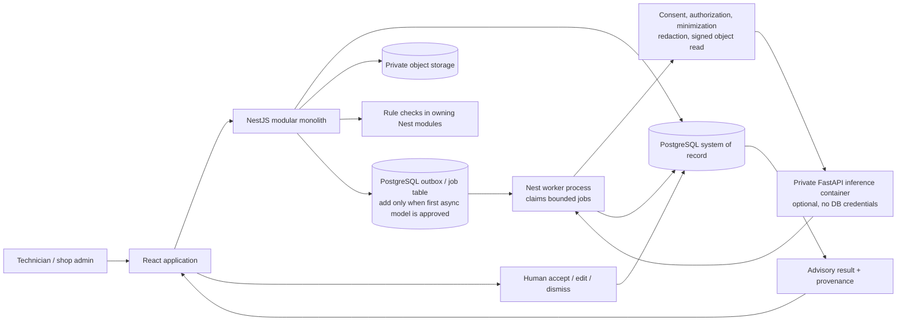

# RepairProof AI Intelligence Architecture

**Status:** Proposed, phased architecture. This is a design, not a claim that the listed models are trained or deployed.  
**System boundary:** NestJS modular monolith remains the system of record. Python/FastAPI is an optional, private inference runtime.  
**Guiding rule:** AI may organize, compare, and suggest. It cannot decide that a diagnosis is true, authorize a repair, attest to part provenance, pass a test, independently verify a repair, or issue a certificate.

## 1. Executive decision

Do not deploy a general AI platform at the start. First add auditable rules and better structured capture in the NestJS modules. They can be validated against the database now and cost little beyond ordinary API/database work. Add Python/FastAPI only when a bounded task has consented data, a measurable baseline, an evaluation set, and a reason to run outside the monolith.

Recommended order:

1. **Now, rule based:** evidence completeness, quotation arithmetic/required disclosures, and basic diagnostic consistency checks.
2. **First model pilot, human confirmed:** invoice OCR and field extraction; optionally technician note fault categorization after a stable taxonomy and corrected labels exist.
3. **Descriptive intelligence:** price distributions and repeat repair counts, with cohort suppression and explicit limitations.
4. **Later, only with mature data:** image classification for visible conditions, price anomaly scoring, repair outcome prediction, component image matching, and repeat failure prediction.
5. **LLM assistance is optional:** use it only for bounded text normalization or explanation after privacy, data processing, cost, and evaluation approval. Keep it out of state transitions and customer decisions.

No photograph, OCR output, model score, or LLM response can establish that a repair diagnosis is truthful. Photos may show a visible condition; they do not establish a hidden fault, causality, repair history, authorship, time, or intent. The evidence hash only identifies bytes seen by the system at ingest.

## 2. Data readiness and gaps

The current Prisma schema provides useful starting signals:

| Existing records | Useful fields/signals | Limits |
|---|---|---|
| `RepairCase`, `Device` | shop, assigned technician, device make/model/category, customer reported problem, case timestamps/status | Text and device identifiers are not yet a consistent, adjudicated fault taxonomy. Cross-shop device matching must not use raw serial/IMEI as a feature or join key. |
| `Diagnostic` | authored `findings` JSON, severity, author, submission time | Technician-entered findings are claims, not ground truth; free-form JSON has schema drift and likely selection bias. |
| `Evidence` and annotations | purpose/category, author, MIME, content hash, scan status, annotations, original/derived relationship | The hash does not prove authenticity. Existing photos have no independently verified diagnosis labels. Invoices may contain personal/business information. |
| `Quotation`, `QuotationItem` | currency, part/labour/additional charges, tax, item text, part source, validity, revisions | Quoted price is not paid price or market price. No explicit tax jurisdiction, transaction completion/payment, supplier, or standardized labor operation code. |
| `Component`, `ComponentReplacement` | shop SKU/name/manufacturer/source, quantity/cost snapshot, replacement date | No global part catalog, supplier invoice relationship, standardized part number coverage, or verified component image corpus. Shop-declared provenance is not independent authentication. |
| `TestResult`, `Verification` | technician test names/outcomes and independent verification result/checklist | Outcomes are sparse and may reflect reporting practices. A technician's test is not the same as independent verification. |
| `Warranty`, `WarrantyClaim`, `Dispute`, `Certificate` | delayed service outcome, claims, disputes, final repair record | Claims are delayed and censored; absence of a claim does not mean success. Certificate presence is not a diagnosis label. |

### Readiness-based priority

| Priority | Capability | What can be validated with current records | Additional prerequisite before learned inference |
|---|---|---|---|
| P0 | Evidence completeness | Whether required purpose/category and linked records exist for a workflow; manually audit false-complete cases | Versioned repair-specific checklist and owner sign-off; no model data needed. |
| P0 | Quote arithmetic and required disclosures | Recompute stored item/subtotal/tax/total and inspect quote version/source completeness | Clarify jurisdiction/tax rules; rules only. |
| P0 | Diagnostic consistency | Check lifecycle prerequisites, missing fields, approved-scope vs recorded action links | Stable diagnostic/operation fields; semantic model only after reviewed mismatch pairs. |
| P1 | Repeat-repair counts | Count cases linked to one device within the same tenant and summarize dates/statuses | Audited identity linkage and fault taxonomy before calling an event a recurrence. |
| P1 | Invoice OCR pilot | Existing invoice-purpose evidence can be sampled if retained and consented | Manually transcribed gold set, language/layout coverage, privacy review, user correction flow. |
| P2 | Fault categorization | Existing technician/customer text can seed taxonomy discovery | Human-adjudicated labels and stable symptom/fault vocabulary. |
| P2 | Price context | Existing itemized quote records can reveal schema and query behavior | Opt-in aggregation, paid/fulfilled labels, market/currency taxonomy, minimum cohort/privacy design. |
| P3 | Component image matching | Existing component names and manufacturer fields can seed catalog cleanup | Canonical part IDs, compatible revisions, rights-cleared images, verified matches. |
| P3 | Diagnostic image analysis | Existing images can help design the capture workflow and visible-condition taxonomy | Consent, curated region labels, independent visible-condition review, out-of-distribution evaluation. |
| P3 | Outcome prediction / statistical anomaly scoring | Test, verification, quote, warranty, and dispute records define candidate outcomes | Sufficient mature events, leakage-safe holdout, calibrated baseline improvement, subgroup review. |

Before training, define versioned taxonomies for symptoms, fault families, repair operations, part identifiers/provenance, test names, markets, and currencies. Preserve the original human-entered text and record normalized fields separately with who/what normalized them. Do not overwrite source records with model output.

### Data and label policy

- Training is opt-in by organization and, for evidence content, by the appropriate data owner. Product usage consent is separate from model-training consent.
- Do not use public customer authorization, disputes, or certificates as unrestricted training feeds. Do not train on a tenant's data for cross-tenant models by default.
- Extract minimum necessary fields to an access-controlled offline dataset. Pseudonymize IDs; exclude names, email, phone, raw serial/IMEI, authorization tokens, and unnecessary free text.
- For image use, retain the immutable original under the evidence policy and create a separately hashed training derivative. Strip EXIF/GPS; detect/redact faces, screens with personal data, labels and identifiers where possible. Redaction itself can fail, so require review before any third-party processing.
- A technician-entered diagnosis is a **weak label**. A later test or claim is an outcome signal, not automatically a root-cause label. Build reviewed labels with source, reviewer, label guide, timestamp, and disagreement state.
- Never auto-ingest model corrections as truth. A human correction becomes a candidate label; adjudicate or sample-audit it before training.
- Split train/validation/test by time and by shop (and, where possible, device family) to avoid leakage from repeated devices, technicians, shops, and quote templates. Report performance by device category, language, market, part source, and evidence quality.
- Set retention, deletion propagation, model/dataset versioning, license review, and a rollback procedure before training. A model artifact must be removable or retired if its data provenance becomes invalid.

## 3. Capability assessment

### 3.1 Repair invoice OCR

- **Problem:** Reduce manual transcription of supplier, invoice number/date, currency, tax, line descriptions, part numbers, quantities, and totals. This supports bookkeeping and part matching; it does not certify that an invoice is genuine.
- **Data:** Invoice PDFs/photos, language/script, page count, scan quality, human-corrected field values, and source invoice hash. Current `EvidencePurpose.INVOICE` can mark a file, but there is no invoice header/line-item model or OCR ground truth. Collect explicit consent and remove customer/vendor personal details from the pilot corpus where possible.
- **Model selection:** Start with local OCR/layout extraction (for example, an OCR engine plus deterministic field parsers); use table/line extraction only after field-level evaluation. Do not start with a generative LLM as an unbounded OCR tool. Use an LLM only as an optional post-processor to normalize uncertain text into a strict schema, never to invent missing values.
- **Training strategy:** Initially no custom model training. Create a gold set of representative, permissioned documents with field-level transcriptions and document-level train/test separation. Later fine-tune layout extraction only if the local baseline fails on target languages/layouts.
- **Inference architecture:** Asynchronous `invoice.extract` job. Fetch an authorized original through a short-lived internal object read, rasterize page-by-page with pixel/page limits, OCR, parse candidate fields, validate totals/currency arithmetic, and return source page/region references. Nest persists a draft extraction linked to the evidence; it does not mutate the invoice or quotation.
- **Confidence:** Per-field confidence and evidence span/box, not one document-level score. Low OCR confidence, inconsistent totals, unknown currency, or unsupported script yields `REVIEW_REQUIRED`; no silently filled values. Calibrate field confidence on held-out document types.
- **Human review:** Staff must confirm or edit extracted values before use in inventory, quotation, tax, or customer-facing records. Always retain source and corrected value provenance.
- **Evaluation:** Character/word error rate; exact match and normalized exact match by field; line-item precision/recall; total/tax arithmetic pass rate; percentage of fields requiring correction; review time; per-language/layout performance; harmful hallucinated-value rate (must be zero for automatic writes).
- **Deployment cost:** Local CPU OCR has no per-document vendor charge, but consumes CPU and storage and may be slow; use bounded page count and concurrency. Hosted OCR/LLM adds usage, egress, privacy review, and quota costs. Keep hosted processing disabled by default and cost-capped.
- **Failure modes:** Blur, glare, rotated pages, handwritten notes, tables, mixed currencies, locale-specific separators, unreadable part numbers, OCR reading unrelated evidence, privacy leakage, LLM filling gaps, duplicate invoices. Fail to draft or show uncertainty; never infer a missing price.

### 3.2 Component identification

- **Problem:** Help map a visible/printed label or technician-entered description to a catalog candidate and reduce duplicate component records.
- **Data:** Standardized manufacturer, category, SKU/part number, model compatibility, supplier identifiers, catalog images with rights, and human-confirmed matches. Current shop `Component` data has names/manufacturer/SKU/source/cost but no shared image corpus or consistent part-number coverage.
- **Model selection:** First use exact/normalized SKU and part-number matching, OCR on labels, and catalog search. If a permissioned image corpus later exists, use image embeddings for **candidate retrieval**, then a calibrated ranker. Avoid a general vision model claiming exact identity from a photograph.
- **Training strategy:** Curate canonical catalog entities and hard negatives (visually similar revisions/aftermarket clones). Label matches at the exact part/revision level by qualified reviewers; keep supplier and provenance evidence as separate labels. Do not treat shop part name as verified identity.
- **Inference architecture:** OCR/metadata parse → candidate search within allowed catalog → top-k candidates with match reasons and catalog source. The user selects/declines; only the selected entity is written. Price/source data is never inferred from the image.
- **Confidence:** Calibrated top-1 and top-k match probability plus ambiguity margin. If model variants are visually indistinguishable, return multiple candidates or “not identified.” No single candidate above the validated threshold means no suggestion.
- **Human review:** Technician confirms part number/revision and compatibility. Supplier invoice or packaging record is needed for provenance; visual appearance alone cannot establish OEM, refurbished, counterfeit status, or authenticity.
- **Evaluation:** Top-1/top-5 accuracy; exact revision accuracy; false confident match rate; abstention/coverage curve; compatibility error rate; subgroup results by vendor, image quality, and part family.
- **Deployment cost:** Catalog/OCR matching is low-cost CPU and database work. Image embedding inference can run on CPU at low volume but corpus indexing, image storage, and GPU throughput add cost. Do not lease GPU capacity before an actual labeled corpus and measured need.
- **Failure modes:** Similar components/revisions, counterfeit lookalikes, unseen aftermarket variants, obscured labels, reflective packaging, poor lighting, catalog drift, and an image matching appearance but not electrical compatibility. Abstain; require a human and a source record.

### 3.3 Diagnostic image analysis

- **Problem:** Offer a second set of eyes for visible damage regions (e.g. cracked glass, corrosion-like discoloration, bent connector, missing shield) and evidence capture quality. It cannot diagnose internal electronic faults.
- **Data:** Original image and capture metadata, device/component context, region annotations, explicit visible-condition taxonomy, and adjudicated labels from qualified reviewers. Current evidence categories and notes are not a labeled visual dataset. Photos are selected and framed by users, not a random sample.
- **Model selection:** Start with non-ML image quality rules (resolution, blur, glare) and technician annotations. If justified, use a small classifier/detector/segmentation model trained only for visible, bounded conditions. Prefer a retrieval aid or region highlight over a generative image narrative. Do not use face/identity recognition.
- **Training strategy:** Build a balanced, consented corpus with multiple devices, cameras, lighting, repair stages, and negative examples; have two reviewers label ambiguous regions. Split by device/shop/time. Review sensitive data and rights; evaluate out-of-distribution and adversarial examples.
- **Inference architecture:** Async job on a redacted derivative. Output visible-condition candidates, bounding regions, model version, input digest, quality warnings, and abstention state. Link result to the original but never alter it. The raw original remains private and unchanged.
- **Confidence:** Per-region calibrated score plus image-quality and out-of-distribution scores. Abstain for unsupported device, blur, low resolution, occlusion, or distribution shift. Confidence is not diagnosis truth probability.
- **Human review:** Technician reviews or rejects every finding and records their own diagnosis separately. A customer must see the result labeled “AI suggestion,” with limitations, if shown at all. It cannot trigger quote, repair, verification, or certificate state.
- **Evaluation:** Per-class precision/recall, mAP/IoU if regions are predicted, calibration error, abstention coverage, false-positive rate on clean controls, failure rates by device/camera/skin-tone-adjacent lighting only where relevant, and blinded technician agreement. Do not use “diagnostic accuracy” unless a real clinical/bench ground truth exists for the specific task.
- **Deployment cost:** Image preprocessing and a small CPU model can run in a bounded worker, but latency and memory can be material. GPU inference and storing training derivatives are non-zero costs. No always-on GPU on a free-tier deployment; use an explicit quota/consent gate or defer.
- **Failure modes:** Internal damage invisible in photos, misleading angle/reflection, dirt mistaken for corrosion, intentionally staged evidence, compression artifacts, camera variation, unseen models, and labels reflecting technician bias. Surface a bounded visible observation or abstain; never state a hidden fault or causal diagnosis from the photo alone.

### 3.4 Fault categorization

- **Problem:** Normalize technician symptom/diagnostic text to a repair taxonomy for search and aggregate analytics, without replacing the signed diagnostic.
- **Data:** Customer-reported problem, technician-authored findings, device family, repair operation and confirmed outcome labels. Current `problemDescription` and `Diagnostic.findings` are available but free-form and potentially contain PII.
- **Model selection:** Begin with taxonomy rules and keyword dictionaries. With reviewed labels, compare TF-IDF word/character n-grams plus logistic regression/linear SVM against a small multilingual text encoder. Keep labels hierarchical and multi-label where symptoms overlap. LLM may propose a normalized label and rationale, but is not the initial classifier.
- **Training strategy:** Create a versioned taxonomy, label guide, reviewed examples, and “other/uncertain” class. Use active learning only to prioritize human review, not to automatically label. Track taxonomy changes and relabel drifted examples.
- **Inference architecture:** Run on submit or in an async job; output candidate category IDs and spans that support each candidate. Redact contact/serial/IMEI first. Store as an advisory linked to the source diagnostic version; the technician may accept or reject.
- **Confidence:** Calibrated per-class probabilities; classify only above validated per-class thresholds. Return multiple labels or abstain for novel/ambiguous text. Never use confidence as proof of diagnosis correctness.
- **Human review:** Technician confirms the category; original text remains unchanged. High-impact classes used in analytics require periodic audit.
- **Evaluation:** Macro-F1, per-class precision/recall, calibration/Brier score, abstention coverage, taxonomy agreement, reviewer correction rate, subgroup and language performance. Use time/shop-held-out test sets.
- **Deployment cost:** Rules are effectively baseline cost. Classical sparse models are CPU-cheap and fit an optional FastAPI worker. Transformer/LLM use increases RAM/latency or API spend; add only if measured quality gain justifies it.
- **Failure modes:** Inconsistent technician language, negation (“no power” vs “power issue”), multilingual code-switching, taxonomy drift, copied templates, duplicate records, and PII in notes. Preserve evidence spans and abstain on unknown classes.

### 3.5 Repair quotation anomaly detection

- **Problem:** Find arithmetic mistakes, missing disclosure, suspicious outliers, or unexpected revisions before sending a quote. “Anomaly” means a review prompt, not fraud or overcharging.
- **Data:** Itemized quote version, source, quantities, part/labor split, currency, tax rate, device/repair category, market, and ultimately accepted/declined/paid result. Current `Quotation`/`QuotationItem` give much of the quote structure but not paid price, jurisdiction, supplier, or complete operation taxonomy.
- **Model selection:** Deterministic invariants first: nonnegative amounts, quantity × unit price, subtotal/tax/total, required part source, approval on material changes, and duplicate/revision checks. Only later use robust cohort percentiles, median absolute deviation or quantile regression for context-aware outlier flags. Do not start with black-box fraud/Isolation Forest scores.
- **Training strategy:** Rules need no training. Statistical bands require normalized operations, part source, currency, region, device family, time period, and enough independent shops. Label reviewed false positives and known data errors separately; high quotes are not positive fraud labels.
- **Inference architecture:** Synchronous deterministic checks inside Nest transaction before quote send. Optional async statistical `quote.context` result computed from permitted aggregate data and attached as a warning; never block customer approval automatically.
- **Confidence:** Rule violations are exact findings. Statistical output should give cohort size, baseline interval, contributing factors, and distance from median; do not present a single fraud probability. Suppress estimates for small/biased cohorts.
- **Human review:** Technician confirms corrections and may override a statistical warning with a reason. Customer must see itemization and material changes; no model changes prices or quote versions.
- **Evaluation:** Rule defect catch rate; arithmetic mismatch rate; warning precision/false-positive rate; review acceptance/override rates; time-to-correction; calibration of prediction interval coverage; per-market and per-source performance.
- **Deployment cost:** Deterministic checks have negligible marginal cost. Aggregates can run as indexed PostgreSQL queries or an offline batch; add Python only when query complexity/volume calls for it. Third-party market data has licensing and recurring costs and is not assumed.
- **Failure modes:** Mixed currencies/tax rules, sparse cohorts, inflated or copied prices, seasonal/supplier changes, parts bundled into labor, and selection bias among participating shops. Show the comparison basis and allow “not enough comparable data.”

### 3.6 Price benchmarking

- **Problem:** Give a shop or customer context about quoted ranges for a comparable service/part, without claiming a universal “fair price.”
- **Data:** Accepted/rejected quotes and preferably paid/fulfilled transactions; normalized repair operation, exact device family, component quality/source, market/currency, date, labor/parts split, tax treatment, and shop participation consent. Current data has quote totals and line items but cannot distinguish a quote from a completed sale.
- **Model selection:** Start with descriptive medians and interquartile/percentile ranges by well-defined cohorts. Later use hierarchical/quantile regression with date, market, device, part source, and operation effects. Avoid a global average or price recommender before transaction outcomes and cohort coverage are credible.
- **Training strategy:** First data dictionary and consented aggregate dataset; deduplicate revisions and exclude cancelled/unfulfilled quotes or label them separately. Use time decay only with explicit versioned methodology. Require minimum independent-shop and case counts; exact minimum is chosen from privacy and statistical power analysis, not guessed from a vendor default.
- **Inference architecture:** Offline/batch aggregate table keyed by coarse market/device/service/time dimensions; API returns range, period, cohort size band, exclusions, and methodology version. Do not expose another shop's row-level price or let shops query a named competitor.
- **Confidence:** Quantiles plus uncertainty interval and coverage. If cohort too small, mix with a broader parent cohort with visible disclosure or return no estimate. Never imply that a quote outside the band is incorrect.
- **Human review:** Customer/shop decides; quotes remain authored by shop. Analysts review methodology and drift; users can report incomparable categories.
- **Evaluation:** Coverage and interval width; temporal backtest error; cohort stability; sensitivity to outliers; geographic/source subgroup error; privacy disclosure tests; rate of “not comparable” and user correction.
- **Deployment cost:** Initial SQL aggregation is inexpensive but requires privacy-safe cohorts and scheduled refresh. A model adds CPU, monitoring, and data governance cost. External parts/market feeds are not free by assumption and require licensed access.
- **Failure modes:** Quote is not paid price, currency/tax mismatch, region and rent differences, OEM vs aftermarket mix, quote-selection bias, small-shop reidentification, and collusion/strategic data entry. Provide context only, suppress small cells, and prohibit automated price-setting.

### 3.7 Repeat-failure analysis

- **Problem:** Surface repeated repairs or post-repair failures by device, fault family, part, and elapsed time so technicians can review patterns.
- **Data:** Stable device identity, normalized fault/operation, replaced parts, repair completion dates, test results, warranty claims, dispute/outcome dates, and follow-up availability. Current cases link to a device and outcomes can be recorded; no global identity or standardized recurrence taxonomy is guaranteed.
- **Model selection:** Start with deterministic counts and time-to-repeat reports. Later consider recurrent-event/survival models only when event timing, censoring, and exposure are well defined. Avoid treating an absent warranty claim as a successful repair.
- **Training strategy:** Build de-identified device histories using keyed identifiers with strict access controls; measure linkage errors and shared-device/ownership transfers. Label same-fault recurrence separately from any later service. Validate at a temporal cutoff and by shop/device family.
- **Inference architecture:** Batch computation over eligible case histories; only expose within-shop patterns initially. Cross-shop statistics require explicit opt-in, privacy review, minimum cohort size, and no raw device identifier exchange.
- **Confidence:** Report counts, denominator, observation window, missing follow-up, and uncertainty. Distinguish “same device had another repair” from “same fault recurred.” No “technician caused repeat” score.
- **Human review:** A technician/analyst verifies whether events are related. Claims and disputes are reviewed context, never an automatic fault label or technician ranking.
- **Evaluation:** Link precision/recall from audited samples; recurrence classification precision/recall; survival calibration/concordance if later used; censoring-aware metrics; false attribution rate; subgroup and shop-level consistency.
- **Deployment cost:** SQL/batch summaries are low-cost at pilot scale. Device linkage and privacy controls are the difficult costs. Survival modeling adds little compute but substantial label/statistical expertise.
- **Failure modes:** Device transfer, duplicate devices, serial typos, unrelated faults on one device, missing follow-up, warranty expiration, and a claim caused by a new accident. Prefer transparent counts and human adjudication.

### 3.8 Repair outcome prediction

- **Problem:** Estimate a narrowly defined operational outcome, such as likelihood of passing the first post-repair test or an interval for turnaround time, for planning and early review.
- **Data:** Completed historical cases with stable intake/diagnostic/part/process features, timestamps, independent verification, repeated test outcomes, warranty follow-up, and missingness indicators. Current `TestResult` and `Verification` are a start, but volume, coverage, label quality, and censoring have not been demonstrated.
- **Model selection:** Do not deploy until a descriptive baseline is stable. Then use interpretable regularized logistic regression for a binary test outcome or quantile regression for duration; compare to a simple baseline and a calibrated gradient-boosted tree only if the latter materially improves held-out performance.
- **Training strategy:** Define outcome window and inclusion criteria in advance. Use only features available at prediction time; prevent leakage from final tests, certificate issuance, or later claims. Train/test by time and hold out shops/devices. Require adequate positive and negative events per subgroup, set by power analysis.
- **Inference architecture:** Async advisory after diagnosis/part selection. Return estimate, interval, top contributing factors, model/data version and missingness. Never delay the repair or make authorization, staffing, warranty, or certificate decisions automatically.
- **Confidence:** Calibrated probability or prediction interval with abstention on out-of-distribution cases. Show base rate and target population; a low score is not a verdict on a technician or device.
- **Human review:** Technician may ignore/correct input assumptions; management may use only aggregate planning after a bias review. Do not rank workers or deny service from this score.
- **Evaluation:** Brier/log loss and calibration for binary outcomes; MAE/quantile coverage for duration; lift over baseline; drift; subgroup calibration/error; decision-curve analysis for the defined human action; missing-data robustness.
- **Deployment cost:** Model inference is likely modest; data curation, monitoring, ongoing evaluation, and governance dominate cost. Keep CPU inference in a worker; no GPU or LLM needed.
- **Failure modes:** Small/sparse data, reporting bias, leakage, changed parts supply, drift, outcome label affected by customer follow-up, and an estimate mistaken for certainty. Hide predictions when calibration or coverage is inadequate.

### 3.9 Evidence completeness assessment

- **Problem:** Identify missing documentation required by the selected repair workflow: intake condition, customer-approved quote, repair action/part records, required test results, and repair-completion evidence.
- **Data:** Case state, device type, evidence purpose/category, quote/approval, replacement records, test/verification, and certificate requirements. These structured links already exist in the database.
- **Model selection:** Deterministic policy engine, not ML. Define versioned checklists by repair/service type. Rules can inspect record presence, scan status, timestamps, and linked IDs; they cannot assess whether content is truthful or technically sufficient.
- **Training strategy:** No training. Product/quality owners version the checklist and review false missing/present flags. Keep rules auditable and effective-dated.
- **Inference architecture:** Evaluate inside Nest module on case read/transition or as a cheap on-demand projection. Return requirement ID, satisfied/missing/blocked, source record IDs, rule version, and next action. This is a completeness indication, never independent verification.
- **Confidence:** Exact status with explainable reason; “content review required” is distinct from “record present.” No probabilistic score.
- **Human review:** Technician resolves missing items. Independent verifier still reviews the actual repair. Customer-visible wording should be “documents recorded” not “repair proven correct.”
- **Evaluation:** Precision/recall against manually audited cases; false-complete rate (most important), false-missing rate, rule coverage by workflow, override frequency.
- **Deployment cost:** Negligible model cost; ordinary indexed database reads. Keep implementation in NestJS, no FastAPI call.
- **Failure modes:** Wrong/old checklist, dangling IDs, a placeholder document counted as proof, scan failure, variant repair not represented in rules. Block transitions only when an explicit product invariant requires it; otherwise warn and explain.

### 3.10 Diagnostic consistency checking

- **Problem:** Catch internally inconsistent or incomplete records, such as a quotation lacking a diagnosed issue, a replacement not reflected in the approved scope, or a test result missing its protocol. This checks record consistency, not whether the underlying diagnosis is true.
- **Data:** Customer symptom, diagnostic fields, quote version/items, approvals, actions/parts, test checklist, evidence purpose, and lifecycle state. Current structured lifecycle and most record links support exact checks; findings remain semi-structured JSON.
- **Model selection:** Rule/constraint checks first: required field presence, state prerequisites, quote approval/version match, item/part source disclosure, test coverage, and contradiction rules for controlled fields. Later add taxonomy-based similarity or LLM-generated “possible mismatch” summaries, never an automatic truth judgment.
- **Training strategy:** Rules require none. For learned matching, build a reviewed corpus of matched/mismatched record pairs and include hard negatives; separate style variation from real contradiction. No labels should be inferred from whether a case completed.
- **Inference architecture:** Deterministic checks synchronously at relevant command boundary; optional text semantic checks asynchronously with exact source spans and versioned outputs. The repair lifecycle service remains the sole transition authority.
- **Confidence:** Rules produce named pass/fail/warn findings. Semantic model produces candidate conflict plus evidence spans and calibrated abstention. Do not aggregate into a “diagnosis correctness” score.
- **Human review:** Technician clarifies or dismisses; consequential changes create a new diagnostic/quote version and audit event. Customer authorization is required for material scope/price changes independently of the model.
- **Evaluation:** Rule defect catch rate, false-block rate, audited precision/recall for contradiction class, reviewer agreement, abstention coverage, per-language performance, and missed material-scope changes.
- **Deployment cost:** Rule checks are negligible and belong in NestJS. Embedding/LLM assistance is optional CPU/API cost and should not run on every case by default.
- **Failure modes:** Terminology mismatch, missing context, revised diagnosis, copied notes, semantic model hallucination, and contradiction warnings mistaken for proof of misconduct. Always cite source fields and allow correction.

## 4. Capability class boundaries

| Class | RepairProof examples | Runtime owner | Allowed effect |
|---|---|---|---|
| Deterministic automation | evidence completeness, arithmetic/tax/schema checks, required fields, lifecycle prerequisites, exact SKU/part number lookup | NestJS module/domain service | May reject invalid data or block a transition only when a documented business invariant says so; every rule is versioned and auditable. |
| Statistical ML | fault-category suggestions, visible-condition classification, price distributions/anomaly flags, recurrence/outcome estimates | Optional private Python/FastAPI inference worker | Advisory output only. Never authorize, set prices, record verified part provenance, mark a test passed, transition a case, or issue a certificate. |
| LLM-based assistance | structured extraction cleanup, note normalization, concise explanation of rule findings | Optional provider/local model adapter behind the same inference contract | Draft suggestions with quoted source spans. No tools, writes, public internet access, or autonomous decisions. Treat documents and OCR text as untrusted input/prompt injection. |

Do not send the entire case to a model by default. Every capability declares a data allowlist, consent rule, retention, maximum payload, timeout, cost budget, and output schema. A model response is untrusted input: validate schema, bounds, tenant/case IDs, and evidence IDs before storing it.

## 5. Target infrastructure and flow



```mermaid
sequenceDiagram
  participant T as Technician
  participant A as NestJS API
  participant D as PostgreSQL
  participant W as Worker
  participant F as FastAPI
  T->>A: Request an eligible, consented analysis
  A->>A: Check role, tenant, case, evidence, purpose, feature flag and quota
  A->>D: Transaction: persist job/outbox intent and audit record
  A-->>T: Accepted (job ID; never waits for inference)
  W->>D: Claim job with lease and idempotency key
  W->>A: Resolve scoped payload and signed read token
  W->>F: Private authenticated request, bounded payload, schema version
  F-->>W: Candidate result, model version, confidence, warnings
  W->>D: Validate and persist advisory + input digest + audit
  T->>A: Review, correct, accept or dismiss
  A->>D: Persist reviewer action; original business record remains unchanged
```

### Runtime boundaries

- NestJS owns authentication, tenant/case authorization, consent, policy, idempotency, job state, all business writes, and audit. The React client never calls FastAPI directly.
- FastAPI has no production PostgreSQL credentials and no object-store service key. It receives a minimal payload or an internal, short-lived object reference for the single authorized file. Its endpoints are private to the application network and authenticated with a rotated service credential; use TLS/mTLS if the network boundary is not private.
- Start with PostgreSQL outbox/job polling because it avoids Redis/Broker cost at pilot volume. The current Prisma schema does **not** yet contain generic AI job, advisory, review, or outbox tables. Add only the smallest reviewed migration needed for the first approved capability; do not imply that the queue already exists. A low-volume worker can be a separate process from the same API image/codebase.
- Use bounded concurrency, strict file/page/token limits, request deadlines, idempotent job IDs, retry only transient failures, dead-letter state, and a per-capability kill switch. No inference dependency may block quote approval, repair execution, independent verification, certificate issuance, or customer access.
- Keep exact rules in the owning Nest domain. Do not duplicate case transitions, pricing calculations, or authorization policy in Python.
- Store model artifacts as versioned files with checksum, license, training dataset version, code commit, preprocessing version, thresholds, and evaluation report. A lightweight manifest is enough initially; do not deploy a model registry platform until multiple models/operators require one.

### Advisory record contract (future migration)

When the first statistical/LLM feature is approved, add durable records approximately shaped as:

```text
AIJob: id, tenantId, caseId?, capability, status, idempotencyKey, requestHash,
       consentRecordId, dataPolicyVersion, attemptCount, availableAt, leaseUntil,
       createdAt, completedAt, failureCode
AIAdvisory: id, jobId, outputSchemaVersion, modelName, modelVersion, modelDigest,
            inputEvidenceIds + input digests, redacted input feature digest,
            output JSON, confidence/interval, abstention reason, warnings,
            generatedAt, expiresAt, reviewStatus
AIReview: id, advisoryId, reviewerId, action, corrected labels/values,
          reason, createdAt
```

Use foreign keys and tenant scoping; encrypt sensitive payloads where unavoidable, minimize stored raw prompt/response, and prefer storing normalized outputs and content digests. Never persist signed URLs, raw bearer tokens, full invoice text, or raw model chain-of-thought. Retain the source evidence according to its own retention policy, not the AI job's retry policy. Include model/provider, taxonomy, prompt-template, and evaluation versions so results can be reproduced or invalidated.

## 6. Validation and release gates

Each capability must pass these gates independently:

1. **Problem and action:** a named user decision is improved; define who acts on the output and what happens on abstention.
2. **Data rights/readiness:** tenant and customer consent, label guide, coverage, source provenance, retention, licensing, and deletion plan are documented.
3. **Non-AI baseline:** implement and measure the rule/statistical baseline first. Model must improve a predeclared operational metric without unacceptable subgroup degradation.
4. **Offline evaluation:** immutable, time/shop/device-separated holdout set; report data size, missingness, confidence intervals, per-group metrics, calibration, failure review, and examples of abstention.
5. **Shadow mode:** no user-visible decision effect; compare suggestions with human work and audit drift/cost/latency.
6. **Human-reviewed pilot:** opt-in shops, clear advisory wording, accept/edit/dismiss capture, safe fallback, rate/cost limits, and a kill switch.
7. **Ongoing operation:** versioned monitoring, quality sampling, drift trigger, incident owner, rollback to rules/manual flow, and periodic revalidation. Do not continuously train from production events.

For scarce labels, show uncertainty and abstain rather than fabricate a confident result. For any capability that could disadvantage a consumer, technician, shop, or part supplier, require a documented impact review and do not automate the consequential decision.

## 7. Deployment cost profile

These are relative architecture costs, not provider price quotes; free-tier quotas, pricing, and terms change. Measure actual bytes, CPU seconds, latency, and request volume before selecting a vendor.

| Mode | Incremental spend profile | Free-tier suitability |
|---|---|---|
| NestJS deterministic rules + PostgreSQL aggregates | Lowest; uses existing API/database, with query/index and maintenance cost | Suitable for initial release; measure DB polling and query load. |
| Local CPU OCR/classical ML worker | No per-call model fee, but consumes the same limited CPU/RAM, may increase latency, and needs worker uptime | Suitable only at small, queued volume with payload caps; pause or throttle when host resources are constrained. |
| Hosted OCR/LLM API | Usage-based external charge, data-transfer and retention implications, quota/region/legal review | Not a safe default for a no-budget product. Opt-in, hard quotas, budget alerts, and a no-provider fallback are required. |
| GPU vision / always-on model server | Highest fixed/idle compute and storage footprint | Generally unsuitable for a free-tier MVP; defer until usage and value justify it. |

Budget controls: feature flags off by default, daily job and byte/token budgets, per-shop quotas, max retries, per-document/page limits, provider timeout, stop-on-budget-exhaustion behavior, and monthly spend dashboard. When the budget is exhausted, return “analysis unavailable” and preserve the manual workflow.

## 8. Observability, privacy, and safety

- Metrics: jobs by capability/status, queue age, inference latency, retry/dead-letter count, bytes/pages per job, CPU/RAM, model/provider availability, estimated and actual cost, abstention rate, reviewer accept/edit/dismiss rate, confidence calibration, and drift indicators.
- Logs contain request/job IDs, model version, latency, and sanitized failure codes. Never log raw photos, OCR text, prompts with PII, authorization links, signed URLs, service secrets, or customer contact fields.
- Trace Nest enqueue → worker claim → inference → persistence using correlation IDs. Health/readiness reports the optional AI worker separately; API health stays healthy when AI is disabled or down.
- Keep separate retention for raw evidence, temporary derivatives, job metadata, reviewed labels, and model artifacts. Delete temporary AI copies when processing ends or by a short configured TTL. A deletion request must propagate to eligible datasets and queued jobs.
- LLM prompt boundary: uploaded documents, OCR text, user notes, and image captions are data, not instructions. No tool use, no hidden cross-tenant retrieval, no open-ended RAG over repair records, and strict output schema validation. If a model provider retains prompts for training by default or cannot meet the approved data policy, do not send customer evidence to it.
- User-facing wording must distinguish “rule check,” “statistical estimate,” and “AI suggestion.” Never use “verified,” “authentic,” “fraudulent,” “correct diagnosis,” or “safe repair” for a model output.

## 9. Architecture decisions

### ADR-AI-001 — Deterministic checks before learned models

**Status:** Accepted. **Decision:** Implement evidence/quote/workflow completeness and arithmetic checks in NestJS before ML. **Reason:** These constraints can be explained exactly and evaluated against the records already present. **Trade-off:** They cannot infer missing technical context. **Revisit:** When a specific decision remains costly after rule coverage is measured.

### ADR-AI-002 — AI is asynchronous and advisory

**Status:** Accepted. **Decision:** Nest owns consent and durable jobs; optional FastAPI performs bounded inference; Nest stores advisory output and human review. **Reason:** Protects repair lifecycle invariants and isolates model failures/latency. **Trade-off:** Results arrive later and need a job UI/state. **Revisit:** Only for a narrowly scoped, low-latency capability with a measured product requirement; it still cannot mutate critical state autonomously.

### ADR-AI-003 — No cross-tenant training by default

**Status:** Accepted. **Decision:** Tenant data remains tenant-scoped unless explicit, revocable training/aggregate consent and privacy safeguards are in place. **Reason:** Repair data, invoices, images, and device identifiers may be sensitive and shops are competitors. **Trade-off:** Smaller datasets and slower model development. **Revisit:** With user consent, data minimization, minimum cohort safeguards, legal basis, and a governance review.

### ADR-AI-004 — Photographs do not prove diagnosis or repair truth

**Status:** Accepted. **Decision:** Vision may suggest visible conditions or image quality only; a qualified human records diagnosis and verification. **Reason:** A photograph cannot establish hidden electrical faults, causality, provenance, timing, authorship, or truth. **Trade-off:** No autonomous visual diagnosis. **Revisit:** Not by model-accuracy claims alone; any change requires a distinct validated sensor/protocol and product policy, not just more photographs.

### ADR-AI-005 — Avoid AI infrastructure until the first capability is approved

**Status:** Accepted. **Decision:** Do not add FastAPI, model serving, GPU, vector database, MLflow, Redis, or a message broker just to reserve a future option. Add one isolated inference container and minimal Postgres job/result tables when one capability passes the gates above. **Reason:** User has no budget and current evidence is not a training corpus. **Trade-off:** First model launch requires a small infrastructure migration. **Revisit:** When an evaluated capability and forecast volume justify that cost.

## 10. Explicit non-goals

- No autonomous diagnosis, quote generation, price setting, approval, repair execution, pass/fail testing, independent verification, certificate issuance, warranty adjudication, fraud accusations, or technician ranking.
- No customer-photo truth/authenticity detector.
- No training on all tenants' data by default; no raw customer or device identifiers in global features.
- No online learning, unreviewed feedback loop, or model-generated changes to immutable quote/certificate history.
- No claim that OCR proves an invoice, vision identifies genuine OEM provenance, or absence of a warranty claim proves success.

## 11. Implementation checklist before first AI job

- [ ] Select exactly one capability and name its user, review action, and measurable baseline.
- [ ] Confirm consent, privacy basis, data retention, data rights, and supported regions/languages.
- [ ] Create reviewed labels and a shop/time/device-separated evaluation set.
- [ ] Add the minimal job/advisory/review schema and migrations; the existing schema currently has none.
- [ ] Add typed Nest outbox/job contract, worker lease/idempotency, tenant policy and per-feature kill switch.
- [ ] Add a private, bounded FastAPI adapter only if Python model tooling materially helps; keep DB credentials out.
- [ ] Implement no-AI fallback, cost/compute limits, dashboard/alerts, and model rollback.
- [ ] Test prompt injection, MIME/file limits, tenant isolation, object URL expiry, deletion propagation, corrupt inputs, timeout, duplicate jobs, malformed model output, and model outage.
- [ ] Review all UI text for advisory language and the prohibition on photo-based truth claims.

