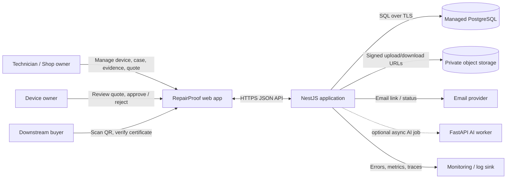
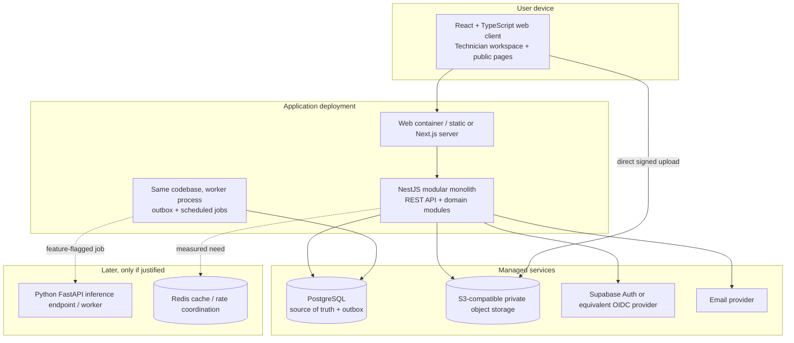
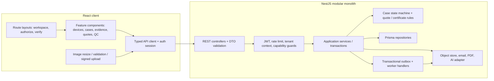
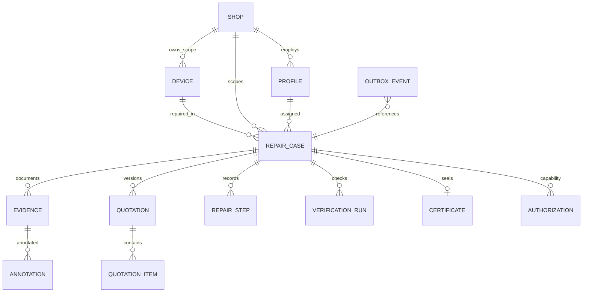
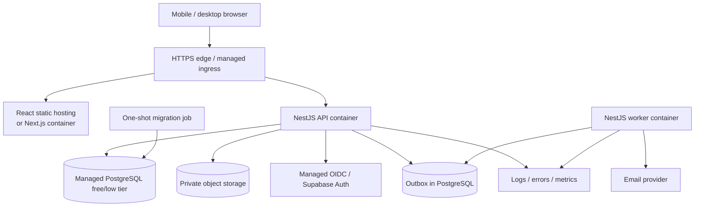

# RepairProof Production Architecture

**Status:** Proposed baseline for the first production release  
**Scope:** Technician proof chain for smartphones and laptops; single shop per account in MVP; public customer authorization and certificate verification; no payments or autonomous diagnosis.  
**Guiding constraint:** Keep the product inexpensive to operate. Free plans are suitable for development and a small pilot, but no provider's free quota or uptime is a production guarantee.

## 1. Executive design

RepairProof is a responsive React/TypeScript web application backed by a NestJS modular monolith and PostgreSQL/Prisma. The monolith owns business rules, authorization, transactional state, and integrations. Evidence bytes live in private object storage. A database-backed outbox drives retryable work such as certificate PDF generation and email. Redis is omitted initially; add it only when measured load or a specific coordination need warrants it. A Python/FastAPI AI capability is a later, independently deployable optional worker, not a dependency of the MVP proof chain.

The current repository is a pnpm monorepo with `apps/web` using Vite and `apps/api` using NestJS/Prisma. The proposed destination preserves the API and shared package, while moving the web app to Next.js if server rendering and public-link SEO/performance justify the migration. React + TypeScript is the required frontend baseline; Next.js is an optional framework preference from the earlier brief. Do not migrate simply for architecture purity: the existing SPA can serve the technician workspace, with Next.js focused on public pages if an incremental migration is preferred.

## 2. System context

Trust boundaries: public browser, authenticated shop workspace, application service, database, object store, and optional external providers. Customer authorization tokens and certificate identifiers are separate capabilities with distinct permissions and response schemas.

## 3. Container architecture

Deploy the API and worker as separate processes/images from one repository and domain codebase. They share modules, schema, and release version; the worker runs only background consumers. This prevents request latency from being coupled to PDF/email work without creating a distributed business system.

## 4. Module boundaries

NestJS modules own their data access and expose application services/events to other modules. No module imports another module's Prisma repositories directly. Start with a single PostgreSQL database and one Prisma schema; organize schema by domain comments/files if tooling permits.

| Module | Owns | Publishes / consumes |
|---|---|---|
| Identity & Shop | profiles, shop membership, roles | user/shop lifecycle |
| Devices | device identity, intake details | device registered |
| Cases | case lifecycle, assignment, transition rules, customer contact | case created/status changed |
| Evidence | metadata, annotations, upload intents, integrity digest | evidence recorded |
| Quotations | immutable quote versions, line items, totals | quote sent/approved/rejected |
| Customer Authorization | hashed capability tokens, expiry, consent/signature record | response event |
| Repair Tracking | ordered work steps and parts used | step completion |
| Verification | checklist runs, pass/fail gate | verification passed/failed |
| Certificates | immutable issued snapshot, public projection, QR identifier | certificate issued |
| Files | object-store adapter, signing, retention and cleanup | file lifecycle |
| Notifications | templates, delivery attempts, preferences | consumes notification intents |
| Jobs / Outbox | durable work scheduling and retries | consumes committed outbox records |
| Audit | append-only actor/action/entity history | consumes domain audit facts |
| AI Adapter (later) | provider-neutral client, consent, redaction, result provenance | asynchronous AI jobs only |

Module dependency rule: HTTP controllers -> application services -> domain model/ports -> infrastructure adapters. Domain modules do not call each other over HTTP. Keep shared package limited to transport DTO schemas, enums, and generated client types; never put server secrets or domain persistence logic there.

## 5. Component architecture

Business invariants live server-side: legal case transitions, only one active quote, customer response idempotency, verification before certification, sealed certificate immutability, tenant scoping, and public privacy projections. Browser validation improves usability but is never the enforcement boundary.

## 6. Database architecture

PostgreSQL is the canonical system of record. Prisma migrations are versioned and applied once per release using a migration job, never by every app replica at startup. Use pooled runtime connections and a direct migration connection where the selected provider supports them. Set TLS, least-privilege database users, automated backups, and a tested restore procedure before real customer data.

### Data rules

- Every tenant-owned row carries `shopId` directly or is reached through a parent with an enforced shop check. Add composite uniqueness/foreign keys where practical (for example `(shopId, id)`) to reduce accidental cross-tenant references. Consider PostgreSQL row-level security as defense in depth only after connection pooling/session context is designed safely; Nest guards and scoped repository methods remain mandatory.
- Use UUID primary keys; unique human-readable case/certificate numbers; indexes on `(shopId, status, createdAt)`, case foreign keys, and token hashes. Avoid indexing raw serial/IMEI unless product search requires it; encrypt or redact sensitive identifiers according to retention policy.
- Money uses `NUMERIC(12,2)` plus ISO currency; never floating point. Store timestamps in UTC. Store checklist/result structures as validated JSON only when fields are genuinely variable; queryable facts belong in relational columns.
- Persist evidence metadata, object key, byte size, MIME, SHA-256 digest, author, capture time, category, and retention state. Do not store bytes in PostgreSQL.
- Customer capabilities: store token hash, expiry, scope, and used/revoked state; return random high-entropy token once. Do not store a bearer token in clear text.
- Append-only `AuditEvent` and `OutboxEvent` records use JSON payloads with schema version and dedupe key. Enforce idempotency keys for quote response, upload completion, and certificate issue requests.
- Certificate issue creates an immutable snapshot of disclosed device/repair/parts/QC/warranty facts and its digest. Subsequent corrections create a revocation/correction record; do not mutate the issued snapshot. A digest detects change but does not alone prove who authored the source facts.
- Soft deletion is not a substitute for retention or privacy erasure. Define a shop data retention schedule and a controlled purge/anonymization workflow, respecting legal holds and certificate integrity commitments.

## 7. API architecture

Use versioned REST JSON API (`/api/v1`), OpenAPI-generated docs/types, DTO validation, consistent problem details, pagination, request IDs, and explicit rate limits. REST is sufficient for the MVP; do not add GraphQL or public webhooks until a client/integration requires them.

| Resource | Example routes | Access |
|---|---|---|
| Session/profile | `GET /me`, `POST /shops` | authenticated |
| Devices | `POST /devices`, `GET /devices`, `GET /devices/:id` | shop member |
| Cases | `POST /cases`, `GET /cases`, `GET /cases/:id`, `POST /cases/:id/transitions` | shop member + policy |
| Evidence | `POST /cases/:id/evidence-upload-intents`, `POST /cases/:id/evidence`, `POST /evidence/:id/annotations` | shop member |
| Quotes | `POST /cases/:id/quotes`, `POST /quotes/:id/send` | shop member |
| Customer capability | `GET /public/authorizations/:token`, `POST /public/authorizations/:token/response` | capability + throttle |
| Tracking / QC | `POST /cases/:id/steps`, `POST /cases/:id/verification-runs` | shop member |
| Certificate | `POST /cases/:id/certificate`, `GET /public/certificates/:number` | authenticated issue / public read |

Use signed upload flow: API authorizes case/category/size and returns a short-lived, object-specific upload URL; browser uploads directly; API verifies object metadata and digest before marking evidence ready. Never expose service-role credentials. Public response bodies are dedicated projections, not ORM models. Support `Idempotency-Key` on operations with costly or irreversible effects. Use optimistic concurrency (`version` column / `If-Match`) on case and quote updates.

## 8. Authentication architecture

Delegate password storage, email verification, reset, and optional MFA to a managed OIDC identity provider (the existing repository already uses Supabase Auth). The browser obtains short-lived access JWTs; Nest verifies issuer, audience, signature/JWKS, expiry, and required claims. Prefer secure, HttpOnly, SameSite cookies when Next.js acts as a BFF; otherwise use the provider SDK's supported secure session pattern and avoid long-lived tokens in localStorage. Do not copy provider service-role secrets into web builds.

Technician onboarding binds an identity to a RepairProof `Profile` and shop membership. Account deletion/deactivation revokes sessions and membership; audit history remains subject to retention policy. Customer authorization is not a user login: it is a narrow, expiring, hashed capability token, rotated on quote refresh and single-use for response.

## 9. Authorization architecture

Combine role-based permissions with resource-level tenant policy. Roles are `SHOP_OWNER` and `TECHNICIAN` in MVP; permissions are explicit and not inferred from UI visibility. Resolve `shopId` from verified membership, never from an untrusted request body. Query every resource through a shop-scoped repository; return 404 for cross-tenant identifiers to avoid enumeration. Public certificate routes return only approved fields and no customer PII. Quote-link routes expose only the current quote and necessary evidence, and accept only approve/reject for that capability.

| Action | Owner | Technician | Customer link | Public buyer |
|---|---:|---:|---:|---:|
| Manage shop / membership | Yes | No | No | No |
| Create/update repair records | Yes | Yes, scoped | No | No |
| Assign staff / retention controls | Yes | No | No | No |
| Approve/reject current quote | No | No | Yes, token-bound | No |
| Read public certificate projection | Yes | Yes | Yes | Yes |

Add platform support/admin access only when there is an operational requirement, with separate audited privileged workflows.

## 10. File storage architecture

Store uploads in a private S3-compatible bucket with random object keys such as `shops/{shopId}/cases/{caseId}/{uuid}`; never derive keys from customer filenames. Keep the bucket private, use TLS, short-lived signed URLs, server-side encryption supplied by the provider, and least-privilege credentials. Client compresses intake photos to the PRD target (1280px, JPEG quality around 0.70, typically <=500 KB); server independently validates actual content, dimensions, file signature, and size. Strip EXIF/GPS metadata by default. MVP should accept photos first; videos/documents require explicit size/retention limits.

**Low/no-cost path:** start with a provider free tier (for example Supabase Storage alongside Supabase Postgres/Auth, or a compatible object store with a published free allowance), but verify current limits, inactivity pauses, egress, regional availability, and backup/export before selection. Keep a `StorageProvider` adapter and standard object keys so migration to another S3-compatible service is possible. For local development use MinIO or a Docker volume; do not mistake local volume persistence for production backup. If there is genuinely no budget, a private local volume is acceptable for a non-critical pilot only, with an explicit backup copy and recovery owner; it is not a resilient production topology.

Deletion workflow removes database access first, queues object deletion, retries failures, and records completion. Orphan scanner finds objects without metadata. Certificate snapshots may pin referenced evidence under a retention policy; disclose that retention to shops.

## 11. Background processing

Begin with a PostgreSQL transactional outbox, not Redis/BullMQ. A transaction writes the business change and an outbox row together. A worker claims rows using `FOR UPDATE SKIP LOCKED`, processes idempotently, applies exponential backoff with jitter, and moves exhausted tasks to a dead-letter state for operator review. A periodic job handles token expiry, retention, orphan scans, and cleanup.

Initial jobs: quote/certificate email delivery; PDF generation if enabled; image metadata/thumbnail work; object deletion; outbox retry. Job payloads contain IDs and minimal data, not full PII or file bytes. Persist attempt count, `availableAt`, lease, last error code, and dedupe key. For low volume, API and worker can run as two processes on one small host. Add Redis/BullMQ only when job volume, scheduling needs, or database polling overhead demonstrates the need.

## 12. Notification architecture

Email is the first channel; SMS is an explicit later provider integration because it has recurring per-message cost and the research plan has not settled the default delivery channel. Notification module consumes outbox intents, renders versioned templates, sends through an adapter, records provider ID/status/attempts, and retries transient failures. Do not send email/SMS inside a database transaction. Avoid putting customer phone/email into logs. The UI can always copy/share the authorization URL, even when no email provider is configured. In free-tier pilot mode, use a verified sender/domain and enforce provider quotas; show delivery status without claiming delivery equals customer receipt.

## 13. AI service integration

AI diagnosis/image analysis is out of MVP scope in the product plan. Preserve an adapter boundary so later experiments do not contaminate core workflow. When a justified use case is approved, submit an asynchronous job from the outbox to a separately deployable Python/FastAPI service. Send only consented, minimum necessary redacted evidence; use signed read URLs with short expiry. Return a versioned suggestion, model/version, confidence or uncertainty, input digest, and safety notes. Persist it as an explicitly advisory result with author/source and allow technician dismissal; AI must not change case status, quote, part provenance, verification result, or certificate without human action. Apply timeouts, concurrency limits, payload limits, provider/model cost caps, retention controls, and a kill switch. No AI request may block quote authorization or repair completion.

The capability evaluation, data readiness gaps, model/human-review boundaries, cost profile, and validation gates are detailed in [RepairProof AI Intelligence Architecture](REPAIRPROOF-AI-INTELLIGENCE-ARCHITECTURE.md). In particular, a photograph can describe visible conditions but cannot establish diagnosis truth.

## 14. Observability and operations

Use structured JSON logs to stdout with correlation/request ID, route, status, latency, module, and non-PII entity IDs. Redact tokens, credentials, customer contact, and upload URLs. Add OpenTelemetry instrumentation when useful, with vendor-neutral export; start with hosted free-tier error tracking and uptime checks if available, plus health/readiness endpoints. Metrics: request rate/error/latency, database pool saturation, outbox age/retries/dead letters, upload failures/storage consumption, email delivery failures, certificate issuance, and backup age. Alert on sustained API failure, database connectivity, growing outbox lag, storage nearing quota, and backup failure. Document an incident contact, restore steps, and key rotation process.

Do not claim a 99.5% production SLO from a collection of free tiers. Define an MVP service objective only after selecting providers and measuring. Monitor budget/quotas and alert before hard limits; export database backups and periodically verify restores. Keep secrets in deployment secret configuration, not source control or frontend environment variables.

## 15. Deployment topology

**Local:** Docker Compose for PostgreSQL, API, web, and optional MinIO; migrations run explicitly. **Pilot:** one small Docker host/container platform for API + worker, static React hosting (or web container), managed Postgres and private object storage. **Growth:** multiple stateless API replicas behind ingress; worker concurrency scaled separately; managed Postgres with backups/connection pool; CDN for public static assets only. Keep images minimal, non-root, health-checked, pinned by digest in release, and scanned in CI. Use rolling deploys only when schema migrations are backward-compatible (expand/contract).

Free-tier caveat: production exposure of repair/customer records requires backups, access control, TLS, and a recovery plan. Free plans can pause, change quotas, or provide limited support. A free deployment is a cost-constrained pilot architecture, not an uptime or durability commitment. Avoid provider-specific lock-in by keeping Nest adapters for identity, storage, mail, and telemetry.

## 16. Technology decisions and trade-offs

| Area | Choice | Trade-off / rationale |
|---|---|---|
| Web | React + TypeScript; Next.js if public rendering/BFF helps | SPA is already in repo and cheapest to continue; Next adds SSR/deployment complexity. Migrate only for a concrete benefit. |
| API | NestJS modular monolith on Node.js | Strong module/DI boundaries and fits repo; one deployable domain system limits ops burden. |
| Persistence | PostgreSQL + Prisma | Relational constraints/transactions suit proof records; Prisma adds migration discipline and pool considerations. |
| Identity | Managed OIDC, current candidate Supabase Auth | Avoid building password security; provider dependence mitigated by OIDC and local profile mapping. |
| Object storage | Private S3-compatible/provider storage | Cheap and separates large bytes from database; free quotas/egress and provider limits vary. |
| Jobs | PostgreSQL outbox + Nest worker | No additional broker bill; polling is adequate at MVP scale, less suited to high throughput. |
| Cache | None initially; Redis later | Reduces operational cost/complexity. Add for measured hot reads, distributed throttling, or job queue need. Never cache authorization decisions without bounded invalidation. |
| Notifications | Email adapter; manual share link fallback | Low operational cost; SMS is effective but recurring cost and unresolved preference. |
| AI | FastAPI optional asynchronous worker | Python model ecosystem; separate runtime only for a concrete AI feature. Keeps core independent of model latency/cost. |
| Deployment | Docker; managed data services for pilot | Easy local parity and portable app containers; fully self-hosting data services shifts backup/security burden to owner. |

## 17. Architecture Decision Records

### ADR-001: Modular monolith for MVP
**Status:** Accepted. **Decision:** One NestJS codebase and PostgreSQL database with domain modules; API and worker are separate runtime processes from that codebase. **Why:** MVP is one cohesive proof-chain workflow, with small team and limited budget. **Consequences:** Strict module ownership and tests around boundaries are needed; scale processes independently before considering service extraction. **Revisit when:** independent scaling, compliance isolation, team ownership, or availability requirements cannot be met within this deployment.

### ADR-002: PostgreSQL is the sole business source of truth
**Status:** Accepted. **Decision:** Persist business state, audit, and durable job intents in PostgreSQL. **Why:** ACID transitions and quote/certificate invariants are central. **Consequences:** Outbox polling adds database work; use indexes and bounded batches. **Revisit when:** proven event throughput warrants a broker.

### ADR-003: Managed identity; no custom password system
**Status:** Accepted. **Decision:** Use OIDC-compatible managed auth, initially Supabase Auth to align with current repo. **Why:** Avoid credential handling and reduce initial implementation. **Consequences:** Provider outages affect login; map external subject to internal profile and retain export/migration paths.

### ADR-004: Private object storage with direct signed uploads
**Status:** Accepted. **Decision:** Keep files out of Postgres and issue scoped short-lived upload/download URLs. **Why:** Cost and database size. **Consequences:** Need orphan cleanup, digest verification, and provider migration adapter; free egress/storage caps must be monitored.

### ADR-005: No Redis in initial release
**Status:** Accepted. **Decision:** Use database-backed outbox and rate limits at ingress/app level. **Why:** Avoid another bill and stateful service before need. **Consequences:** Polling and cross-instance throttling are limited. **Revisit when:** measured queue lag/DB load or distributed throttling becomes material.

### ADR-006: AI stays outside MVP critical path
**Status:** Accepted. **Decision:** No AI service deployment until a validated use case; later integrate via asynchronous adapter and human-reviewed outputs. **Why:** MVP explicitly excludes automated diagnosis and repairs require technician judgment. **Consequences:** No AI-based workflow in first release; interface boundary is reserved, not prebuilt infrastructure.

### ADR-007: Public capabilities are narrowly scoped and hashed
**Status:** Accepted. **Decision:** Customer quote links are random, high-entropy, expiring capability tokens stored hashed; certificates use separate public identifiers and privacy projections. **Why:** Customer accounts add friction, but public endpoints must remain least-privilege. **Consequences:** Token revocation/rotation and rate limiting are required; token values must never enter logs/referrers.

### ADR-008: Certificate is a sealed snapshot
**Status:** Accepted. **Decision:** Issue immutable certificate snapshot with digest and explicit correction/revocation records. **Why:** RepairProof's proof value depends on stable issued facts. **Consequences:** Corrections require a new linked record; a hash is tamper-evidence, not an independent timestamp/notary.

### ADR-009: React framework migration is benefit-driven
**Status:** Proposed. **Decision:** Keep React/TypeScript; choose Next.js for the web app only if SSR/public route/BFF benefits justify migration, otherwise continue current Vite SPA for MVP. **Why:** Repo already has a working Vite application and migration does not itself improve proof integrity. **Consequences:** Public certificate rendering can begin client-side; if SEO or server-side session security becomes important, migrate incrementally.

## 18. Delivery sequence

1. Harden schema and tenant scoping; implement state machine, quote versioning, authorization capability, audit/outbox, and certificate snapshot.
2. Implement private object storage signed uploads, image limits/EXIF stripping, and cleanup.
3. Complete technician proof chain and public customer/certificate projections.
4. Add email adapter and worker; provide copy/share link fallback.
5. Add deployment secrets, migrations, backups/restore, health checks, quota monitoring, and operational runbook.
6. Reassess Next.js migration, SMS, Redis, AI, and multi-shop needs using actual product evidence and measured constraints.

## 19. Open operational decisions

- Select hosting, database, object storage, and email providers only after comparing current free quotas, region, inactivity behavior, backup/export, and data residency needs; those limits change and should not be treated as architectural constants.
- Define customer and evidence retention, deletion/erasure, consent language, and certificate correction policy before onboarding real shops.
- Choose currency/tax policy and customer contact delivery default; the existing user research flags delivery channel as unresolved.
- Decide whether the initial public certificate page needs search indexing; default to `noindex` and avoid exposing serial/IMEI or customer identity.
