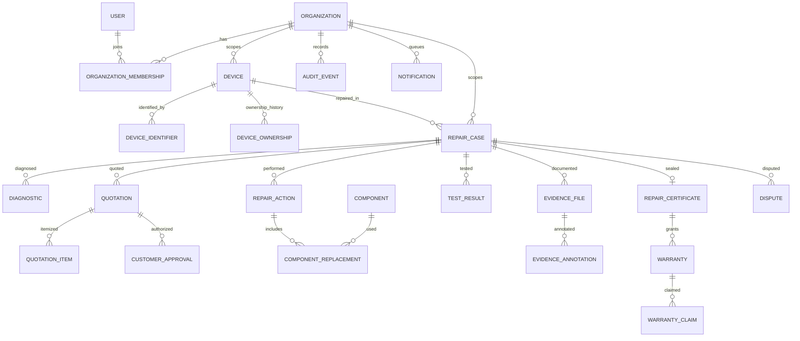

# RepairProof Relational Database Design

**Status:** Proposed production baseline. The canonical draft Prisma schema is [database/prisma/schema.prisma](database/prisma/schema.prisma).  
**Engine:** PostgreSQL 15+; Prisma Client; UUID tenant-scoped records; object bytes stored outside the database.  
**Scope:** Includes all requested entities and supporting relations for a complete repair proof, warranty, audit, notification, and dispute lifecycle.

## 1. Model overview

## 2. Entity dictionary

`schema.prisma` is the exact field/type/key/index source of truth. All listed IDs are PostgreSQL `uuid` primary keys (`@db.Uuid`) except `AuditEvent.id` (`bigserial`). All timestamps are `timestamptz(6)` UTC. Foreign keys are named in Prisma `@relation`; tenant-owned rows use composite `(organizationId, parentId)` references where needed. FK delete behavior is intentionally conservative: core repair records use `RESTRICT`; actor references that can be anonymized use optional IDs and `SET NULL` when that does not affect a tenant key. There is no physical cascade through proof records.

| Entity / table | Fields and PostgreSQL types | Keys, indexes, relationships | Delete and retention |
|---|---|---|---|
| `User` | `id uuid`; external identity `authIssuer varchar(255)`, `authSubject varchar(255)`; email `varchar(320)` and normalized email; display name `varchar(160)`, phone `varchar(32)`, locale; created/updated/disabled timestamps | PK `id`; unique `(authIssuer, authSubject)`; index normalized email and disabled state. 1:M memberships, authored cases, actions, evidence, tests, certificates, audits, notifications. Identity provider remains source for credentials. | No cascading delete. Disable first; anonymize optional profile PII when policy permits while retaining required attribution. Keep audit attribution by nullable user FK + actor type. Retain while any legal/audit need exists. |
| `Organization` | `id uuid`, name `varchar(160)`, slug `varchar(80)`, status enum, timezone, country code `char(2)`, timestamps, soft-delete timestamp | PK; unique slug; status/date index. Parent of memberships, devices, cases, components, evidence, notifications, disputes, audit. | `RESTRICT` while child records exist. Close/soft-delete; tenant data purge is a controlled workflow after retention/legal hold. |
| `OrganizationMembership` | `id uuid`, `organizationId uuid`, `userId uuid`, role/status enums, nullable inviter UUID, joined/created/updated/revoked timestamps | PK; unique `(organizationId,userId)` and `(organizationId,id)`; indexes `(userId,status)`, `(organizationId,role,status)`. M:1 organization/user; optional inviter. | `RESTRICT` membership parent delete; revoke membership rather than delete. History retention follows audit policy. |
| `Device` | `id uuid`, tenant UUID, category enum, make/model varchar, color/storage, notes text, creator UUID, timestamps/deletedAt | PK; tenant composite unique `(organizationId,id)`; indexes tenant/category/make/model and tenant/createdAt. 1:M identifiers, ownership periods, repair cases. | Restrict deletion while history references it. Soft-delete/archive; keep minimal identity for certified history. |
| `DeviceIdentifier` | `id uuid`, tenant/device UUID, identifier type enum, encrypted `bytea`, HMAC lookup hash `char(64)`, optional last4, created/retired timestamps | PK; composite tenant/device FK; unique `(organizationId,type,lookupHash)` for exact duplicate prevention; tenant/device index. | Retire or crypto-erase ciphertext on request/retention expiry; do not delete proof records that need non-sensitive device model details. Hash key rotation needs a migration strategy. |
| `DeviceOwnership` | `id uuid`, tenant/device UUID, ownership enum, owner name/email/phone, valid from/to, created/erased timestamps | PK; composite device FK; index `(organizationId,deviceId,validFrom)` and `validTo`. Device has ownership history. | Ownership contact PII should be erased/anonymized after defined retention; preserve non-identifying ownership event if justified. Never cascade from Device. |
| `RepairCase` | `id uuid`, tenant/device UUID, case number, status/priority enums, creator/assignee UUIDs, customer name/email/phone, problem/history text, expected/open/close times, row version, timestamps/deletedAt | PK; unique `(organizationId,id)` and `(organizationId,caseNumber)`; list index `(organizationId,status,openedAt DESC)`, assignee/status, device/openedAt. Parent for all repair evidence and outcomes. | Restrict hard delete. Soft-delete/hide operationally; PII erasure/anonymization only under retention policy and certificate/legal constraints. |
| `Diagnostic` | `id uuid`, tenant/case UUID, version integer, draft/final enum, summary/recommendation text, findings JSONB, author UUID, finalized/created/updated timestamps | PK; unique `(caseId,version)` and `(organizationId,id)`; tenant/case/date index. M:1 case and author. | Restrict case delete; final diagnostics immutable by application policy. Retain as part of proof record; correct by new version. |
| `Quotation` | `id uuid`, tenant/case UUID, version integer, status enum, currency char(3), `numeric(12,2)` subtotal/tax/discount/total, terms text, validUntil/sentAt/createdAt/supersededAt, author UUID | PK; unique `(caseId,version)` and `(organizationId,id)`; tenant/case/status, validity indexes. 1:M items/approvals. | Restrict case delete. Never overwrite sent/approved quote; revise with new version. Retention follows case record policy. |
| `QuotationItem` | `id uuid`, tenant/quote UUID, position integer, item enum, description varchar(500), optional component UUID, part source enum, quantity `numeric(10,3)`, unit/line total `numeric(12,2)`, tax rate `numeric(7,4)`, created timestamp | PK; unique `(quotationId,position)`; FK `(organizationId,quotationId)` to quote; tenant/quote index. | Restrict quote delete; immutable after quote is sent. Snapshot part description/provenance to preserve what customer approved. |
| `CustomerApproval` | `id uuid`, tenant/case/quote UUIDs, token HMAC `char(64)`, decision/channel enums, signer name/note, expiry/responded/revoked timestamps, IP/user-agent hashes, created timestamp | PK; unique token hash; composite FKs to tenant case and quote; indexes tenant/case/date and expiration/response. Many attempts/reissued links per case/quote. | Restrict parent deletion. Token hash only; revoke/expire. Retain decision, time, quoted version and evidence of consent per dispute/contract policy; expire/delete network hashes sooner. |
| `RepairAction` | `id uuid`, tenant/case UUID, sequence integer, title varchar(180), description text, status enum, optional performer UUID, started/completed/created/updated timestamps | PK; unique `(caseId,sequence)` and `(organizationId,id)`; tenant/case/status index. 1:M replacements. | Restrict case delete; completed actions are append-only/corrected with audit record. |
| `Component` | `id uuid`, tenant UUID, optional SKU, name/manufacturer/part number, category/source enums, JSONB metadata, timestamps/archive time | PK; tenant/id unique; unique `(organizationId,sku)` (Postgres permits multiple nulls); tenant/category/name index. Referenced by replacements. | Archive, do not delete if replacement history references it. |
| `ComponentReplacement` | `id uuid`, tenant/case UUID, optional action/component UUIDs, component name/part/source snapshots, quantity `numeric(10,3)`, optional unit cost `numeric(12,2)`, disposition enum, replacedAt, notes | PK; tenant/id unique; composite tenant FKs to case/action/component; indexes tenant/case/date and tenant/component. | Restrict case deletion; historical snapshot must survive component catalog changes. Keep with certificate/case retention. |
| `TestResult` | `id uuid`, tenant/case UUID, test code/name, outcome enum, result text, optional measured value `numeric(18,6)` and unit, notes, optional performer UUID, performed/created timestamps | PK; tenant/id unique; composite case FK; indexes tenant/case/time and tenant/case/outcome. | Restrict case deletion; append new test run rather than overwrite. Retain with proof record. |
| `EvidenceFile` | `id uuid`, tenant/case UUID, uploader UUID?, category/status enums, storage provider/bucket/object key, original name, MIME, byte size bigint, SHA-256 char(64), capture/retention/creation/deletion timestamps, description | PK; tenant/id unique; unique `(storageProvider,bucket,objectKey)`; composite tenant/case FK; indexes tenant/case/category/date, status/date, retention. Bytes reside in private object storage. | Restrict case delete. Soft-delete metadata then async object deletion; hold/pin evidence referenced by live certificate/dispute. Define explicit retention and backup policy. |
| `EvidenceAnnotation` | `id uuid`, tenant/evidence UUID, optional author UUID, X/Y `numeric(5,2)` percentages, note text, created timestamp | PK; composite tenant/evidence FK; tenant/evidence/date index. | Restrict evidence delete; annotations are immutable audit facts. Same retention as evidence. |
| `RepairCertificate` | `id uuid`, tenant/case UUID, certificate number varchar(64), status enum, immutable JSONB snapshot, snapshot hash char(64), issuer UUID, issue/revoke timestamps, reason | PK; unique case (one active certificate issuance record in baseline) and certificate number; tenant/id unique; tenant/status/issued index. | Restrict all deletes. Immutable; revoke/supersede with reason and issue a linked replacement in a future extension if multiple versions are needed. Keep long-term while certificate is publicly verifiable. |
| `Warranty` | `id uuid`, tenant/case/certificate UUID, status enum, start/end timestamps, terms snapshot, created/void timestamps | PK; tenant/id unique; composite tenant FKs; index tenant/end/status. Certificate 1:M warranties; warranty 1:M claims. | Restrict deletion. Retain through term plus applicable claim/dispute limitation period; terms snapshot immutable. |
| `WarrantyClaim` | `id uuid`, tenant/warranty/case UUID, claim number, status enum, claimant contact, description/resolution, opened/resolved timestamps | PK; unique `(organizationId,claimNumber)` and tenant/id; composite tenant FKs; index tenant/status/openedAt. | Restrict parent delete. Erase contact details after closure retention while preserving claim outcome if permitted. |
| `Dispute` | `id uuid`, tenant/case UUID, optional claim UUID, dispute number, status/actor enums, subject/description/resolution, open/close timestamps | PK; unique `(organizationId,disputeNumber)` and tenant/id; tenant/status/opened and tenant/case indexes. FK case and org. | Restrict delete; legal hold blocks purge. Retain communications/evidence under a separately defined dispute schedule. |
| `Notification` | `id uuid`, tenant UUID, optional case/user UUIDs, channel, template key, encrypted recipient address, JSONB payload, status, attempts/next retry, provider ID/error code, queued/sent/delivered timestamps | PK; tenant/id unique; composite tenant/case FK; queue index `(status,nextAttemptAt)` and tenant/case/date. | Restrict org/case deletion; delivery payload must be minimized and purged after provider reconciliation window. Keep status/audit metadata longer only if needed. Never store reusable cleartext link token in payload. |
| `AuditEvent` | `bigserial id`, nullable tenant/case/user IDs, actor type, action enum, entity type/id, request ID, IP HMAC, JSONB redacted changes, occurredAt | PK; optional FKs; indexes tenant/time desc, tenant/entity, case/time desc, actor/time desc. Append-only. | No update/delete in app role. Keep per legal/security retention policy; partition by time when volume warrants. Never log secrets, raw capability tokens, or full customer data. |

## 3. Relational integrity and tenant isolation

### Tenant boundary

Every tenant-owned aggregate begins with `organizationId`. Children referencing a tenant parent use a composite foreign key to `(organizationId,id)`; corresponding unique constraints are present on parent rows. This makes a cross-organization `caseId` reference fail in PostgreSQL even if an application query is incorrect. A database constraint cannot itself prove the authenticated user belongs to that organization, so the API must still:

1. Resolve active organization membership from the verified identity, never trust `organizationId` from an arbitrary body.
2. Scope every read/write by both organization and resource ID.
3. Apply role/policy checks in Nest guards/application services.
4. Use a least-privilege runtime database role and TLS.
5. Optionally add PostgreSQL RLS after validating pooled-connection tenant context reset behavior. RLS is defense in depth, not a replacement for scoped repositories.

Global `User` is an identity principal. Membership conveys tenant role; do not put one global `role` on User. Public endpoints use narrow service methods and projection DTOs.

### Constraints Prisma cannot express alone

Add SQL migration constraints for:

- `DeviceOwnership.validTo IS NULL OR validTo > validFrom`.
- `Quotation.version > 0`, `QuotationItem.quantity > 0`, nonnegative line values where business policy requires it.
- `EvidenceFile.byteSize > 0`, lowercase 64-char SHA-256 checks, annotation coordinates `BETWEEN 0 AND 100`.
- `Warranty.endsAt > startsAt` and non-overlapping active warranty policy if required.
- Unique one-active-quote per case using a partial unique index over status in (`DRAFT`,`SENT`,`APPROVED`) only if business semantics truly allow one approved active quote; otherwise enforce one open sent quote.
- `AuditEvent` append-only trigger/privileges; immutable quote/certificate fields via application policy and, for stronger guarantees, triggers.

Prisma represents ordinary foreign keys and indexes; use carefully versioned raw SQL migrations for partial/expression indexes, check constraints, RLS, and triggers. Verify generated migration SQL during review.

## 4. Referential actions and delete policy

Use `RESTRICT` for organizations, devices, cases, diagnostics, quotes, approvals, repair actions, evidence, certificates, warranties, claims, and disputes. Physical cascading deletes would erase evidence needed by downstream records and violate proof-history expectations. `SET NULL` is appropriate only for optional attribution pointers where the parent may be removed/anonymized and the tenant key remains intact. Organization/case composite FKs generally use `RESTRICT` because `SET NULL` would also null a required tenant key.

Normal deletion is lifecycle state (`disabledAt`, `deletedAt`, `archivedAt`, `revokedAt`, `erasedAt`) plus queued storage cleanup. A dedicated retention job uses a privileged maintenance path, checks legal holds and certificates, deletes object bytes and eligible PII, then records a purge event. Do not grant the app's normal database role broad `DELETE` permission on audit tables.

## 5. Data retention and privacy policy baseline

Exact durations require jurisdiction, contract, and product policy decisions; the database design supports retention dates and erasure markers but does not guess legal periods.

| Data class | Default handling to define before production |
|---|---|
| Account identity | Keep while account is active; disable on departure; delete/anonymize after account closure and obligations expire. |
| Customer contact and ownership PII | Keep only to operate case, warranty, and dispute; redact or crypto-erase after configured retention. Encrypt highly sensitive values and minimize copies. |
| Serial/IMEI | Treat as sensitive identifier; encrypted at rest plus keyed lookup hash; no public certificate display. Define deletion/rotation behavior. |
| Evidence objects | Per-organization policy; retain while case/certificate/warranty/dispute obligations require. Delete asynchronously after expiry and legal-hold check. |
| Approvals and quotes | Retain the approved quote snapshot and decision evidence for applicable contract/dispute period; raw IP/user-agent hashes shorter. |
| Certificate snapshot | Long-lived public proof record while valid; public projection excludes customer PII and sensitive identifiers. Revocation is retained. |
| Warranty claims/disputes | Retain through resolution and the applicable limitation period; preserve legal holds. |
| Notifications | Keep delivery metadata for operational reconciliation; remove encrypted destination and sensitive payload after a short configured window. |
| Audit events | Append-only; security/legal retention set by policy. Redact payloads at write time rather than trying to clean logs later. |

Support tenant export, data subject access/deletion workflow, legal hold, retention overrides with actor/reason, and purge verification. Soft deletion alone is not privacy erasure.

## 6. Migration strategy

### Canonical schema and migration ownership

The current repo has a Prisma schema under `apps/api/prisma/schema.prisma` and another under `apps/api/src/prisma/schema.prisma`. The new canonical target is `database/prisma/schema.prisma`. Before adopting it:

1. Diff the two existing schemas and preserve any real differences deliberately.
2. Back up local/dev data and inventory existing migrations and environment URLs.
3. Change the API Prisma configuration/scripts to reference `../../database/prisma/schema.prisma` (relative path from `apps/api`) and set migration directory to `database/prisma/migrations` using supported Prisma config for the pinned version.
4. Validate and generate client from only the canonical schema. Remove duplicate schema copies only after build/CI scripts point at canonical location.
5. Never run `prisma db push` against production. Production uses reviewed, committed migrations and `prisma migrate deploy` once in a release job.

### Expand/contract rollout

1. **Baseline:** create a backup; run `prisma migrate diff` against the real existing database; check in a baseline migration or mark a verified existing schema as baseline. Do not reset production.
2. **Expand:** add new tables, nullable columns, indexes (large indexes concurrently via reviewed SQL), and constraints initially `NOT VALID` when supported; do not drop/rename columns used by deployed code.
3. **Backfill:** idempotent resumable scripts in bounded batches. Log counts and checkpoints; avoid holding a long transaction. Validate tenant IDs and orphan counts before enforcing constraints.
4. **Dual-read/write only if necessary:** use a temporary compatibility window for renames/data moves; add monitoring and a removal date. Avoid indefinite duplicated sources.
5. **Validate/contract:** validate constraints; deploy code relying on new model; later remove obsolete columns/tables in a separate release after old app version is gone and rollback window closes.
6. **Release:** migration one-shot before app deployment; API and worker images from same commit; health check, smoke-check critical reads/writes, preserve previous image and documented rollback. Destructive rollback uses forward fix or restore, not automatic down migration.

### Initial migration increments

- `001_identity_tenants`: User, Organization, OrganizationMembership; external auth subject mapping.
- `002_devices_cases`: Device, encrypted identifiers, ownership history, RepairCase; tenant composite keys.
- `003_diagnostics_quotes_approvals`: diagnostics, quote versions/items, token hashes/approval results.
- `004_repair_proof`: actions, components/replacements, test results, evidence metadata/annotations.
- `005_certificates_warranties`: immutable certificate snapshots, warranty and claim records.
- `006_operations`: notifications, disputes, audit events, queue indexes and retention metadata.

Migration granularity can be smaller if an incremental release needs it; do not create dozens of migrations for a schema not yet in production.

## 7. Local development sample data

Seed data must be synthetic, idempotent, clearly marked, and impossible to point at production accidentally. `prisma/seed.ts` should refuse to run when `NODE_ENV=production` or `SEED_DEMO_DATA` is not explicitly true. Use a disposable local database name and separate `.env.local` credentials. Keep real data exports out of fixtures and version control.

Example local scenario (human-readable seed specification; IDs should be deterministic UUIDs in the seed script):

| Record | Sample value |
|---|---|
| Organization | `org-demo-repair`, “Northstar Device Repair (DEMO)”, slug `northstar-demo`, status ACTIVE |
| Owner user | `owner-demo@example.test`, display “Demo Shop Owner”, external auth subject `seed-owner-demo` (not a real login credential) |
| Technician user | `tech-demo@example.test`, display “Demo Technician”, subject `seed-tech-demo` |
| Memberships | Owner role OWNER; technician role TECHNICIAN; both ACTIVE in demo org |
| Device | Smartphone, “Acme”, “Model X Demo”, blue, 128 GB; no real serial/IMEI (or fixed fake values under reserved `TEST-` prefix) |
| Ownership | CUSTOMER, “Sample Customer”, `customer@example.test`, `+10000000000`; synthetic only |
| Case | `RP-DEMO-0001`, status DIAGNOSING, symptom “Intermittent charging in demo data” |
| Diagnostic | v1 FINAL, “USB-C port debris or connector wear suspected”; finding marked illustrative |
| Quote | v1 DRAFT, USD subtotal 80.00, tax 0.00, total 80.00; item “Diagnostic labor (demo)” 1 × 80.00 |
| Component | Demo aftermarket charging port module; SKU `DEMO-USB-C-001` |
| Evidence | metadata only, storage key `demo/...`; use generated fixture image with visible DEMO watermark, never a customer photo |

Seed code should use `upsert` with stable keys; create no live email, SMS, or real authorization links. Demo tokens must be unusable outside local environment. Add a prominent `[DEMO]` marker in sample org and UI. `prisma migrate reset` is local-only and must require a development database guard.

## 8. Design decisions and trade-offs

1. **Organization is the tenant root.** A RepairProof tenant may be a shop or a later multi-shop organization. Membership is many-to-many so one person can work with multiple orgs. Costs: organization ID is carried through many child rows to make composite FKs possible.
2. **Users are distinct from organizations.** OIDC owns credentials; RepairProof owns profile and membership. This avoids password storage and supports identity provider changes.
3. **Ownership is temporal, customer contact on a case is a snapshot.** Device ownership can change, while each repair case preserves the contact details relevant at intake. Avoid reading a current owner to rewrite historical case context.
4. **Sensitive device IDs are encrypted and searchable via HMAC.** Exact-match search is supported without a plaintext B-tree index. HMAC key rotation requires versioned hash material or a controlled rehash migration; do not use a plain SHA-256 hash for low-entropy identifiers.
5. **Quotes are versioned snapshots.** Money is decimal with currency; quote items snapshot wording and part provenance so later catalog edits cannot change customer-approved terms. Reconcile totals in a transaction and/or database checks.
6. **Approvals are separate capability records.** Hash high-entropy link tokens; expiry, revocation, and response are first-class. Capture only necessary consent metadata; do not store raw token, raw IP, or unbounded user agent.
7. **Evidence bytes are external.** PostgreSQL stores immutable metadata and SHA-256. This avoids database bloat but creates an object-store/database consistency problem handled by upload state, verification, outbox cleanup, and orphan scans.
8. **Certificate is an immutable JSONB snapshot plus digest.** Flexible snapshot allows public rendering to evolve while preserving issued disclosure. Relational source facts remain queryable. Hashing detects alteration only if hash and source are protected; it is not a public blockchain/notary.
9. **Audits and lifecycle history are append-oriented.** Correct by new versions/events; don't overwrite sealed proof. This increases row volume and necessitates retention/partitioning later.
10. **Enums are appropriate for stable state machines; variable checklist content remains JSONB.** If reporting requires checklist-level aggregation, normalize checklist templates and individual answers rather than querying JSONB indefinitely.

## 9. Scaling risks and bottlenecks

| Risk | Symptom | Mitigation / trigger to revisit |
|---|---|---|
| Tenant list queries | Slow case lists as cases grow | Composite indexes led by `organizationId`, keyset pagination by `(openedAt,id)`, select only needed fields; inspect `EXPLAIN (ANALYZE, BUFFERS)`. |
| Hot tenant/case indexes | Bloat and writes from too many secondary indexes | Add indexes only for measured query plans; monitor write latency and `pg_stat_user_indexes`; remove unused indexes. |
| Audit/event growth | Large indexes, slow vacuum, backup growth | Time partition `AuditEvent` when volume justifies it; batch retention and archival; keep hot recent partitions. Partitioning complicates unique constraints/FKs. |
| Evidence metadata plus object consistency | orphaned DB rows or storage blobs | Explicit upload state machine, digest verification, transactional outbox, retries, orphan reconciliation. Never claim atomic DB+object-store transaction. |
| Serial/IMEI lookup | CPU/key rotation complexity | HMAC lookup index and tenant scope; store key version; rate-limit enumeration; benchmark lookup and rotation. |
| Connection exhaustion | Prisma pool saturation on small DB tier | Pooler, bounded API/worker concurrency, short transactions, no DB call per item, monitor pool wait; don't scale replicas blindly. |
| Large JSONB fields | Expensive reads/indexing and hidden schema drift | Enforce schema version and DTO validation; keep large payloads out; normalize if filtering/analytics needs fields. |
| Notification/outbox contention | Worker rows repeatedly scanned | Index queue state/nextAttempt, claim small batches with `SKIP LOCKED`; archive completed rows; use a dedicated broker only after evidence of contention. |
| Public token/certificate abuse | Table scans or enumeration | Unique token hash/certificate number indexes, constant-time token comparison, rate-limit at edge, never expose raw IDs with PII. |
| Cross-tenant bug | Invalid object reference despite role checks | Composite tenant FKs, scoped repositories, adversarial tests; consider RLS with safe transaction-local tenant context. |
| Free-tier limits | Paused database, storage exhaustion, weak backup guarantees | Quota alerts, export/restore rehearsal, provider-independent object keys, paid plan before real production dependability is required. |

## 10. Implementation checklist

- [ ] Resolve duplicate existing Prisma schemas and generate from one canonical location.
- [ ] Add API Prisma config/scripts for `database/prisma/schema.prisma` and migrations.
- [ ] Validate schema and generate SQL against the exact pinned Prisma version; inspect every FK/index/delete action.
- [ ] Add the SQL checks and partial unique indexes listed above.
- [ ] Define encryption/HMAC key management, rotation and backup recovery.
- [ ] Define retention durations, legal hold and erasure behavior with product/legal requirements.
- [ ] Implement membership-scoped access in every repository; add cross-tenant negative tests.
- [ ] Implement outbox and object lifecycle reconciliation before allowing production evidence uploads.
- [ ] Write idempotent local-only synthetic seeds with production refusal guard.
- [ ] Establish backup/restore rehearsal before importing real shops or customer data.
