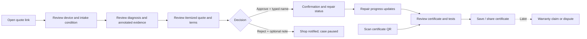
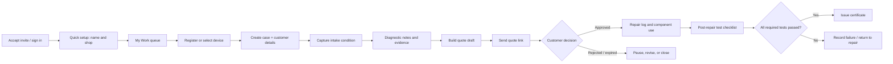
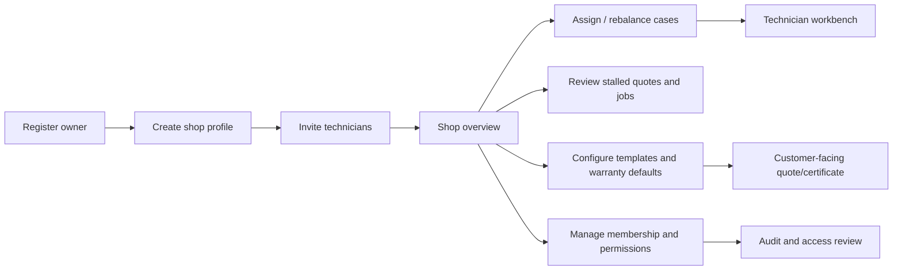
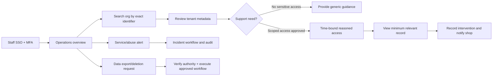
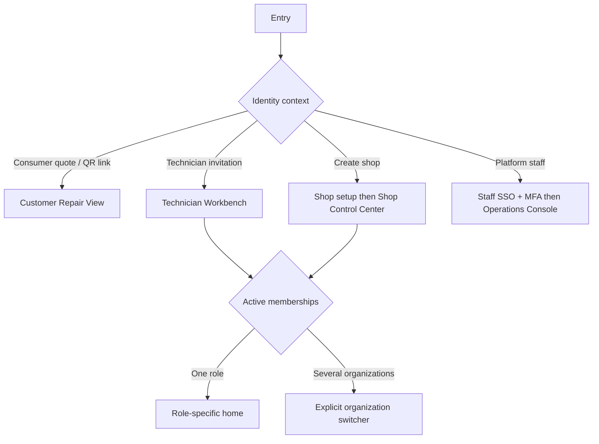

# RepairProof Product Experience Blueprint

**Audience:** Product, design, and engineering  
**Design principle:** One product, four distinct surfaces. Route users by role and task; do not place consumers, technicians, shop owners, and platform operators in one permission-heavy dashboard.

## 1. Experience architecture

### Role surfaces

| Surface | Primary user | Navigation model | Access |
|---|---|---|---|
| **Customer Repair View** | Device owner | One case link with progress, quote, evidence, decision, certificate, and later warranty/dispute access | No account for MVP; scoped, expiring token |
| **Technician Workbench** | Bench technician | My queue, cases, devices, capture/repair workflow | Shop membership; cases assigned or available by shop policy |
| **Shop Control Center** | Shop owner/manager | Shop-wide queue, staff, templates, profile, delivery and records | Separate owner/admin role and routes |
| **Platform Operations Console** | RepairProof support/admin | Tenant lookup, service health, abuse/support cases, audited interventions | Separate identity realm or strong step-up MFA; never a shop dashboard mode |

The platform operator console is not in the customer or shop navigation. Support staff should see minimal scoped context, not unrestricted customer photos by default. All privileged access is audited and time-bounded.

### Product stages

- **MVP:** technician registration and shop setup; devices/cases; diagnostics/evidence; quotes; token-based customer approval; repair execution; post-repair verification; certificate and public lookup.
- **Later:** customer account/passport; full warranty lifecycle and claims; structured disputes; multi-shop organizations, integrations, advanced platform support workflows.
- The journeys below describe the complete intended experience. Later-only steps are tagged **Later** so the MVP scope remains explicit.

## 2. Shared interaction rules

1. Preserve context: keep case number, device label, and current stage visible in case work.
2. Autosave drafts for long forms and warn before leaving only when unsaved changes remain.
3. Ask once: reuse device and customer details within the case, and carry quote line information into repair completion and the certificate.
4. Show status as words and icons, never color alone: `Not started`, `In progress`, `Needs attention`, `Passed`, `Failed`, `Not tested`.
5. Record proof as it happens: capture photos inline on mobile; do not make technicians re-enter actions already recorded.
6. Make uncertainty explicit: distinguish “reported by customer,” “observed by technician,” and “verified in test.”
7. Use progressive disclosure for advanced details while preserving customer-impacting facts such as cost, part provenance, warranty, and risks.
8. Separate `Save draft`, `Send to customer`, `Approve`, `Issue certificate`, and destructive actions. Do not hide irreversible actions inside a generic save.

## 3. Journey A — Consumer / device owner

### Objective and entry

**Objective:** Understand what the shop found and proposes, make an informed decision without creating an account, follow repair progress, and retain the outcome.  
**Entry:** Unique quote link by email/SMS/share, or certificate QR/link after completion. No account or app install in MVP.

### Journey map

| Step / screen | Interactions and decisions | Empty / loading / error / success | Accessibility and friction reduction |
|---|---|---|---|
| 1. Secure link landing | Validate token, explain shop name, device model, case reference, and link expiry. Continue to quote. | **Empty:** no case data is not shown; offer contact shop. **Loading:** compact skeleton plus “Opening estimate.” **Error:** invalid/expired/revoked link with clear next step; never reveal whether arbitrary tokens belong to a real customer. **Success:** “Estimate ready to review.” | No login. Do not place token in analytics or referrer. Focus heading after load; announce state. Link should work on mobile browser. |
| 2. Repair summary | See reported issue, device model, intake condition and up to six intake photos. Expand details. | **Empty:** “No intake photos were recorded” (not blank image boxes). **Loading:** image placeholders retain layout. **Error:** one failed image does not block quote. **Success:** clear before-repair baseline. | Text alternative for each photo; pinch zoom and keyboard zoom. Label customer-reported vs technician-recorded statements. |
| 3. Diagnosis and evidence | Browse diagnostic summary and annotated photos; tap/click pin to read note; see uncertainty and test status. | **Empty:** “No diagnostic images shared.” **Loading:** progressive thumbnails; full image on demand. **Error:** disclose unavailable asset and offer retry/contact shop. **Success:** selected pin’s note is announced and visibly highlighted. | Pin list provides a keyboard/screen-reader alternative to coordinates. Do not use color alone for pins. Optimize images and keep evidence context. |
| 4. Quote review | Review version, validity date, part/labor rows, part provenance, tax, total, warranty terms, and what is excluded. Ask shop a question through contact action (MVP may use displayed contact only). | **Empty:** no actionable quote means show “Estimate is being prepared,” without approval controls. **Loading:** skeleton rows. **Error:** stale quote or refresh conflict; preserve current read and explain newer version. **Success:** total and version remain visually prominent. | Currency is explicit. Distinguish zero/unknown/not applicable. Explain technical terms inline. Avoid forced scrolling through long legal text before the decision. |
| 5. Approve or decline | Approve: type legal name and optional note, confirm exact quote version/total. Decline: optional reason; confirmation before final submission. | **Empty:** decision form hidden until a sent quote exists. **Loading:** disable duplicate submit; “Sending decision.” **Error:** expired link, changed quote, network failure; retain typed name/note and allow retry. **Success:** receipt with decision, time, quote version and next step. | Full keyboard flow; explicit button names (“Approve estimate for $X”); no prechecked consent. Idempotent response prevents accidental double submission. |
| 6. Repair progress | Follow customer-safe timeline: approved, in repair, verification, ready. **MVP:** page/link can show latest state if shop updates it. | **Empty:** “No new update yet.” **Loading:** stable timeline skeleton. **Error:** status refresh failure shows last updated time and retry. **Success:** latest timestamp and shop contact. | Do not expose private technician notes or internal statuses. Provide non-color state labels. Avoid requiring repeated polling by user. |
| 7. Certificate view | View repair summary, parts/provenance, checks (passed/failed/not tested), warranty duration/terms, issue state/date. Download/print/share. | **Empty:** if not issued, “Certificate will appear after final checks.” **Loading:** show certificate shell. **Error:** revoked/superseded certificate explains status and points to current record if linked. **Success:** verification code and QR/link visible. | Public certificate excludes name, phone, email, full serial/IMEI. Screen-reader table semantics; printer-friendly layout; `noindex` by default. |
| 8. Warranty / dispute **Later** | Open claim against a certificate/warranty; describe concern, choose relevant repair, attach evidence; track status. Dispute uses a separate, neutral evidence submission flow. | **Empty:** “No claim submitted.” **Loading:** upload progress. **Error:** unsupported file, expired warranty, upload failure, missing required info. **Success:** case number, submitted date, expected response window. | Do not imply claim guaranteed. Offer plain-language coverage boundaries and alternative contact path. Do not force account creation for initial submission. |

### Consumer friction removed

- No forced RepairProof account, app download, password creation, or redundant device entry.
- Quote has one obvious action per decision and a plain-language total.
- Rejection is allowed without a coercive flow; approval captures a clear receipt.
- Failed evidence loads never block reviewing quote totals or contacting the shop.
- Certificate QR leads directly to a privacy-safe verification page.

## 4. Journey B — Technician

### Objective and entry

**Objective:** Capture an accurate baseline, document diagnosis and work with minimal duplicate data entry, and close the repair with defensible test results.  
**Entry:** Invite or sign-up from shop; after sign-in, technician lands on their work queue, not the owner dashboard.

### Journey map

| Step / screen | Interactions and decisions | Empty / loading / error / success | Accessibility and friction reduction |
|---|---|---|---|
| 1. Invite / registration | Accept shop invitation, verify identity, set display name and optional MFA. If joining without invite, create account then request/create shop. | **Empty:** no invite gives create/join choices. **Loading:** clear invite validation. **Error:** expired/revoked invite with resend route. **Success:** opens technician queue. | Invite link is one-time/expiring; keyboard accessible. Avoid asking for shop data already on invite. |
| 2. My Work queue | See assigned, unassigned (if allowed), awaiting customer, and ready-to-test sections; search case/device. Quick action “New repair.” | **Empty:** show “Start a repair” and concise steps. **Loading:** table/list skeleton. **Error:** retry without losing filters. **Success:** queue counts and last updated. | Mobile card view; filters accessible; no owner-only settings mixed into queue. Remember filter/sort. |
| 3. Device registration / selection | Search existing shop devices by make/model or identifier; select existing or register new. Capture only supported fields and required intake condition. | **Empty:** search miss with “Register this device.” **Loading:** debounce and announce result count. **Error:** duplicate identifier warns and offers existing record. **Success:** selected device summary. | Serial/IMEI masked after entry; support camera input; do not force identifiers when absent. Autofill manufacturer/model where possible without blocking manual entry. |
| 4. Case intake | Enter customer name/contact, symptom/history, device condition. Auto-generate case number after save. Add required baseline photos. Save draft if interrupted. | **Empty:** progressive form; no blank dashboard. **Loading:** save indicator and upload progress. **Error:** field-level errors; resume draft; duplicate case warning. **Success:** case created and stage set to Registered. | Keep form sections short; voice dictation works in notes; accessible camera and file picker; compress before upload; upload can continue with recoverable retry. |
| 5. Diagnostics | Add structured finding, severity/uncertainty, recommended work; attach immutable evidence, annotate photo with pins and notes. Choose “Finalize diagnosis” when ready. | **Empty:** checklist prompt for symptom, observation, evidence; allow “No photo available” with reason. **Loading:** local preview then upload queue. **Error:** failed upload remains in pending state and can retry; do not silently mark submitted. **Success:** timestamp/author and final version shown. | Annotation alternative: select image then add note with optional location fields. Touch-friendly pins; zoom does not lose coordinate. State “reported” vs “observed.” |
| 6. Quote draft | Add labor and parts; choose provenance for each part; totals/tax calculated. Reuse diagnostic recommendation and known component. Preview customer view. | **Empty:** starter rows and saved price presets (optional). **Loading:** no network calculation spinner if local math can update; save status. **Error:** currency/total mismatch; preserve work. **Success:** immutable quote version ready to send. | Tabular entry with labels; units/currency clear; keyboard row creation. Do not require inventory setup to quote one part. |
| 7. Send authorization | Confirm customer destination, channel and exact quote version; send or copy link. If email not configured, copy/share remains available. | **Empty:** show missing customer contact with manual link copy option if safe policy allows. **Loading:** delivery attempt status. **Error:** provider failure does not discard quote; show copy link and retry. **Success:** sent attempt and expiry date visible. | Confirm destination partially masked; protect public link from casual shoulder-surfing. Do not imply delivery equals read. |
| 8. Customer response | Queue updates; open approved/rejected/expired event. On approval, start work. On rejection, revise or close. | **Empty:** “Awaiting customer.” **Loading:** refresh event status. **Error:** stale status uses server version and reconciliation prompt. **Success:** response timestamp, signer name, quote version. | No repetitive manual refresh; use modest polling or notification. Clearly distinguish approved quote from amended quote. |
| 9. Repair execution | Add ordered actions while working; attach photos; record component and provenance/serial where appropriate; mark action completed. | **Empty:** “No repair actions recorded” plus add action. **Loading:** autosave indicator/upload queue. **Error:** conflict prompts refresh/merge; photo retry. **Success:** timeline attributed to technician. | Mobile-first one-handed capture, camera opens directly, save-and-next action. Avoid requiring a full narrative for routine steps. |
| 10. Post-repair tests | Use device-category checklist; record pass/fail/not tested, notes, evidence. Confirm required tests. Failed test returns case to repair; not-tested states require reason if allowed. | **Empty:** load relevant checklist by device class. **Loading:** preserve each answer. **Error:** cannot finalize with missing mandatory items; focus first incomplete item. **Success:** signed test run and summary. | Do not encode pass/fail by color only; test controls keyboard operable; allow “Not tested” with reason rather than forcing false pass. |
| 11. Issue certificate | Preview exact public disclosure, warranty terms/duration, part provenance, test summary; issue/seal after gate passes. | **Empty:** action disabled with explicit unmet requirements. **Loading:** background PDF generation status. **Error:** concurrent update asks refresh; no duplicate certificate. **Success:** immutable certificate number, public link, print/download, case certified. | Preview privacy fields; announce generated artifact; keyboard QR link available as text. Irreversible action has explicit confirmation and actor attribution. |

### Technician friction removed

- Inline evidence capture and compression; no separate upload-management screen.
- Existing device/customer details are reused; optional identifiers are not artificial blockers.
- Quote rows can start from diagnosis, while pricing remains editable and transparent.
- Save drafts and resumable uploads protect bench work from interruptions.
- A checklist can mark “not tested” honestly; users are not pushed into false pass states.
- Certificate data is assembled from the case instead of retyped.

## 5. Journey C — Shop administrator

### Objective and entry

**Objective:** Set up the shop once, route work clearly, monitor the case pipeline and delivery, control shop-level access, and help the team create consistent records.  
**Entry:** Owner signup/shop creation or owner invitation; dedicated Shop Control Center at `/shop`, separate from technician `/workbench`.

### Journey map

| Step / screen | Interactions and decisions | Empty / loading / error / success | Accessibility and friction reduction |
|---|---|---|---|
| 1. Owner registration | Create identity, verify email, create a shop or accept ownership transfer. Set locale, timezone, currency defaults. | **Empty:** explain what will be needed before form. **Loading:** verification status. **Error:** duplicate email or provider outage with recovery route. **Success:** one-screen setup checklist. | Do not make every business field mandatory. Labels and inline validation; avoid asking for billing/payment details when absent. |
| 2. Shop profile | Add shop display name, contact, location, certificate branding/logo optionally. Preview public quote. | **Empty:** defaults and optional fields clearly marked. **Loading:** logo upload progress. **Error:** invalid logo/file with safe fallback. **Success:** profile saved and preview. | Logo alt text and fallback initials; timezone/currency explicit; no need to configure theme before doing work. |
| 3. Invite team | Invite by email, select role, set case visibility/assignment policy. Resend/revoke invitations. | **Empty:** show owner as only member and “Invite technician.” **Loading:** invite delivery status. **Error:** existing member handled by membership state; provider failure provides copy invite. **Success:** pending invitation list. | Role descriptions in plain language; invite keyboard flow; prevent removing last owner. |
| 4. Shop overview | See active pipeline by status, cases needing assignment, quotes awaiting response, overdue work, failed tests. Filter by technician/date. | **Empty:** guided “Create first case” path. **Loading:** stable cards and table skeleton. **Error:** show stale timestamp and retry; do not show fabricated zero metrics. **Success:** counts link into filtered cases. | Not a technician task board clone; owner dashboard prioritizes exceptions and workload. Charts have table/text alternatives. |
| 5. Case assignment | View shop case queue, assign/reassign technician, set priority and due date; review history. | **Empty:** no unassigned cases. **Loading:** optimistic assignment with rollback on failure. **Error:** membership unavailable/conflict. **Success:** assignee and actor audit entry visible. | Confirmation only for meaningful reassignment; status and assignment filters accessible. |
| 6. Templates and defaults | Configure common quote line templates, test checklist defaults, certificate/warranty language, email sender preferences. | **Empty:** safe defaults; optional setup. **Loading:** preview updates. **Error:** invalid terms preview blocks publish but preserves draft. **Success:** versioned template applied to new cases only. | Explain that changing defaults does not alter sent quotes/certificates. Avoid complex workflow builder in MVP. |
| 7. Access and shop settings | Manage roles, deactivate staff, export shop records, retention settings (later), shop profile. | **Empty:** no extra users. **Loading:** state changes in progress. **Error:** cannot remove last owner / active case reassignment required. **Success:** access change logged. | Sensitive actions require re-authentication/confirmation; disclose impact; access review easy to navigate. |
| 8. Dispute/warranty oversight **Later** | See claims/disputes attached to shop cases; assign response owner, gather existing evidence, record outcome. | **Empty:** no open matters. **Loading:** case record and attachments. **Error:** access to unsupported claim rejected with help route. **Success:** clear status, due date and audit history. | Neutral language and full timeline; protect claimant PII from broad staff access. |

### Shop admin friction removed

- Owners can do setup later; no wall of settings before first repair.
- Dashboard centers exceptions and workload rather than vanity metrics.
- Templates are optional accelerators and never mutate historical customer-approved records.
- Team invitations use role descriptions; owner permissions do not leak into technician navigation.

## 6. Journey D — Platform administrator

### Objective and entry

**Objective:** Maintain service integrity and help resolve account, abuse, data, and operational issues without casually exposing tenant data or acting as a shop user.  
**Entry:** Separate staff authentication, mandatory MFA, just-in-time role grant, audited console session. This persona is operational/admin, not a product user dashboard.

### Navigation model

`Service health` · `Organizations` · `Support requests` · `Security events` · `Data requests` · `Audit log` · `Configuration`.

### Journey map

| Step / screen | Interactions and decisions | Empty / loading / error / success | Accessibility and friction reduction |
|---|---|---|---|
| 1. Staff sign-in | SSO, MFA, device/session checks; request elevated access for sensitive operation. | **Empty:** no account self-registration. **Loading:** auth progress. **Error:** generic denial without leaking account existence. **Success:** staff role and expiry shown. | Keyboard MFA support; accessible security key setup; step-up auth avoids repeated prompts for low-risk read tasks. |
| 2. Operations overview | Service health, failed jobs, abuse/security queue, pending data requests. No customer record content by default. | **Empty:** “No active incidents.” **Loading:** source timestamps. **Error:** clear degraded data source. **Success:** actionable alert counts. | Status uses text and icon; alert priority can be sorted and filtered accessibly. |
| 3. Organization lookup | Search by exact organization ID/slug or verified support case; show only metadata/membership/status. | **Empty:** no match with safe generic result. **Loading:** progress. **Error:** rate limit/audit failure blocks sensitive access. **Success:** scope and reason captured. | Avoid broad PII search. Provide paste-friendly exact IDs. Never enumerate public data. |
| 4. Support request | Verify requester authority; provide generic instructions first. If record access required, state reason, fields sought, and duration; obtain required approval. | **Empty:** no open request. **Loading:** approval state. **Error:** no access without justification/approval. **Success:** time-bound session and audit notice. | Clear warnings and accessible reason form. Avoid dark patterns that make broad access the default. |
| 5. Incident / abuse response | Review minimum evidence, suspend token/account or rate-limit; document action, impact, and escalation. | **Empty:** no signal. **Loading:** recent events timeline. **Error:** fail closed on uncertain identity; escalation route. **Success:** remediation summary and follow-up owner. | High-impact actions have confirmation and undo/rollback plan where possible; keyboard traps avoided. |
| 6. Data export/deletion request | Verify authority and scope; preview affected records, dependencies, legal holds; execute approved export/purge workflow. | **Empty:** none pending. **Loading:** job progress. **Error:** hold/conflict explains next step and does not silently partially delete. **Success:** downloadable export or purge receipt. | Explain irreversible scope plainly; maintain an accessible status and notification trail. |

### Platform admin friction removed

- Routine support starts with tenant-safe metadata and instructions, not browsing customer content.
- Just-in-time scoped access reduces both time and unnecessary approvals for harmless tasks.
- Incident actions are linked to a case/request and show consequences before execution.
- Data export/erasure is a guided workflow with dependencies, not raw database access.

## 7. Registration, onboarding, and dashboard routing

- Login redirects to the last valid role surface. A dual owner-technician can switch via an explicit role/workspace switcher, never a mixed dashboard.
- First-time technician onboarding asks for display name and invite acceptance; then presents a 3-minute “open a case” walkthrough that can be skipped.
- Owner onboarding collects only shop name, timezone, currency, and contact preference; team/logo/templates are later checklist items.
- Platform administrators use a separate staff identity and session boundary.

## 8. Global states and content patterns

### Empty states

Every empty page answers: what is empty, why, and the single next useful action. Distinguish “nothing exists” from “you do not have access,” “still loading,” and “no results.” Never show a blank table with no recovery action.

### Loading states

- Keep page landmarks and headings stable; use skeletons for known layouts.
- For uploads, show per-file progress and retry/remove controls; mark pending versus verified.
- For long jobs, show status, last update, and safe navigation away; notify on completion.
- Avoid indefinite spinners; after a reasonable wait, expose retry/help and request ID.

### Error states

- Preserve form data after validation/network errors.
- Explain the next action in human language; reserve error codes for support details.
- Distinguish recoverable file/provider failures from rejected business rules.
- Use server state as authority after concurrent quote/case updates; show what changed.
- Public pages avoid token enumeration and do not reveal private record existence.

### Success states

Confirm the completed action and its durable reference: case number, quote version/decision time, evidence upload state, test summary, certificate number, or claim ID. Offer a relevant next action, not a celebratory modal that blocks progress.

## 9. Navigation and information architecture

### Technician Workbench

`My work` · `Cases` · `Devices` · `Search` · `Help`. Case detail tabs: `Overview` · `Evidence & diagnosis` · `Quote` · `Repair log` · `Tests` · `Certificate`. Hide unavailable future features instead of showing disabled dead-end menu items.

### Shop Control Center

`Overview` · `All cases` · `Team` · `Templates` · `Shop profile` · `Exports & access`. Shop-wide settings are not placed in technician case tabs.

### Customer Repair View

One single-case page with anchored sections: `Summary` · `What the shop found` · `Estimate` · `Decision` · `Progress` · `Certificate`. No global dashboard or account navigation in MVP.

### Platform Operations Console

Separate staff app or strictly isolated route bundle and authorization policy. Its navigation focuses on system/support operations. No impersonation button; if delegated view is ever needed, it must show a persistent “support access” banner and reason.

## 10. Accessibility specification

- Target WCAG 2.2 AA; normal text contrast ≥4.5:1; large text and essential non-text UI ≥3:1.
- Full keyboard operation, visible focus, logical heading order, semantic tables, labeled form controls, and screen-reader announcements for status/progress.
- Case timelines provide ordered-list semantics; status chips have text; test outcomes never rely on color alone.
- Evidence annotations have list-based navigation and text notes; coordinate-only interaction is insufficient.
- Customer approval/rejection supports keyboard and screen readers with exact amount/version in accessible names.
- Touch target 44×44 CSS px where practical; mobile camera and upload controls are accessible.
- Error messages are associated with inputs and focus moves to error summary on failed submission.
- Respect reduced motion, zoom to 200%, reflow, and browser high-contrast settings.
- Keep privacy and security instructions readable; avoid hiding important details in hover-only tooltips.

## 11. Reduce friction without weakening proof

| Friction | Improvement | Proof / safety retained |
|---|---|---|
| Customer must create account | Scoped no-login quote/certificate link | High-entropy, hashed, expiring token; narrow data projection |
| Technician repeats device data | Search and reuse device profile; snapshot relevant intake facts on case | Case preserves the state observed at intake |
| Upload is a separate task | Capture inline and upload in background | Visible pending/verified state; digest and retry |
| Quote requires inventory setup | Free-text item plus optional component catalog | Require provenance disclosure for replacement part |
| Revision overwrites prior agreement | Create a new quote version and send new link | Prior version and approval history remain visible |
| Long sequential forms | Save sections and allow draft continuation | Gate finalization/issue at domain milestones |
| Failed test traps technician | Record failure/not-tested and return to repair | Certificate gate prevents falsely passing required checks |
| Many roles clutter navigation | Separate role homes and route guards | Explicit role switch for users with multiple memberships |
| Support asks for full account access | Just-in-time scoped access | Reason, duration, audit, and customer/shop notification |

## 12. Product questions to validate in research

The existing research plan flags customer delivery channel and offline bench conditions as open decisions. Validate these in moderated workflows:

1. Is email delivery sufficient for MVP, with copy/share fallback, or is SMS necessary for quote response speed?
2. Do technicians need offline evidence capture in basements or low-connectivity environments? If yes, define conflict resolution and secure local retention before adding offline mode.
3. Which proof details do customers actually inspect before approving: intake photos, annotated fault evidence, provenance, warranty, or total price?
4. Do shops want the customer-facing view branded by the shop, or does RepairProof’s independent identity increase trust?
5. What is the right post-repair customer notification cadence without paid SMS or notification fatigue?

## 13. MVP screen inventory

| Role | MVP screens |
|---|---|
| Consumer | Quote link landing; case/intake and diagnosis review; quote detail; approve/reject; decision receipt; repair status; public certificate verify/print |
| Technician | Sign-in/invite; my-work queue; device search/register; case intake; diagnosis/evidence annotation; quote editor/preview/send; customer response state; repair action log; test checklist; certificate preview/issue |
| Shop administrator | Owner signup/shop profile; overview/queue; assignment; team invites/roles; basic template defaults; shop profile and exports |
| Platform administrator | Staff sign-in/MFA; operations overview; tenant metadata lookup; support request/access workflow; security event/incident view; audited data export/deletion requests |

Warranty claims, structured disputes, customer accounts, cross-shop analytics, and advanced support impersonation are designed extensions and should not be exposed as unfinished MVP navigation.
