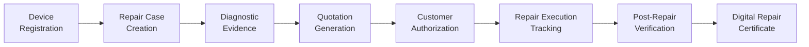
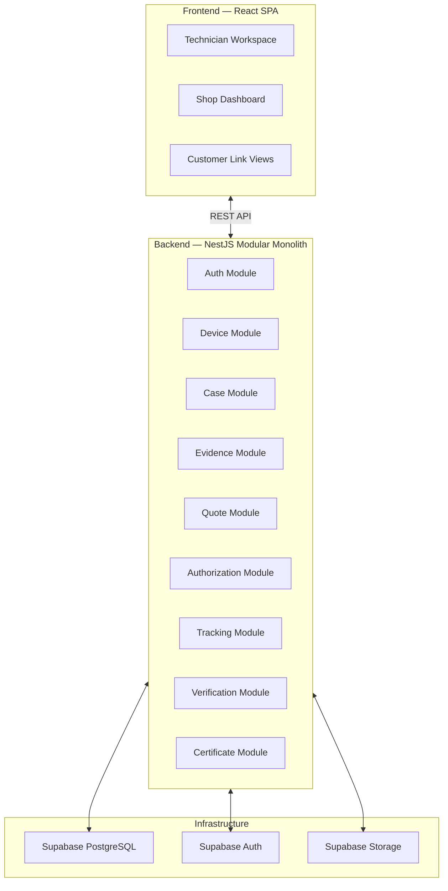
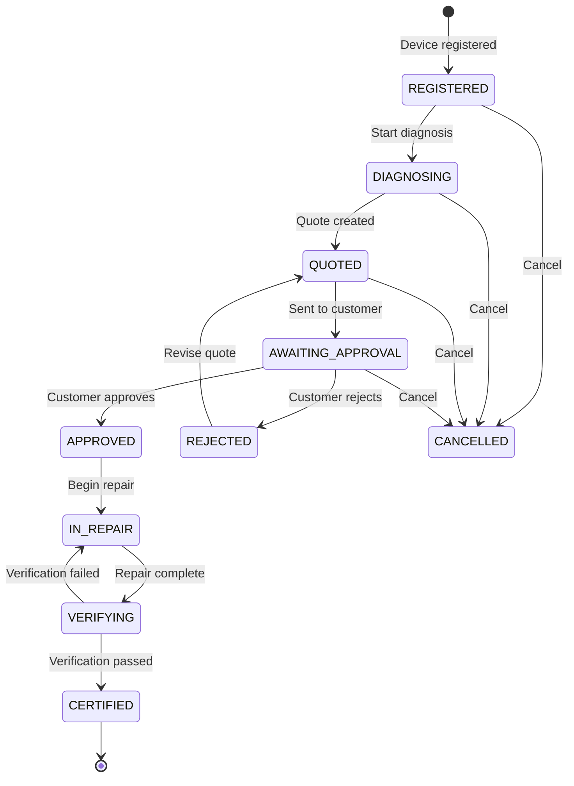
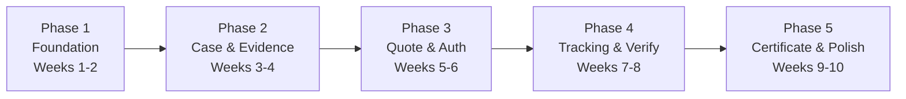

# RepairProof — MVP Development Plan

> **Status**: Draft for Review  
> **MVP Focus**: Technician-side repair proof chain  
> **Target**: Functional end-to-end flow for smartphones & laptops  

---

## 1. MVP Scope — The Proof Chain

The MVP implements the **core transaction lifecycle** that makes RepairProof valuable — a technician can register a device, document everything, and produce a verifiable repair certificate.



### What's IN the MVP
| Module | Key Capabilities |
|--------|-----------------|
| **Device Registration** | Register smartphones/laptops by make, model, serial/IMEI. Photo of device condition at intake. |
| **Repair Case Management** | Create, assign, and track repair cases through defined statuses. |
| **Diagnostic Evidence Engine** | Upload photos/videos of faults. Annotate evidence. Record diagnostic observations. |
| **Repair Quotation System** | Itemized parts + labor quotes. Version-tracked quotes. |
| **Customer Authorization** | Customer views quote, approves/rejects via unique link (no account required). |
| **Repair Execution Tracking** | Step-by-step repair log. Photo documentation of work performed. Parts used tracking. |
| **Post-Repair Verification** | Checklist-based verification. Before/after photo comparison. Functional test results. |
| **Digital Repair Certificate** | Generated PDF/web certificate. Unique verification code. QR code for public lookup. |
| **Auth & User Management** | Technician signup/login. Role-based access (technician, shop owner). |

### What's OUT of the MVP
- Consumer mobile app (consumers interact via shared links only)
- AI-powered diagnostics or image analysis
- Price intelligence / market comparisons
- Business analytics dashboards
- Multi-shop / franchise management
- Warranty lifecycle management (beyond basic warranty period on certificate)
- Payment processing
- Repair marketplace / public technician listings
- Device Repair Passport (cumulative history — post-MVP)

---

## 2. Architecture

### 2.1 Modular Monolith Structure



### 2.2 Technology Decisions

| Layer | Technology | Rationale |
|-------|-----------|-----------|
| **Frontend** | React 18 + TypeScript + Vite | Fast builds, strong typing, wide ecosystem |
| **UI Components** | Tailwind CSS + shadcn/ui | Consistent, accessible, customizable primitives |
| **Backend** | NestJS (Node.js) | Modular architecture built-in, decorators, guards, DI |
| **ORM** | Prisma | Type-safe queries, migrations, Supabase-compatible |
| **Database** | PostgreSQL 17 (via Supabase) | Free, 500 MB, 60 direct + 200 pooled connections |
| **Auth** | Supabase Auth | 50K MAUs free, email + OAuth, JWT-based |
| **File Storage** | Supabase Storage | 1 GB free, 50 MB/file, perfect for repair photos |
| **PDF Generation** | @react-pdf/renderer or Puppeteer | Repair certificates |
| **QR Codes** | qrcode (npm) | Certificate verification links |
| **Testing** | Vitest (unit), Playwright (e2e) | Per product spec |
| **Containerization** | Docker + Docker Compose | Local dev parity, future deployment |

### 2.3 Supabase Free Tier Budget

> [!IMPORTANT]
> These are hard limits on the free tier. The plan is designed to stay well within them for an MVP.

| Resource | Limit | MVP Usage Estimate | Headroom |
|----------|-------|--------------------|----------|
| DB Size | 500 MB | ~20-50 MB (early) | ✅ Plenty |
| File Storage | 1 GB | ~300 photos × 3 MB = ~900 MB | ⚠️ Tight — compress client-side |
| MAUs | 50,000 | <100 (MVP) | ✅ Plenty |
| Connections | 200 pooled | ~5-10 concurrent | ✅ Plenty |
| Egress | 5 GB/mo | <1 GB (MVP) | ✅ Fine |

> [!TIP]
> **Image strategy**: Compress all uploads client-side to ~500 KB max (using browser Canvas API) before sending to Supabase Storage. This extends the 1 GB limit to ~2,000 photos — enough for hundreds of repair cases.

---

## 3. Database Schema (Core Tables)

> [!NOTE]
> This is the Prisma schema design. Supabase Auth handles the `auth.users` table — we reference it via `userId` foreign keys. RLS is bypassed by Prisma; authorization is enforced in NestJS guards.

```
┌──────────────┐     ┌──────────────────┐     ┌───────────────────┐
│   Profile     │     │     Device       │     │   RepairCase      │
├──────────────┤     ├──────────────────┤     ├───────────────────┤
│ id (PK)      │     │ id (PK)          │     │ id (PK)           │
│ userId (FK)  │◄───┐│ registeredById   │     │ deviceId (FK)     │
│ role         │    ││ category         │     │ technicianId (FK) │
│ shopId (FK)  │    ││ make             │     │ shopId (FK)       │
│ displayName  │    ││ model            │     │ status            │
│ phone        │    ││ serialNumber     │     │ priority          │
│ createdAt    │    ││ imei             │     │ customerName      │
└──────┬───────┘    ││ intakePhotos[]   │     │ customerPhone     │
       │            ││ condition        │     │ customerEmail     │
       │            ││ createdAt        │     │ problemDescription│
       │            │└──────────────────┘     │ authorizationToken│
       │            │                         │ createdAt         │
┌──────▼───────┐    │                         │ closedAt          │
│    Shop      │    │                         └─────────┬─────────┘
├──────────────┤    │                                   │
│ id (PK)      │    │         ┌──────────────────────────┼──────────────────┐
│ name         │    │         │                          │                  │
│ address      │    │         ▼                          ▼                  ▼
│ phone        │    │  ┌──────────────┐    ┌──────────────────┐   ┌────────────────┐
│ ownerId (FK) │◄───┘  │  Evidence    │    │   Quotation      │   │  RepairStep    │
└──────────────┘       ├──────────────┤    ├──────────────────┤   ├────────────────┤
                       │ id (PK)      │    │ id (PK)          │   │ id (PK)        │
                       │ caseId (FK)  │    │ caseId (FK)      │   │ caseId (FK)    │
                       │ type         │    │ version          │   │ stepNumber     │
                       │ fileUrl      │    │ status           │   │ description    │
                       │ annotation   │    │ items[]          │   │ photos[]       │
                       │ category     │    │ laborCost        │   │ partsUsed[]    │
                       │ capturedAt   │    │ totalCost        │   │ status         │
                       │ capturedById │    │ validUntil       │   │ startedAt      │
                       └──────────────┘    │ customerResponse │   │ completedAt    │
                                           │ respondedAt      │   └────────────────┘
                                           └──────────────────┘
                                                                  ┌────────────────┐
                       ┌──────────────┐    ┌──────────────────┐   │ QuotationItem  │
                       │ Verification │    │  Certificate     │   ├────────────────┤
                       ├──────────────┤    ├──────────────────┤   │ id (PK)        │
                       │ id (PK)      │    │ id (PK)          │   │ quotationId    │
                       │ caseId (FK)  │    │ caseId (FK)      │   │ type           │
                       │ checklist[]  │    │ certificateNo    │   │ description    │
                       │ passed       │    │ qrCode           │   │ partName       │
                       │ verifiedById │    │ verificationUrl  │   │ partSource     │
                       │ notes        │    │ warrantyMonths   │   │ quantity       │
                       │ verifiedAt   │    │ issuedAt         │   │ unitPrice      │
                       └──────────────┘    │ pdfUrl           │   │ totalPrice     │
                                           └──────────────────┘   └────────────────┘
```

**Key design decisions:**
- **Soft-delete** everywhere (add `deletedAt` column) — repair records must never truly vanish
- **Audit trail**: `createdAt`, `updatedAt`, `createdById` on all tables
- **Customer has no account**: Identified by name + phone + email on the case. Authorization via unique token link.
- **Evidence is immutable**: Once captured, evidence records cannot be edited (only annotations can be added)
- **Quotation versioning**: Each revision creates a new `Quotation` row with incremented `version`

---

## 4. API Design (Core Endpoints)

### Auth
| Method | Endpoint | Description |
|--------|----------|-------------|
| POST | `/auth/signup` | Register technician/owner |
| POST | `/auth/login` | Login (wraps Supabase Auth) |
| POST | `/auth/refresh` | Refresh JWT |
| GET | `/auth/me` | Get current user profile |

### Devices
| Method | Endpoint | Description |
|--------|----------|-------------|
| POST | `/devices` | Register a device |
| GET | `/devices` | List devices (filtered by shop) |
| GET | `/devices/:id` | Get device details |
| PATCH | `/devices/:id` | Update device info |

### Repair Cases
| Method | Endpoint | Description |
|--------|----------|-------------|
| POST | `/cases` | Create repair case |
| GET | `/cases` | List cases (with filters: status, tech, date) |
| GET | `/cases/:id` | Full case details (with evidence, quotes, steps) |
| PATCH | `/cases/:id/status` | Transition case status |
| POST | `/cases/:id/assign` | Assign technician |

### Evidence
| Method | Endpoint | Description |
|--------|----------|-------------|
| POST | `/cases/:id/evidence` | Upload diagnostic evidence (multipart) |
| GET | `/cases/:id/evidence` | List evidence for a case |
| POST | `/cases/:id/evidence/:eid/annotate` | Add annotation |

### Quotations
| Method | Endpoint | Description |
|--------|----------|-------------|
| POST | `/cases/:id/quotations` | Create quotation |
| GET | `/cases/:id/quotations` | List quotation versions |
| GET | `/cases/:id/quotations/latest` | Get latest quotation |

### Customer Authorization (Public — no auth required)
| Method | Endpoint | Description |
|--------|----------|-------------|
| GET | `/authorize/:token` | View case summary + quotation |
| POST | `/authorize/:token/respond` | Approve or reject quote |

### Repair Steps
| Method | Endpoint | Description |
|--------|----------|-------------|
| POST | `/cases/:id/steps` | Add repair step |
| PATCH | `/cases/:id/steps/:sid` | Update step (photos, status) |
| GET | `/cases/:id/steps` | List all repair steps |

### Verification
| Method | Endpoint | Description |
|--------|----------|-------------|
| POST | `/cases/:id/verification` | Submit verification checklist |
| GET | `/cases/:id/verification` | Get verification result |

### Certificate
| Method | Endpoint | Description |
|--------|----------|-------------|
| POST | `/cases/:id/certificate` | Generate certificate |
| GET | `/certificates/:code` | Public certificate lookup (by verification code) |
| GET | `/certificates/:code/pdf` | Download certificate PDF |

---

## 5. Repair Case Status Machine



---

## 6. Project Structure (Monorepo)

```
repairproof/
├── apps/
│   ├── web/                          # React frontend (Vite)
│   │   ├── src/
│   │   │   ├── components/           # Shared UI components
│   │   │   │   ├── ui/               # shadcn/ui components
│   │   │   │   ├── layout/           # Shell, sidebar, header
│   │   │   │   └── common/           # Buttons, modals, file upload
│   │   │   ├── features/             # Feature-based modules
│   │   │   │   ├── auth/
│   │   │   │   ├── devices/
│   │   │   │   ├── cases/
│   │   │   │   ├── evidence/
│   │   │   │   ├── quotations/
│   │   │   │   ├── tracking/
│   │   │   │   ├── verification/
│   │   │   │   └── certificates/
│   │   │   ├── hooks/                # Custom React hooks
│   │   │   ├── lib/                  # API client, utils, constants
│   │   │   ├── pages/                # Route-level pages
│   │   │   │   ├── dashboard/
│   │   │   │   ├── cases/
│   │   │   │   ├── public/           # Customer auth + cert lookup
│   │   │   │   └── settings/
│   │   │   ├── stores/               # State management (Zustand)
│   │   │   ├── types/                # Shared TypeScript types
│   │   │   └── App.tsx
│   │   ├── index.html
│   │   ├── vite.config.ts
│   │   ├── tailwind.config.ts
│   │   └── package.json
│   │
│   └── api/                          # NestJS backend
│       ├── src/
│       │   ├── modules/
│       │   │   ├── auth/             # Auth guard, JWT verification
│       │   │   ├── device/           # Device CRUD
│       │   │   ├── case/             # Case management + status machine
│       │   │   ├── evidence/         # Evidence upload + storage
│       │   │   ├── quotation/        # Quote creation + versioning
│       │   │   ├── authorization/    # Customer auth links
│       │   │   ├── tracking/         # Repair step logging
│       │   │   ├── verification/     # Post-repair checklists
│       │   │   └── certificate/      # PDF generation + QR codes
│       │   ├── common/
│       │   │   ├── guards/           # AuthGuard, RoleGuard
│       │   │   ├── interceptors/     # Logging, transform
│       │   │   ├── filters/          # Exception filters
│       │   │   ├── decorators/       # @CurrentUser, @Roles
│       │   │   └── dto/              # Shared validation DTOs
│       │   ├── prisma/
│       │   │   ├── schema.prisma
│       │   │   └── migrations/
│       │   ├── config/               # Env config module
│       │   ├── app.module.ts
│       │   └── main.ts
│       ├── test/
│       └── package.json
│
├── packages/
│   └── shared/                       # Shared types, constants, enums
│       ├── src/
│       │   ├── types/
│       │   ├── constants/
│       │   └── enums/
│       └── package.json
│
├── docker/
│   ├── Dockerfile.api
│   ├── Dockerfile.web
│   └── docker-compose.yml
│
├── docs/                             # Product & technical docs
├── .env.example
├── package.json                      # Workspace root
├── pnpm-workspace.yaml
├── tsconfig.base.json
└── README.md
```

---

## 7. Development Phases

### Phase 1 — Foundation (Week 1-2)
> Project scaffold, auth, database, basic device registration

| Task | Details | Estimate |
|------|---------|----------|
| Project scaffold | Monorepo, NestJS, React, Prisma, Docker Compose | 1 day |
| Supabase setup | Project creation, env config, storage buckets | 0.5 days |
| Prisma schema | Core tables: Profile, Shop, Device | 1 day |
| Auth module | Supabase Auth integration, JWT guard, role guard | 2 days |
| Device registration | CRUD API + frontend form with photo upload | 2 days |
| App shell | Layout, sidebar, routing, theme | 1.5 days |
| **Phase 1 Deliverable** | Technician can sign up, log in, register devices with photos | |

### Phase 2 — Case & Evidence (Week 3-4)
> Repair case lifecycle and diagnostic evidence capture

| Task | Details | Estimate |
|------|---------|----------|
| Case module | CRUD + status machine + assignment | 2 days |
| Case list UI | Filterable, sortable case dashboard | 1.5 days |
| Case detail page | Tabbed view: info, evidence, quote, steps, verification | 2 days |
| Evidence module | Multi-file upload, annotation, categorization | 2 days |
| Evidence viewer | Photo gallery with zoom, annotations overlay | 1.5 days |
| Image compression | Client-side compression (Canvas API, ~500 KB target) | 0.5 days |
| **Phase 2 Deliverable** | Full case creation → diagnostic evidence workflow | |

### Phase 3 — Quotation & Authorization (Week 5-6)
> Quote builder and customer-facing authorization flow

| Task | Details | Estimate |
|------|---------|----------|
| Quotation module | Itemized line items, labor costs, totals, versioning | 2 days |
| Quote builder UI | Dynamic form with part/labor rows, live total | 1.5 days |
| Authorization module | Token generation, public endpoint, response tracking | 1.5 days |
| Customer view | Public page: case summary, evidence, quote, approve/reject | 2 days |
| Email/SMS notification | Quote link delivery (Supabase Auth email or custom SMTP) | 1 day |
| Quote PDF | Downloadable quotation document | 1 day |
| **Phase 3 Deliverable** | Complete quote → customer approval flow | |

### Phase 4 — Repair Tracking & Verification (Week 7-8)
> Step-by-step repair logging and post-repair verification

| Task | Details | Estimate |
|------|---------|----------|
| Repair steps module | Sequential step CRUD with photos + parts | 2 days |
| Repair timeline UI | Visual timeline of repair progress with photos | 1.5 days |
| Parts tracking | Log parts used per step (name, source, OEM/aftermarket) | 1 day |
| Verification module | Configurable checklist per device category | 1.5 days |
| Verification UI | Checklist form with pass/fail + notes per item | 1 day |
| Before/after comparison | Side-by-side evidence viewer | 1 day |
| **Phase 4 Deliverable** | Full repair execution → verification workflow | |

### Phase 5 — Certificate & Polish (Week 9-10)
> Digital certificate, public lookup, and overall polish

| Task | Details | Estimate |
|------|---------|----------|
| Certificate module | Generate unique cert number, QR code | 1.5 days |
| Certificate PDF | Professional PDF with case summary, evidence, warranty | 2 days |
| Public lookup page | Verify certificate by code or QR scan | 1 day |
| Shop settings | Shop profile, branding (logo on certificates) | 1 day |
| Error handling | Global error states, loading skeletons, empty states | 1 day |
| Responsive design | Mobile-friendly technician workspace | 1.5 days |
| Testing | Unit tests for critical paths, e2e for main flow | 2 days |
| **Phase 5 Deliverable** | Complete MVP — end-to-end proof chain functional | |

### Timeline Summary



> [!NOTE]
> Estimates assume a single developer working part-time (~4-5 hours/day). Adjust if you have different capacity. Each phase ends with a usable deliverable — you can demo at the end of any phase.

---

## 8. Supabase Configuration

### Storage Buckets
| Bucket | Purpose | Access |
|--------|---------|--------|
| `device-photos` | Intake condition photos | Authenticated (technician) |
| `evidence` | Diagnostic evidence files | Authenticated (technician) |
| `repair-steps` | Repair progress photos | Authenticated (technician) |
| `certificates` | Generated certificate PDFs | Public (via signed URL) |
| `shop-assets` | Shop logos, branding | Authenticated (shop owner) |

### Image Compression Strategy
```
Original photo (5-8 MB)
  → Client-side resize (max 1920px wide)
  → Canvas.toBlob(quality: 0.7)
  → Target: ~300-500 KB per image
  → 1 GB storage ≈ 2,000-3,000 images
  → Enough for ~200-500 repair cases
```

### Auth Configuration
- **Email + password** for technicians and shop owners
- **Custom SMTP** to remove the 2 emails/hour limit (use free SendGrid/Resend tier)
- **No customer accounts** — customers access via unique authorization tokens

---

## 9. Key Technical Decisions

| Decision | Choice | Why |
|----------|--------|-----|
| State management | Zustand | Lightweight, TypeScript-first, no boilerplate |
| Form handling | React Hook Form + Zod | Performant forms with schema validation |
| Routing | React Router v6 | Standard, file-based routing possible |
| API client | Axios + react-query (TanStack Query) | Caching, optimistic updates, loading states |
| Date handling | date-fns | Tree-shakeable, immutable |
| PDF generation | @react-pdf/renderer | React-based PDF, runs in Node.js |
| Monorepo tool | pnpm workspaces | Simple, fast, no extra tooling |
| Linting | ESLint + Prettier | Standard, configured once |

---

## 10. Security Considerations (MVP)

> [!WARNING]
> Even for an MVP, repair records contain customer PII. These are non-negotiable.

- **All API routes behind JWT guard** (except public certificate lookup and customer authorization)
- **Role-based access**: Technicians see only their shop's data
- **Customer authorization tokens**: Cryptographically random, expire after 7 days
- **Evidence immutability**: No DELETE endpoint for evidence (soft-delete only by admin)
- **Image URLs**: Signed URLs with expiration (not public bucket URLs)
- **Input validation**: Zod schemas on frontend, class-validator DTOs on backend
- **CORS**: Restricted to frontend domain
- **Rate limiting**: NestJS throttler on auth endpoints
- **Environment secrets**: Never committed; `.env.example` documents required vars

---

## 11. Post-MVP Roadmap (Not Built Now)

After the MVP proves the core value, these modules follow in priority order:

1. **Consumer App** — Customers create accounts, view repair history, manage devices
2. **Device Repair Passport** — Cumulative repair history tied to device identity
3. **Warranty Management** — Warranty claims, expiry tracking, dispute workflow
4. **Shop Dashboard** — Multi-technician views, workload distribution, KPIs
5. **Repair Intelligence** — Common failure patterns, repair duration benchmarks
6. **Price Intelligence** — Fair pricing guidance based on anonymized data
7. **Business Analytics** — Revenue, turnaround time, customer satisfaction
8. **AI Services** — Image-based damage assessment, component identification (Python/FastAPI)
9. **Platform Administration** — Multi-tenant management, compliance tools

---

## 12. Success Criteria

The MVP is **done** when a technician can:

- [ ] Sign up and create a shop profile
- [ ] Register a customer's device with intake photos
- [ ] Create a repair case with problem description
- [ ] Upload diagnostic evidence (photos with annotations)
- [ ] Build an itemized quotation
- [ ] Send the quote to a customer via link
- [ ] Customer can view and approve/reject the quote (no login needed)
- [ ] Log repair steps with photos and parts used
- [ ] Complete a post-repair verification checklist
- [ ] Generate a digital repair certificate with QR code
- [ ] Anyone can verify the certificate via public lookup page
