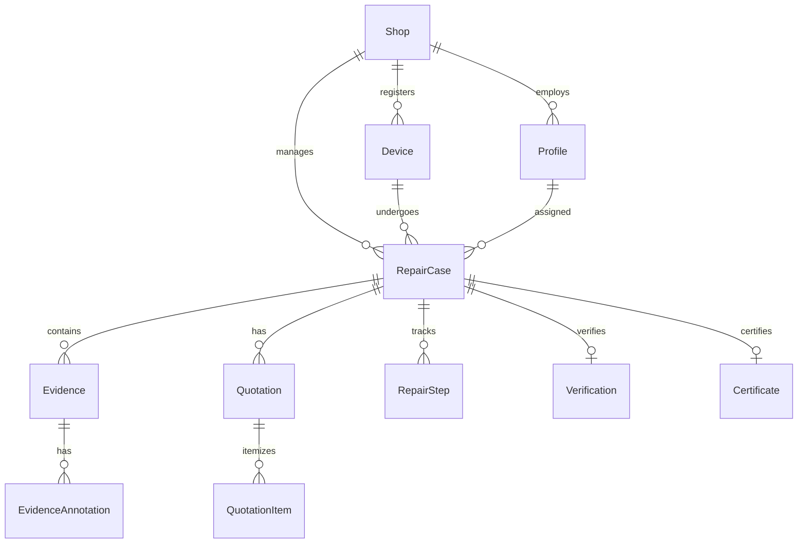
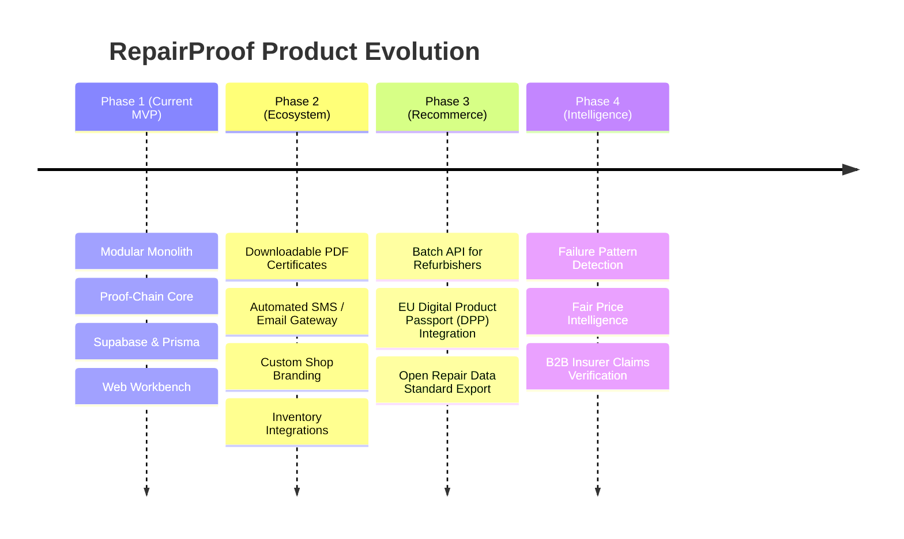

# REPAIRPROOF — PRODUCT REQUIREMENTS DOCUMENT (PRD)
## Version 1.0 • Engineering & Product Specification • Modular Monolith Architecture

---

## Document Control
* **Document Title**: RepairProof Master Product Requirements Document
* **Document Version**: 1.0.0
* **Author**: Principal Product Management & Architecture Team
* **Product Category**: Repair Verification and Intelligence Infrastructure
* **Target Platforms**: Web (Responsive Desktop & Mobile), Containerized Services
* **Status**: Approved for Engineering Implementation

---

## 1. Product Overview

**RepairProof** is an evidence-driven repair verification and intelligence platform designed to make electronics repair transactions transparent, measurable, documented, and accountable. 

Unlike traditional repair shop point-of-sale (POS) software, CRMs, or inventory databases, RepairProof serves as an **independent proof of record**. It captures the complete lifecycle of a physical repair—from intake cosmetic condition baselines and microscopic diagnostic fault evidence to itemized replacement component provenance, step-by-step technical logs, post-repair subsystem quality sweeps, and tamper-resistant digital certificates.

---

## 2. Vision and Mission

* **Vision**: Build a globally accessible, evidence-driven repair ecosystem that restores consumer and market confidence in electronics repairs, preserves the secondary market value of hardware, and accelerates the circular economy.
* **Mission**: Equip independent technicians and repair businesses with standardized tools to prove their craft and component quality, while providing consumers and downstream buyers with unalterable, transparent repair records.

---

## 3. Problem Statement

1. **Information Asymmetry**: Consumers cannot verify whether a diagnosis is authentic or fabricated to inflate service margins.
2. **Component Provenance Obscurity**: Consumers and secondary buyers have no verifiable way to confirm whether replacement parts are genuine OEM, refurbished OEM, high-grade aftermarket, or dangerous counterfeit clones.
3. **Technician Liability & Blame-Shifting**: Technicians frequently face accusations, chargebacks, and negative reviews over pre-existing defects or secondary subsystem failures that were present prior to intake.
4. **Siloed Repair Data**: Maintenance records are trapped in proprietary shop databases or lost on paper receipts, rendering repairs invisible during device resale and trade-in.
5. **Anti-Repair Barriers**: Opaque diagnostic practices hand manufacturers justification for parts pairing and hardware serialization under the guise of consumer safety.

---

## 4. Target Audience

1. **Consumers (Device Owners)**: Owners of smartphones and laptops requiring repairs.
2. **Independent Repair Technicians**: Bench technicians, microsoldering specialists, and hardware engineers.
3. **Repair Shop Owners & Managers**: Independent storefronts, mobile tech services, and repair franchises.
4. **Electronics Refurbishers & Recommerce Merchants**: Businesses refurbishing and reselling used devices on Back Market, eBay, or direct B2C channels.
5. **Secondary Device Buyers & Insurers**: Individuals or institutions verifying device health and repair history prior to purchase or policy underwriting.

---

## 5. User Personas

| Persona | Role | Key Goal | Core Friction |
|---|---|---|---|
| **P-1: Alex (Consumer)** | Smartphone Owner | Fast, honest screen & battery repair with personal data safety. | Fears component bait-and-switch and unexpected fee inflation. |
| **P-2: Sarah (Pro Consumer)** | Laptop Knowledge Worker | Keep mission-critical MacBook/PC functioning without data loss. | Opaque component sourcing and slow diagnostic turnaround. |
| **P-3: Marcus (Technician)** | Lead Bench Technician | Accurately diagnose faults, microsolder, and prove quality. | Blamed for pre-existing scratches or unrecorded prior liquid damage. |
| **P-4: David (Shop Owner)** | Multi-Store Operator | Maximize quote conversion rates and eliminate customer disputes. | High quote rejection rates and disparate tools (POS, WhatsApp, paper). |
| **P-5: Elena (Refurbisher)** | Bulk Recommerce Ops | Certify functional health of batches to lower return rates. | Inconsistent grading and marketplace return penalties. |

---

## 6. Functional Requirements (FR)

All functional requirements are categorized and assigned unique identifiers:

```
FR-[MODULE]-[NUMBER]
```

### 6.1 Device Intake & Registration (`FR-DEV`)

| ID | Title | MoSCoW | Description |
|---|---|:---:|---|
| **FR-DEV-001** | Device Category Selection | **MUST** | System shall support `SMARTPHONE` and `LAPTOP` device categories in the initial release. |
| **FR-DEV-002** | Hardware Identification | **MUST** | System shall record Make, Model, Serial Number, IMEI, Color, and Storage Capacity. |
| **FR-DEV-003** | Cosmetic Intake Baseline | **MUST** | System shall require a detailed text description of pre-existing cosmetic damage (scratches, dents, cracks, missing screws). |
| **FR-DEV-004** | Client-Side Image Compression | **MUST** | System shall compress all uploaded intake photos in the browser (max 1280px dimension, JPEG quality 0.70, target $\le$500KB) before transmission to conserve storage. |
| **FR-DEV-005** | Multi-Angle Intake Photos | **MUST** | System shall support uploading up to 6 intake condition photos showing front, back, corners, and port condition. |
| **FR-DEV-006** | Device Search & Indexing | **SHOULD** | System shall allow searching registered devices by serial number, IMEI, make, or model. |

### 6.2 Repair Case Management & State Machine (`FR-CASE`)

| ID | Title | MoSCoW | Description |
|---|---|:---:|---|
| **FR-CASE-001** | Unique Case Numbering | **MUST** | System shall generate a collision-free sequential case identifier formatted as `RP-YYYYMMDD-XXXX`. |
| **FR-CASE-002** | Customer Contact Binding | **MUST** | System shall associate customer Name, Phone, and optional Email to the repair case. |
| **FR-CASE-003** | Problem Description | **MUST** | System shall record customer-reported symptoms, faults, and accidental drop/liquid history. |
| **FR-CASE-004** | Strict State Machine | **MUST** | System shall enforce allowed status transitions: `REGISTERED` $\rightarrow$ `DIAGNOSING` $\rightarrow$ `QUOTED` $\rightarrow$ `AWAITING_APPROVAL` $\rightarrow$ `APPROVED` $\rightarrow$ `IN_REPAIR` $\rightarrow$ `VERIFYING` $\rightarrow$ `CERTIFIED`. |
| **FR-CASE-005** | Transition Rejection Validation | **MUST** | System shall throw a `400 Bad Request` with an explanatory message if an illegal state transition is attempted. |
| **FR-CASE-006** | Cryptographic Auth Token | **MUST** | System shall generate a cryptographically random authorization token (minimum 48 hex characters) valid for 14 days upon case creation. |
| **FR-CASE-007** | Priority Tagging | **SHOULD** | System shall support priority tiers: `LOW`, `NORMAL`, `HIGH`, `URGENT`. |
| **FR-CASE-008** | Technician Assignment | **SHOULD** | System shall allow shop owners to assign or reassign cases to specific technicians. |

### 6.3 Diagnostic Evidence Engine (`FR-EVI`)

| ID | Title | MoSCoW | Description |
|---|---|:---:|---|
| **FR-EVI-001** | Evidence Categorization | **MUST** | System shall categorize uploaded evidence into: `INTAKE`, `DIAGNOSTIC`, `DURING_REPAIR`, and `POST_REPAIR`. |
| **FR-EVI-002** | Coordinate Pinpoint Annotation | **MUST** | System shall allow technicians to click anywhere on an evidence photo to attach an $(x, y)$ percentage coordinate pin with a defect note. |
| **FR-EVI-003** | Evidence Immutability | **MUST** | Once submitted, evidence records cannot be modified or replaced. Deletion is restricted to soft-deletion by administrative roles. |
| **FR-EVI-004** | Metadata Stamping | **MUST** | System shall record capture timestamp, author profile ID, mime type, file size, and descriptive notes for all evidence assets. |
| **FR-EVI-005** | Multi-Pin Overlay Display | **MUST** | System shall render interactive pin overlays on evidence photos in the technician workbench and customer view. |

### 6.4 Quotation & Pricing Engine (`FR-QUO`)

| ID | Title | MoSCoW | Description |
|---|---|:---:|---|
| **FR-QUO-001** | Itemized Line Items | **MUST** | System shall support itemized quotation rows categorized as `PART` or `LABOR`. |
| **FR-QUO-002** | Component Provenance Tiers | **MUST** | System shall require every replacement part line item to disclose its provenance grade: `OEM`, `AFTERMARKET`, `REFURBISHED`, or `CUSTOMER_PROVIDED`. |
| **FR-QUO-003** | Automated Subtotal & Tax Calculation | **MUST** | System shall calculate Parts Cost, Labor Cost, Tax Amount, and Total Cost with two-decimal precision. |
| **FR-QUO-004** | Quotation Versioning | **MUST** | When an estimate is revised, the system shall archive previous versions and increment the version counter ($v1 \rightarrow v2$), marking previous active quotes as `SUPERSEDED`. |
| **FR-QUO-005** | Validity Window | **MUST** | System shall enforce an expiration window (default: 7 days) on quotations. |

### 6.5 Customer Authorization Portal (`FR-AUTH`)

| ID | Title | MoSCoW | Description |
|---|---|:---:|---|
| **FR-AUTH-001** | Public Token-Authenticated Route | **MUST** | System shall provide a public web endpoint (`/authorize/:token`) accessible without login. |
| **FR-AUTH-002** | Transparent Case Presentation | **MUST** | The authorization page shall display device specs, intake condition, diagnostic photos with pin notes, and the itemized quotation. |
| **FR-AUTH-003** | Electronic Signature Sign-off | **MUST** | Customer must input their typed legal name to execute an `Approve` or `Decline` action. |
| **FR-AUTH-004** | Atomic State Transition | **MUST** | Customer approval shall atomically transition quotation status to `APPROVED` and case status to `APPROVED` in a single database transaction. |
| **FR-AUTH-005** | Customer Notes Capture | **SHOULD** | Customer shall have the option to include special instructions or notes during sign-off. |

### 6.6 Repair Execution Tracking (`FR-TRK`)

| ID | Title | MoSCoW | Description |
|---|---|:---:|---|
| **FR-TRK-001** | Sequential Step Logging | **MUST** | System shall track sequential repair steps with auto-incrementing step numbers per case. |
| **FR-TRK-002** | Technical Procedure Notes | **MUST** | System shall record detailed step descriptions (e.g., solder temperatures, hot air rework curves, adhesive curing times). |
| **FR-TRK-003** | Execution Photo Proof | **MUST** | Technicians shall be able to attach photographic proof to individual execution steps. |
| **FR-TRK-004** | Step Completion Status | **MUST** | System shall track step status (`PENDING`, `IN_PROGRESS`, `COMPLETED`, `SKIPPED`) with completion timestamps. |
| **FR-TRK-005** | Installed Parts Tracking | **SHOULD** | System shall record part numbers and serials utilized during specific repair steps. |

### 6.7 Post-Repair Verification & QC (`FR-VER`)

| ID | Title | MoSCoW | Description |
|---|---|:---:|---|
| **FR-VER-001** | Category-Specific QC Checklist | **MUST** | System shall provide a tailored hardware inspection checklist: 11 tests for Smartphones (Display, Touch, Loudspeaker, Earpiece, Microphones, Front Camera, Rear Camera, Port/Fast Charge, Battery Health, Cellular/Wi-Fi, Biometrics) and 10 tests for Laptops. |
| **FR-VER-002** | Binary Pass/Fail Auditing | **MUST** | Every checklist item must be verified as passed or failed with optional notes. |
| **FR-VER-003** | Verification Gate | **MUST** | System shall prevent issuing a Digital Certificate if the overall verification has not been marked as `PASSED`. |
| **FR-VER-004** | Inspector Attribution | **MUST** | System shall record the technician profile ID who completed and signed off on the QC sweep. |

### 6.8 Digital Repair Certificate & Passport (`FR-CERT`)

| ID | Title | MoSCoW | Description |
|---|---|:---:|---|
| **FR-CERT-001** | Unique Certificate Number | **MUST** | System shall issue a unique certificate code formatted as `CERT-RP-YYYYMMDD-XXXXXX`. |
| **FR-CERT-002** | Dynamic High-Density QR Code | **MUST** | System shall generate a clean, scannable QR code data URL encoding the certificate verification URL. |
| **FR-CERT-003** | Public Verification Registry | **MUST** | System shall provide a public, unauthenticated lookup endpoint (`/verify/:certificateNumber`) displaying the verified repair passport. |
| **FR-CERT-004** | Warranty Terms Binding | **MUST** | Certificate shall bind warranty duration (in months) and explicit warranty coverage terms. |
| **FR-CERT-005** | Case Closure Finalization | **MUST** | Issuing a certificate shall automatically transition the case to `CERTIFIED` and set `closedAt` timestamp. |
| **FR-CERT-006** | Certificate PDF Generation | **SHOULD** | System shall generate a downloadable, printable PDF certificate for counter handover. |

---

## 7. Non-Functional Requirements (NFR)

```
NFR-[CATEGORY]-[NUMBER]
```

### 7.1 Performance (`NFR-PERF`)
* **NFR-PERF-001**: API response times for read operations shall be $\le 200\text{ ms}$ under normal load (p95).
* **NFR-PERF-002**: Client-side image compression must execute in $\le 1.5\text{ seconds}$ per photo on modern mobile devices.
* **NFR-PERF-003**: Public authorization and certificate lookup pages shall achieve a Google Lighthouse Performance Score $\ge 90$.

### 7.2 Security & Data Privacy (`NFR-SEC`)
* **NFR-SEC-001**: All private API endpoints shall require a valid Bearer JWT signed by Supabase Auth.
* **NFR-SEC-002**: Customer authorization tokens must use cryptographically secure pseudo-random generators (`crypto.randomBytes(24)`).
* **NFR-SEC-003**: Customer PII (phone, email) shall never be exposed on public `/verify/:certificateNumber` routes. The public certificate passport shall only show device specs, fitted component grades, and warranty status.
* **NFR-SEC-004**: Database connections must enforce SSL/TLS encryption in transit.

### 7.3 Availability & Reliability (`NFR-AVAIL`)
* **NFR-AVAIL-001**: System shall maintain 99.5% uptime during standard commercial operating hours.
* **NFR-AVAIL-002**: All state transitions and quotation updates shall be wrapped in ACID database transactions (`prisma.$transaction`).
* **NFR-AVAIL-003**: Soft-delete pattern shall be enforced across all primary entities (`deletedAt` timestamp).

### 7.4 Accessibility (`NFR-A11Y`)
* **NFR-A11Y-001**: All user-facing views must comply with **WCAG 2.1 Level AA** standards.
* **NFR-A11Y-002**: All form inputs must have associated `<label>` elements and visible focus indicators.
* **NFR-A11Y-003**: Contrast ratio for normal body text against background must be at least 4.5:1.

---

## 8. User Stories

```
US-[NUMBER]: As a [Role], I want [Feature], so that [Benefit].
```

* **US-001**: As a technician, I want to take and compress intake photos directly in my mobile browser, so that I establish an indisputable cosmetic baseline without filling up cloud storage limits.
* **US-002**: As a technician, I want to click on a microscopic photo of a logic board to drop a pinpoint note on a burnt component, so that I can explain the physical defect to the customer clearly.
* **US-003**: As a shop owner, I want to send an itemized quotation link via SMS/email, so that the customer can review and authorize the repair without creating an account or installing an app.
* **US-004**: As a consumer, I want to see exactly what grade of parts (OEM vs Aftermarket) are being installed, so that I can make an informed cost vs. quality decision.
* **US-005**: As a technician, I want a structured post-repair checklist before closing a case, so that I verify that all critical sensors, cameras, and ports function before pickup.
* **US-006**: As a consumer, I want a verifiable digital certificate with a QR code, so that I can prove the quality of the repair and retain warranty protection.
* **US-007**: As a secondary device buyer, I want to scan a QR code on a refurbished phone, so that I can verify its authentic repair history and battery health.

---

## 9. Acceptance Criteria (Given / When / Then)

### AC-001: Case Creation & Auth Token Generation
```gherkin
Given a technician is logged in and selects a registered device
When the technician submits the new repair case form with valid customer details
Then the system creates the case with status "REGISTERED"
And generates a unique caseNumber starting with "RP-"
And generates a cryptographically random authorizationToken valid for 14 days
```

### AC-002: Invalid State Transition Rejection
```gherkin
Given a repair case is currently in status "REGISTERED"
When an API request attempts to patch the status directly to "CERTIFIED"
Then the system rejects the request with HTTP status 400 Bad Request
And returns an error message listing the permitted next statuses ["DIAGNOSING", "CANCELLED"]
And the case status remains unchanged as "REGISTERED"
```

### AC-003: Coordinate Pinpoint Annotation
```gherkin
Given an evidence photo has been uploaded for a repair case
When a technician clicks on the photo at coordinates (x: 45%, y: 62%)
And enters the annotation note "Solder bridge on capacitor C401"
Then the system records the pin with author attribution and timestamp
And the pin is rendered at the exact coordinate overlay on subsequent views
```

### AC-004: Customer Quotation Authorization
```gherkin
Given a customer accesses the public route "/authorize/:token" with an active quote
When the customer types their signature name and clicks "Authorize & Begin Repair"
Then the quotation status transitions atomically to "APPROVED"
And the repair case status transitions to "APPROVED"
And the customer response note and timestamp are sealed in the record
```

### AC-005: Quality Verification Gate for Certificate Issuance
```gherkin
Given a repair case in progress where post-repair verification has NOT passed
When a technician attempts to issue a digital certificate
Then the system rejects the request with HTTP status 400 Bad Request
And notifies the technician that all post-repair checklist items must pass first
```

### AC-006: Public Certificate Verification Privacy
```gherkin
Given a valid certificate number "CERT-RP-20261118-123456"
When an unauthenticated public user navigates to "/verify/CERT-RP-20261118-123456"
Then the system renders the certificate status, device make/model, warranty duration, and fitted parts
And hides customer name, phone number, and email address completely
```

---

## 10. Feature Prioritization (MoSCoW Matrix)

```mermaid
quadrantChart
    title MoSCoW Feature Allocation for RepairProof
    x-axis Low Technical Complexity --> High Technical Complexity
    y-axis Non-Essential / Secondary --> Mission-Critical Verification
    quadrant-1 MUST HAVE (Core MVP Scope)
    quadrant-2 SHOULD HAVE (Phase 2 Fast-Follow)
    quadrant-3 COULD HAVE (Post-MVP Enhancements)
    quadrant-4 WON'T HAVE (Strictly Out of Scope)
    "Device Intake & Baseline": [0.30, 0.88]
    "Case State Machine": [0.25, 0.95]
    "Diagnostic Pin Annotations": [0.45, 0.92]
    "Itemized Part Tiers Quote": [0.40, 0.85]
    "Public Customer Auth Link": [0.35, 0.90]
    "Post-Repair QC Sweep": [0.30, 0.82]
    "Digital Certificate & QR": [0.42, 0.96]
    "PDF Export Engine": [0.55, 0.70]
    "SMS Gateway Integration": [0.60, 0.65]
    "Custom Shop Branding": [0.50, 0.60]
    "Full POS Cash Drawer": [0.75, 0.20]
    "AI Automated Diagnosis": [0.85, 0.15]
```

### Must Have (MVP)
* Device intake for smartphones and laptops with cosmetic condition notes.
* Client-side image compression for all photo uploads.
* 10-state case state machine with transition enforcement.
* Diagnostic evidence capture with coordinate pinpoint annotation.
* Transparent itemized quotation system (OEM, Aftermarket, Refurbished, Labor).
* Public token-authenticated customer authorization portal (`/authorize/:token`).
* Step-by-step repair execution log.
* Post-repair subsystem verification checklist.
* Tamper-evident digital repair certificate with QR code generator.
* Public certificate lookup registry (`/verify/:certificateNumber`).

### Should Have (Phase 2)
* Downloadable PDF certificate generator.
* Custom SMTP/SMS gateway integration for instant authorization link delivery.
* Shop branding (custom logo and address on certificates and customer views).
* Filterable search and CSV export for repair logs.

### Could Have (Phase 3)
* Integration with Open Repair Data Standard (ORDS) taxonomy.
* API webhooks for external POS systems (RepairDesk, Square).
* Multi-technician workload assignment and shop performance metrics.

### Won't Have (Explicitly Excluded from Core MVP)
* Retail point-of-sale cash register, barcode printers, or cash drawer drivers.
* Payment gateway processing (Stripe / Square checkout fees).
* Autonomous AI diagnostic decision-making.
* Consumer mobile apps requiring app-store downloads.
* Marketplace technician ratings or pay-to-win shop rankings.

---

## 11. Business Rules

1. **Rule BR-001 (Immutability of Sealed Certificates)**: Once a Digital Repair Certificate is issued, neither the certificate nor its associated repair steps, fitted parts, or verification checklist can be altered.
2. **Rule BR-002 (Single Active Quotation)**: A repair case may have only one active quotation in status `DRAFT`, `SENT`, or `APPROVED` at any given time. Creating a revised quote automatically marks previous unapproved versions as `SUPERSEDED`.
3. **Rule BR-003 (Token Expiration)**: Customer authorization tokens expire exactly 14 calendar days from generation. After expiration, the public portal displays an expired notice and prompts the customer to contact the shop for a refreshed quote.
4. **Rule BR-004 (Soft-Deletion Protocol)**: Records in `Device`, `RepairCase`, `Evidence`, `Quotation`, and `RepairStep` must never be physically deleted from the database. Deletion sets `deletedAt = NOW()`.
5. **Rule BR-005 (Privacy by Default)**: Public endpoints (`/authorize/:token` and `/certificates/:certificateNumber`) must never return internal shop financial notes, technician payroll calculations, or customer street addresses.

---

## 12. User Permissions & RBAC Matrix

| System Action | Unauthenticated Customer | Authenticated Technician | Authenticated Shop Owner | Platform Administrator |
|---|:---:|:---:|:---:|:---:|
| **View Public Certificate (`/verify`)** | ✅ Allowed | ✅ Allowed | ✅ Allowed | ✅ Allowed |
| **View Authorization Link (`/authorize`)** | ✅ Allowed (With Token) | ✅ Allowed | ✅ Allowed | ✅ Allowed |
| **Approve / Decline Quote** | ✅ Allowed (With Token) | ❌ Denied | ❌ Denied | ❌ Denied |
| **Register New Device** | ❌ Denied | ✅ Allowed | ✅ Allowed | ✅ Allowed |
| **Create Repair Case** | ❌ Denied | ✅ Allowed | ✅ Allowed | ✅ Allowed |
| **Upload Evidence & Pin Notes** | ❌ Denied | ✅ Allowed | ✅ Allowed | ✅ Allowed |
| **Build Quotation** | ❌ Denied | ✅ Allowed | ✅ Allowed | ✅ Allowed |
| **Log Repair Steps** | ❌ Denied | ✅ Allowed | ✅ Allowed | ✅ Allowed |
| **Submit QC Verification** | ❌ Denied | ✅ Allowed | ✅ Allowed | ✅ Allowed |
| **Issue Digital Certificate** | ❌ Denied | ✅ Allowed | ✅ Allowed | ✅ Allowed |
| **Modify Shop Profile & Branding** | ❌ Denied | ❌ Denied | ✅ Allowed | ✅ Allowed |
| **Soft-Delete Records** | ❌ Denied | ❌ Denied | ✅ Allowed | ✅ Allowed |

---

## 13. Data Requirements & Schema Dictionary



### Core Entities & Field Constraints

1. **Profile**: `id` (UUID), `userId` (Supabase Auth ID), `role` (`TECHNICIAN`, `SHOP_OWNER`), `displayName`, `email`, `phone`, `shopId`.
2. **Shop**: `id` (UUID), `name` (String, max 100), `address`, `phone`, `email`, `logoUrl`, `ownerId`.
3. **Device**: `id` (UUID), `category` (`SMARTPHONE`, `LAPTOP`), `make`, `model`, `serialNumber` (indexed), `imei` (indexed), `color`, `storageCapacity`, `intakePhotos` (Array of URLs), `intakeCondition` (Text).
4. **RepairCase**: `id` (UUID), `caseNumber` (Unique, indexed), `deviceId` (FK), `shopId` (FK), `technicianId` (FK), `status` (Enum), `priority` (Enum), `customerName`, `customerPhone`, `customerEmail`, `problemDescription`, `authorizationToken` (Unique), `authorizationExpiresAt` (DateTime).
5. **Evidence**: `id` (UUID), `caseId` (FK), `capturedById` (FK), `type` (`PHOTO`, `VIDEO`), `category` (`INTAKE`, `DIAGNOSTIC`, `DURING_REPAIR`, `POST_REPAIR`), `fileUrl`, `fileName`, `fileSize`, `mimeType`, `description`, `capturedAt`.
6. **EvidenceAnnotation**: `id` (UUID), `evidenceId` (FK), `x` (Float, 0.0–100.0), `y` (Float, 0.0–100.0), `note` (Text), `authorName`.
7. **Quotation**: `id` (UUID), `caseId` (FK), `version` (Int), `status` (`DRAFT`, `SENT`, `APPROVED`, `REJECTED`, `SUPERSEDED`), `laborCost` (Decimal), `partsCost` (Decimal), `taxAmount` (Decimal), `totalCost` (Decimal), `validUntil` (DateTime).
8. **QuotationItem**: `id` (UUID), `quotationId` (FK), `type` (`PART`, `LABOR`), `description`, `partName`, `partSource` (`OEM`, `AFTERMARKET`, `REFURBISHED`, `CUSTOMER_PROVIDED`), `quantity`, `unitPrice`, `totalPrice`.
9. **RepairStep**: `id` (UUID), `caseId` (FK), `stepNumber` (Int), `title`, `description`, `status` (`PENDING`, `IN_PROGRESS`, `COMPLETED`, `SKIPPED`), `photos` (Array), `partsUsed` (JSON).
10. **Verification**: `id` (UUID), `caseId` (FK, Unique), `verifiedById` (FK), `passed` (Boolean), `checklist` (JSON), `notes`, `verifiedAt`.
11. **Certificate**: `id` (UUID), `caseId` (FK, Unique), `certificateNumber` (Unique, indexed), `qrCodeUrl`, `verificationUrl`, `warrantyPeriodMonths` (Int), `warrantyTerms`, `issuedAt`, `issuedById`.

---

## 14. Error Scenarios & Edge Cases

| Error Code | Trigger Condition | System Behavior | User Remediation |
|---|---|---|---|
| `ERR-CASE-4001` | Attempted invalid state transition. | HTTP 400 with invalid transition error message. | Transition case through sequential state pipeline. |
| `ERR-AUTH-4004` | Expired customer authorization token. | HTTP 400 "This authorization link has expired". | Customer is prompted to contact workshop to re-issue estimate. |
| `ERR-CERT-4002` | Issuing certificate before verification passes. | HTTP 400 "Cannot issue certificate: Post-repair verification has not passed". | Complete all QC checks in Tab 4 before sealing. |
| `ERR-FILE-4013` | Upload file exceeds 50MB limit or corrupt format. | HTTP 400 "File size exceeds limit or unsupported format". | Browser auto-compresses to $\le$500KB; check image file integrity. |
| `ERR-DB-5001` | Concurrent modification of quote or case. | Database transaction rollback; optimistic lock failure. | Refresh workbench to view latest server state. |

---

## 15. Security Requirements

1. **Authentication Boundary**: All mutation endpoints under `/cases`, `/devices`, `/evidence`, `/quotations`, and `/steps` require a verified Supabase JWT bearer token.
2. **Shop Tenant Isolation**: Technicians and shop owners can only access repair records belonging to their assigned `shopId`.
3. **Input Sanitization**: All text and description inputs must be sanitized to prevent Stored Cross-Site Scripting (XSS).
4. **Data at Rest**: Photos stored in Supabase Storage must be delivered via authenticated or signed URLs.
5. **No Passcode Storage**: RepairProof explicitly forbids storing full device unlock passcodes in plaintext. Intake forms advise customers to back up and remove PINs or use maintenance modes.

---

## 16. Accessibility Requirements

* **Keyboard Navigation**: All interactive elements (tabs, modal dialogs, buttons, coordinate pins) must be reachable and operable using `Tab`, `Enter`, `Escape`, and arrow keys.
* **Screen Reader Labels**: Images must include descriptive `alt` tags (e.g., `alt="Diagnostic evidence showing fractured ribbon cable"`).
* **Color Independence**: Status badges must not rely solely on color; text labels and distinctive icons (`CheckCircle`, `XCircle`, `AlertCircle`) must accompany every status state.

---

## 17. MVP Scope Baseline

The MVP is deemed complete when a technician can execute the uninterrupted proof chain:
1. Register a customer smartphone or laptop with intake photos.
2. Create a repair case.
3. Upload microscopic/camera evidence and drop pinpoint annotations.
4. Build an itemized quotation disclosing component provenance tiers.
5. Send authorization link to customer; customer executes no-login sign-off.
6. Log execution steps with photo proof.
7. Complete post-repair hardware verification checklist.
8. Seal digital repair certificate and verify the passport via public QR scan.

---

## 18. Future Roadmap



---

## 19. Success Metrics (KPIs)

1. **Quote Conversion Velocity**: Average time from quotation delivery to customer authorization $< 4\text{ hours}$.
2. **Quote Acceptance Rate**: $\ge 75\%$ quote approval rate when visual diagnostic pin evidence is provided.
3. **Dispute Reduction**: $\ge 80\%$ reduction in secondary liability disputes regarding cosmetic or non-repaired components.
4. **Bench Documentation Speed**: Technicians complete intake photos, defect pin, and quotation in $< 90\text{ seconds}$.
5. **Passport Scans**: Number of downstream QR verification scans per issued certificate over 6 months.

---

## 20. Explicitly Excluded Functionality

To maintain architectural focus and avoid scope creep, the following modules are **explicitly excluded** from the RepairProof core:
1. **POS Hardware Driver Interfaces**: No integration with physical cash drawers, receipt thermal printers, or barcode scanner serial ports.
2. **Payment Processing**: RepairProof does not act as a merchant of record or process credit card payments. Shops handle invoicing through their existing POS or cash terminals.
3. **Automated AI Diagnosis**: RepairProof never fabricates diagnostic certainty or replaces skilled technician judgment with automated AI guesses.
4. **Marketplace Listings**: No public ranking of repair shops, sponsored technician directories, or pay-to-win advertising.

---

## 21. Dependencies & Unresolved Product Decisions

### Technical Dependencies
* **Supabase Free-Tier Limits**: Storage is capped at 1GB; client-side image compression is mandatory to maintain headroom for $\approx 2,000$ repair cases.
* **Supabase Inactivity Pausing**: Projects pause after 7 days of zero activity; production hosting requires persistent database connection pooling.

### Unresolved Product Decisions for User Research Validation
* **DEC-001 (Customer Phone vs. Email Delivery)**: Should customer authorization links be delivered via SMS (Twilio/AWS SNS) as the default, or is email delivery sufficient for Phase 1? *(Decision gate: Phase 1 research finding on consumer response speed).*
* **DEC-002 (Offline-First Bench App)**: Do technicians working in basement workshops require local-first PWA offline caching for evidence photos? *(Decision gate: Shop environment fieldwork).*
