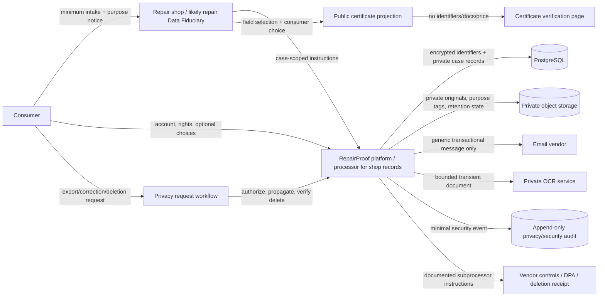

# RepairProof Privacy Architecture and Privacy Impact Assessment

**Prepared:** 22 November 2026  
**Scope:** Consumer, shop, platform administration, repair evidence, certificate verification, notifications, analytics, AI/OCR, and vendor processing. This is a product/privacy engineering design, not an Indian-law opinion. Have Indian privacy and consumer counsel validate role allocation, lawful grounds, notices, retention, and applicability before launch.

## 1. Executive decision

RepairProof should treat the shop that collects a consumer’s repair information as the primary decision-maker for that repair record. The shop is generally the Data Fiduciary/controller for information it collects to diagnose, quote, repair, document, warrant, or resolve a complaint. RepairProof should act as a processor/service provider for those shop-directed operations, but may be a separate Data Fiduciary for its own accounts, security, platform administration, service analytics, support, and legal obligations where it decides the purposes and means. Contracts and notices must reflect the actual flow, not simply label every party “processor.”

Make privacy a property of the data model and APIs:

- Store only what is needed to identify a customer, perform the repair, communicate, document authorization, and resolve a warranty/dispute.
- Keep identifiers, customer documents, repair evidence, quotes, and audit detail private behind resource authorization.
- Make public certificate verification a deliberately small, revocable projection. It must not return personal documents, evidence URLs/hashes, serial numbers, IMEI, contact information, quote prices, private notes, or detailed test records.
- Use clear purpose-specific notices and optional consent records. A repair service must not be held hostage to optional analytics, promotional email, AI processing, or public certificate disclosure.
- Build export, correction, withdrawal, retention, and deletion into the product now, even though most DPDP substantive provisions are scheduled to commence later.

### Immediate privacy defect from current code

`CertificateService.verifyCertificate()` currently returns serial number and IMEI through the device relation, approved quotation total and line items, repair step names, test results/checklists, shop address/phone, and evidence metadata including content hashes. The public certificate page renders serial number and IMEI. This is not a privacy-safe public certificate. Replace it with an allowlisted DTO before public launch. The public verify endpoint should return only certificate validity/status, issue date, device category and optionally make/model, high-level verified-work summary, warranty period/status, and shop display name; each optional field should be configurable by the shop and subject to consumer disclosure choice. No evidence bytes, URLs, object keys, hashes, customer identity, case ID, serial/IMEI, exact location, price, dispute text, or internal audit fields.

## 2. Indian requirements and commencement timeline

The law is phased. “Rules notified” does not mean every substantive duty is already in force. As of 22 November 2026:

| Framework | Status and relevance to RepairProof |
|---|---|
| Digital Personal Data Protection Act, 2023 | The Data Protection Board of India was established on 13 November 2025. The commencement notification brought sections 2, 18–26, 35, 38–43, and section 44(1) and (3) into force on that date. Section 6(9) and section 27(1)(d) commenced 13 November 2026. The principal processing duties and rights in sections 3–17, most of section 27, and section 44(2) are scheduled 18 months after 13 November 2025: **13 May 2027**. The official phased notification controls. [G.S.R. 843(E), 13 Nov 2025](https://www.meity.gov.in/static/uploads/2025/11/c56ceae6c383460ca69577428d36828b.pdf), [Board establishment notification, G.S.R. 844(E)](https://www.meity.gov.in/static/uploads/2025/11/cc217843dc3bcb37b2b05bcc3b4e031f.pdf) |
| Digital Personal Data Protection Rules, 2025 | Rules 1, 2, and 17–21 commenced on publication, 13 November 2025; Rule 4 commenced one year later, 13 November 2026; Rules 3, 5–16, 22, and 23 are scheduled 18 months after publication, 13 May 2027. The December 2025 corrigendum made textual corrections; it did not change the phased dates. [G.S.R. 846(E), 13 Nov 2025](https://www.meity.gov.in/static/uploads/2025/11/53450e6e5dc0bfa85ebd78686cadad39.pdf), [MeitY DPDP documents and corrigendum listing](https://www.meity.gov.in/documents/act-and-policies/digital-personal-data-protection-rules-2025-gDOxUjMtQWa?pageTitle=Digital-Personal-Data-Protection-Rules-2025) |
| Consent Manager provisions | Section 6(9) and Rule 4 are now in force. They govern entities taking the distinct registered Consent Manager role; RepairProof should not claim or provide that regulated intermediary function without reviewing registration and Schedule requirements. This does not mean every Data Fiduciary must use a Consent Manager. [DPDP Act, India Code](https://www.indiacode.nic.in/bitstream/123456789/22037/1/a2023-22.pdf) |
| IT Act and SPDI Rules, 2011 | The DPDP Act’s section 44(2) amendment/repeal is scheduled for the 18-month phase, so do not assume the legacy SPDI framework has already disappeared. The SPDI Rules may apply to a body corporate handling sensitive personal data/information (for example, passwords, financial information, health/medical records, or biometric data); RepairProof may receive such information inside customer-uploaded invoices/photos even if it does not request it. Review Rule 4–8 duties, privacy policy, consent, purpose, retention, disclosure, security, and grievance handling against the actual entity structure. [SPDI Rules, G.S.R. 313(E)](https://meity.gov.in/sites/upload_files/dit/files/GSR313E_10511%281%29.pdf) |
| CERT-In Directions, 28 April 2022 | Applicable entities within scope must retain ICT logs securely for a rolling 180 days within Indian jurisdiction and report specified cyber incidents within six hours of noticing/being informed, among other requirements. This is a security-log requirement, not a reason to retain repair evidence or all customer records for 180 days after their purpose ends. Define a separate, minimal security-log schedule and incident process. [CERT-In Directions](https://www.cert-in.org.in/PDF/CERT-In_Directions_70B_28.04.2022.pdf), [CERT-In overview](https://www.cert-in.org.in/Directions70B.jsp) |
| Consumer Protection Act, 2019 and E-Commerce Rules, 2020 | The Act took effect on **20 July 2020**. The E-Commerce Rules were notified on **23 July 2020** and apply to qualifying e-commerce entities, including specified digital marketplace/inventory models and services offered to consumers in India. The **2021 amendment** took effect on publication (17 May 2021) and changed rule 4(1), including the resident nodal officer/designated functionary requirement for covered entities. A **2026 amendment**, G.S.R. 789(E), is notified to commence **1 January 2027** and changes the definition of “ranking”; this matters if RepairProof lists or ranks shops/services. RepairProof’s applicability depends on whether it merely supplies shop workflow software or itself facilitates/operates consumer transactions/marketplace services. If in scope, design for transparent service/merchant information, explicit affirmative purchase/authorization action, and a published grievance mechanism; the Rules require acknowledgement within 48 hours and redressal within one month. [Department of Consumer Affairs FAQ on Act commencement](https://consumeraffairs.nic.in/sites/default/files/file-uploads/latestnews/FAQ.pdf), [2020 E-Commerce Rules](https://consumeraffairs.gov.in/public/upload/files/E%20commerce%20rules_1732703966.pdf), [2021 amendment](https://consumeraffairs.gov.in/public/upload/files/Consumer%20Protection%20%28E-Commerce%29%20%28Amendment%29%20Rules%2C%202021_1732704241.pdf), [2026 amendment, G.S.R. 789(E)](https://egazette.gov.in/WriteReadData/2026/276125.pdf) |

**Legal launch gates:** determine whether RepairProof or each shop is the relevant Data Fiduciary for each purpose; assess whether shops/platform qualify as e-commerce entities; map any SPDI received in evidence; appoint and publish required grievance contacts if applicable; review cross-border vendors/transfers and applicable sector-specific recordkeeping. The architecture below anticipates DPDP Rules 2025 requirements in the 2027 phase without representing them as already commenced on the assessment date.

**Children:** the DPDP Act defines a child as a person under 18. The Act’s substantive child-data duties in section 9 are in the 18-month commencement phase (13 May 2027). Do not collect date of birth “just in case.” If a workflow knows the customer is a child, require a suitable parent/guardian flow for authorization and any legally required consent, avoid behavioral tracking/targeted advertising, and implement age-aware service notices before that phase starts. Counsel must confirm any applicable statutory exemptions and the acceptable verification method.

## 3. Data inventory, minimization, and purpose limitation

| Data | Current/source | Necessary use | Minimize / control |
|---|---|---|---|
| Account identity: email, display name, auth user ID, role, shop | Profile/Supabase | Authentication, support, membership | Keep auth ID separate from public IDs; return only needed profile fields; avoid exposing email in certificates or public APIs. |
| Customer name/email/phone | RepairCase | Intake, quote/approval communications, repair and warranty contact | Require only contact methods needed for selected workflow; avoid collecting both email and phone by default; verify contact when used for authorization/SMS; mask in staff list views. |
| Symptom, findings, diagnostic measurements, repair notes | Case/Diagnostic/RepairStep/TestResult | Diagnose and document work; customer communication; complaint resolution | Structured fields and length bounds; no unrelated health/identity data; warn before uploading unrelated documents; separate internal notes from customer-visible text. |
| Device make/model/category | Device | Identify device and appropriate repair | Prefer category/make/model. Serial/IMEI is optional and should be omitted unless a specific service step needs exact identification. |
| Serial number / IMEI | Device currently stores plaintext and indexes it | Exact unit identity, parts/repair matching only if required | Field-level envelope encryption; keyed HMAC index only where exact lookup is necessary; mask to last 2–4 characters in UI; redact from logs/exports/public certificate; restrict to assigned case roles. No raw indexing unless necessary. |
| Photos, invoice, diagnostic reports, component/test evidence | Evidence/object storage | Substantiate intake, parts, tests, customer authorization, claims | Private bucket; purpose tags; original/derived separation; per-file access checks; remove EXIF GPS and unnecessary metadata from derived previews; no public URLs or public hash endpoints. |
| Quote parts, totals, taxes, approval/signature | Quotation/Approval | Customer authorization and shop accounting | Customer sees only their case and current quote; public certificate omits amounts; preserve version history only as long as dispute/legal purpose needs. |
| Warranty and dispute records | Warranty/Claim/Dispute | Contractual service and complaint resolution | Restrict to involved shop/customer and necessary platform review; separate dispute narrative from general analytics. |
| Consent/preferences | New consent ledger | Show notice, record optional choices/withdrawal, determine optional processing | Store purpose, notice version, subject, action, time, channel, source, actor, and evidence; never infer consent from account creation or silence. |
| Audit/security events | AuditEvent/PlatformAdminAuditEvent, infra logs | Accountability, fraud/security investigation, legal obligations | Record IDs, action, actor, result, request ID, and minimal metadata; never store raw tokens, full notes, image content, full device identifiers, or quote bodies. Restrict/immutability controls. |
| Price/analytics data | RepairPriceTransaction and aggregates | Statistical benchmarking and service reliability | Separate identifiers from analytic rows; use approved invoice-backed records; minimum cohort thresholds; suppress small groups; no customer-level views or re-identification keys in analytics. |

Every field and event must map to a named purpose. A purpose registry should be code-owned and reviewed. A new use such as model training, marketing, public certificate search, or cross-shop benchmarking requires a new documented purpose, legal basis, notice and consent assessment before collection/use.

## 4. Consent and notice architecture

Create a `PrivacyNoticeVersion` and append-only `PrivacyChoiceEvent` model, distinct from notification preferences and customer quotation approval.

Suggested privacy choice fields:

```text
id, subjectType, subjectId, shopId?, purposeCode, choice (GRANTED|REFUSED|WITHDRAWN),
noticeVersion, noticeLocale, capturedAt, channel, captureSource, actorType,
evidence (minimal metadata), supersedesEventId, createdAt
```

Do not store a consent event as a mutable boolean. Keep a history of grant, refusal, and withdrawal. A customer quote approval is a separate legal/business authorization record and must not be treated as consent to analytics, public disclosure, marketing, or AI processing.

### Notices and separate choices

- Provide a short point-of-collection notice before customer data is submitted: data items, shop/controller identity, why needed, who receives it (RepairProof and necessary vendors), retention criteria, how to contact the shop/RepairProof, and how to exercise rights.
- Account creation notice for staff is separate from consumer repair notice.
- Distinguish necessary repair processing from optional: product analytics beyond service operation, promotional email/SMS, public certificate fields, and sending evidence to an external model provider. Optional choices are off by default and independently selectable.
- Withdrawal is as easy as grant, in the same channel when practical; stop future optional processing promptly and inform processors. Withdrawal does not retroactively invalidate lawful processing already performed or remove records a shop must keep for active warranty/dispute or law. Explain this plainly.
- No bundled or pre-ticked optional choices. Record the notice version and language shown, affirmative action, and time.
- RepairProof should not represent itself as a registered Consent Manager unless it applies for and receives registration under the specific Rules.

## 5. Data subject rights: access/export, correction, deletion

Implement a privacy request service with request ID, identity verification state, requester role, affected shop(s), scope, legal hold, processor tasks, status, SLA, and response receipt. Expose in-app request UI plus a published privacy contact. Keep a manual assisted path for consumers without an account using case-specific verification; do not require an account password for a customer who only used an authorization link.

### Export

- Verify identity using account authentication or two independent, proportionate case attributes. Do not email a complete export solely based on a name or case number.
- Compile a portable ZIP/JSON manifest with customer profile fields, device record with identifiers masked by default (full identifier only after strong verification and where the requester is entitled), cases, quotes/versions, approvals, diagnostics, repair actions, tests, warranties, disputes, evidence list and download access, notification preferences, and relevant processing/recipient information.
- Produce short-lived private download link, notify the user through verified channel, log issuance, expire link quickly, prevent search indexing, and delete temporary export after 24 hours (or shorter) unless retried.
- Exclude other customers/staff personal data, internal security secrets, privileged abuse-detection signals, and third-party content. Explain withheld categories and route disputes to review.

### Correction

- Let the consumer request corrections to contact/profile data and flag inaccuracies in case/device data.
- Preserve historically signed/approved artifacts: corrections create a version or correction event, never silently rewrite a signed quote, approval, technician statement, invoice original, test result, or issued certificate. Show corrected data and provenance to authorized viewers.
- Route repair-record corrections to the shop as controller; RepairProof acts on shop instructions for processor-held records. Add an escalation/appeal path if the shop fails to respond.
- Reissue a certificate or mark it superseded when a verified correction changes its public claims.

### Deletion / erasure

Use a state machine: `REQUESTED → IDENTITY_CHECK → SCOPE_CHECK → LEGAL_HOLD_REVIEW → APPROVED/PARTIAL/DECLINED → PRIMARY_DELETE_OR_ANONYMIZE → VENDOR_PROPAGATION → BACKUP_EXPIRY → COMPLETED`.

- Delete account/profile data when no longer needed and no legal basis to retain; disable sessions and tokens immediately.
- For a shop-managed case, notify the responsible shop and record the controller’s instruction/decision. A processor must not independently erase the shop’s records unless contract/instruction or law allows it.
- For active warranty, open dispute, court/regulatory hold, or other legally required record, retain only the minimum necessary in a restricted legal-hold vault; access requires explicit role and logged reason. Inform requester of scope, reason, and expected review date.
- Delete originals/derivatives and all object versions, thumbnails, exports, OCR scratch files, caches, queued email content, and vendor copies; revoke signed URLs where provider supports it. Verify deletion from primary storage and let encrypted backups age out on a stated schedule. Do not claim backup erasure before it occurs.
- Anonymize historical analytics only if irreversibility is robust and no key can relink a person. De-identification is not merely removing name/email; serial/IMEI, rare model/case combinations, exact dates, text, and image hashes can re-identify.
- Preserve a minimal suppression/tombstone record needed to prevent re-import or honor an opt-out, containing no unnecessary repair details.

Set a product SLA of acknowledgement within 2 business days and target completion within 30 calendar days, with status updates for complex cases. Treat this as a proposed service target, not a statement of statutory deadlines; counsel should align it with current and commencing rules.

## 6. Retention schedule (proposed; validate legal/contractual need)

The current evidence worker defaults to 2,555 days (about seven years). That is a product setting, not a blanket statutory requirement. Replace one global duration with purpose-specific schedules and a legal-hold override. Suggested starting policy:

| Record | Proposed retention trigger | Initial schedule | Action |
|---|---|---:|---|
| Unverified upload intent / quarantine object | Expiry or rejection | 24 hours after intent expiry (current signed upload window 15 minutes) | Delete object and intent metadata after cleanup confirmation; keep minimal rejection event. |
| Customer contact/account | Account closure or last active purpose | 30 days after closure, unless active case/warranty/dispute/contract need | Delete or irreversibly anonymize; keep minimal security/fraud suppression event if justified. |
| Open repair case and active evidence | Case active | Until case closure + active warranty period + dispute-resolution window | Review at each event; delete unnecessary raw docs once warranty/complaint needs end. |
| Final case record, customer approvals, invoice/evidence originals | Closed case | Default 3 years after final closure as a product proposal; extend only to documented statutory/tax, contractual, warranty, or dispute need, with a maximum reviewed per schedule | Restricted archival tier; mask identifiers; legal hold can pause expiry. Counsel to choose final period per shop/record type. |
| Warranty record and claim | Warranty end/claim close | Warranty period + 3 years after final claim closure as a proposed limitation buffer | Retain minimal certificate/decision; delete unnecessary images and contact copies sooner. |
| Public certificate projection | Certificate expiry/revocation | While warranty/certificate validation is useful, then 1 year for anti-fraud validation unless law/contract requires otherwise | Public endpoint shows revoked/expired status and minimal record, not personal data. |
| Signed object/export URLs | Creation | 60 seconds for evidence; 15 minutes maximum for customer export | Never persist in logs or DB; revoke where supported. |
| Notifications | Delivery/read | 90 days after send/read | Keep delivery metadata only longer if needed for security dispute; delete body and email-only action content. |
| Consent/privacy request ledger | Withdrawal/request close | While purpose remains and then 3 years as proposed evidence of handling | Retain minimal versions/events, no document copies unless needed. |
| Audit events | Event date | 180 days minimum for applicable CERT-In system logs; 1 year for application access/audit as proposal; longer only for specific legal hold | Separate system/security logs from business audit. Restrict, minimize, and export immutably. Counsel/CERT-In applicability check required. |
| Backups | Backup creation | 35 days rolling as a proposed operations target | Encrypted, restricted, tested; deleted records must not be restored into active systems without reapplying deletion tombstones. |
| Aggregated price statistics | Aggregation approval | Retain only while cohort remains sufficiently large and non-identifying | Re-check re-identification risk and remove small cohorts. |

All deletion jobs need idempotency, a result ledger, retry/alert on object-delete failure, and a periodic orphan scan. Report retention outcomes rather than only marking a DB row deleted.

## 7. Evidence access permissions

| Actor | Access rule |
|---|---|
| Consumer | Only records explicitly associated with their case; only customer-facing categories; download requires active case capability/session and short-lived URL. No access to internal annotations, staff-only evidence, other customer records, or original storage paths. |
| Assigned technician | Case evidence for currently assigned case and active organization membership. Read/write operations are checked server-side at request time, not inferred from a signed URL previously issued. |
| Shop administrator | Their organization’s case evidence where business role requires it; sensitive download and export is audited. |
| Platform administrator | No routine case access. Break-glass access requires ticket/purpose, time-bounded grant, least privilege, and append-only audit. Redact unless reviewing a specific complaint/security event. |
| Processor/vendor | Only transient data necessary to provide service, contractually restricted; OCR and email payload minimization; no vendor reuse/training. |

Enforce tenant + assignment + evidence purpose + malware status + deletion/retention state in one server-side authorization query before creating signed URLs. Signed URLs are bearer credentials: do not put them in logs, analytics, referrers, public certificate responses, or long-lived notifications. Configure private buckets, no directory listing, no public ACL, exact-key upload scope, and content-disposition safe filenames. For browser downloads, use `Content-Disposition: attachment` for PDFs/documents and prevent inline active content where possible.

## 8. Device identifier protection

Serial numbers and IMEIs are direct device identifiers and become personal data when linked or linkable to a person. They can also enable warranty fraud, account/device correlation, or stalking when disclosed. Apply:

1. **Collect less:** serial/IMEI optional; explain why it is needed; do not require both. Prefer manufacturer/model plus device category for ordinary repair flow.
2. **Encrypt:** envelope-encrypt raw identifiers using a KMS-managed key; separate encryption key from database backups. Rotate keys with versioned ciphertext.
3. **Search safely:** only if exact search is required, store a separate keyed HMAC for equality lookup; do not use deterministic encryption or plain hash as an index. Never expose HMAC or ciphertext to clients.
4. **Display minimally:** mask in consumer/staff lists; reveal full value only on detail screen with role/assignment authorization and, for staff, business need. Log reveal events without logging the value.
5. **Public/private boundary:** never include serial/IMEI in certificate QR/public JSON, notification previews, analytics, URLs, filenames, or log fields.
6. **Retention:** erase identifier when exact-unit matching, warranty, and dispute needs expire; retain make/model only if still useful and non-identifying in context.
7. **Existing data migration:** encrypt current plaintext, remove database indexes on raw serial/IMEI, and verify replicas/backups/logs for historical copies.

## 9. Public repair certificate vs private customer record

Use separate API DTOs, database views/services, and cache policies; never serialize the private `Certificate`/`RepairCase` Prisma object as the public response.

| Public certificate projection (opt-in/configured) | Private repair/customer record |
|---|---|
| Random high-entropy certificate lookup identifier; valid/revoked/expired status; issue date; coarse device category and optionally make/model; completion/independent-verification statement; warranty duration/status; shop display name; integrity caveat. | Customer name/contact, exact serial/IMEI, device ownership, symptoms, diagnostics, quotations/prices, authorization/signature, evidence files/metadata/hashes, repair notes, test details, dispute/warranty claim narratives, staff identity, internal audit, object paths/tokens. |
| No PII or personal document, no evidence download, no case ID, no raw certificate DB ID, no stable device identifier. | Available only to customer/session and permitted case staff with server-enforced tenant/assignment controls. |
| Public route response uses `Cache-Control: no-store`, `X-Robots-Tag: noindex, nofollow`, rate limits, privacy-safe not-found response, and aggregate abuse monitoring. | Authenticated API responses use `Cache-Control: private, no-store` where personal data is included. |

Certificate code should be an independent random capability (at least 128 bits), not derived from case number/UUID. The QR should point to that code only. Keep a revocation/supersession state. Shop and customer should choose optional fields at issuance; default to minimum. Public verification cannot prove evidence truth—only that RepairProof has a matching issued record and recorded verification workflow.

## 10. Privacy-safe analytics

- Operational metrics use event counters and aggregate cohorts: counts by workflow state, repair category, broad time period, and region only where sample thresholds are met.
- Analytics must not include names, email, phone, serial/IMEI, case number, certificate number, free text, filenames, object paths, exact location, or photo/invoice content.
- Use pseudonymous tenant IDs only where per-shop dashboards require them; they remain personal/business data and stay access-controlled. Internal platform aggregate datasets use a separate table/role and no join key to customer/contact data.
- Apply minimum cohort threshold (e.g. at least 10 cases and 5 independent shops for shared price statistics; price engine already uses stricter sample thresholds). Suppress rare combinations and exact dates; consider differential privacy before external publication.
- Do not add third-party web analytics pixels/session replay by default. If a vendor becomes justified, disable form-field capture, mask sensitive UI, disclose the vendor, and offer required consent where appropriate.
- Keep model training opt-in and separate from service telemetry. Never train on repair evidence, invoices, or customer notes by default.

## 11. Vendor and processor controls

Maintain a vendor register and processing inventory with: vendor/legal entity, purpose, data fields, regions/subprocessors, transfer basis, security controls, deletion/backup behavior, breach notice term, retention, support-access model, model-training prohibition, and exit/deletion verification.

| Vendor/system | Likely data | Required control |
|---|---|---|
| Supabase Auth | Email, account/session identifiers | Contract/DPA, region confirmation, admin MFA, token/session retention, support access review, export/deletion workflow. |
| Supabase Storage | Evidence bytes, object metadata | Private bucket, region/replication confirmation, service-role access only, signed URLs, subprocessor list, deletion and backup schedule. |
| Resend | Email address, generic message, secure action link | Send generic content only, no diagnosis/price/evidence; DPA/subprocessor/region review; delivery event retention; suppression and bounce handling. |
| Redis | Rate-limit keys and IP-derived request identifiers | Prefer keyed/pseudonymous identifiers, TTL, authentication/TLS/network isolation, no repair payload. |
| ClamAV | Uploaded bytes during scan | Private network, no long-term storage beyond scanning, restricted telemetry, updates, timeout and incident controls. |
| Invoice OCR | Invoice bytes, extracted values, correction data | Private network/service identity, no model training, bounded ephemeral processing, signed result, no public access, delete scratch data, avoid reviewer-ID header as an identity assertion. |
| Sentry (optional) | Sanitized error context | No request bodies, user payloads, tokens, notes, or file contents; region/retention/DSA review and deletion configuration. |

Where the shop is Data Fiduciary and RepairProof is processor, provide a processing agreement covering documented instructions, confidentiality, security, subprocessors, rights assistance, breach cooperation, deletion/return, audit evidence, and no independent reuse. For RepairProof’s own purposes, issue its own notice and determine its own lawful ground.

## 12. Auditability and privacy accountability

- Privacy notices, consent/withdrawal, access/export, correction, deletion, legal hold, public certificate opt-in/field selection, evidence view/download, admin break-glass, vendor export, and retention purge are auditable events.
- Audit metadata contains subject/case pseudonymous IDs and purpose codes; do not copy repair content into audit metadata. Never log raw authorization tokens, signed URLs, full serial/IMEI, uploaded bytes, or OCR text.
- Separate append-only privacy/security audit from normal application tables; runtime service role should insert but not update/delete. Export signed daily batches to immutable storage and alert on sequence gaps or failed export.
- Scope audit viewer to privacy/security roles; log the act of viewing/exporting audit data itself.
- Meet applicable CERT-In log requirements through infrastructure security logs; apply separate minimization and retention to case/business audit.

## 13. Privacy impact assessment (PIA)

### Processing description

RepairProof facilitates repair intake and management. Shops enter customer contact and device information, capture reported symptoms, store diagnostic/repair evidence, issue quotations for customer approval, record repair/test/verification outcomes, generate certificates and warranties, handle claims/disputes, and may submit invoice-backed observations for aggregate price intelligence. Customers may access case information through an authorization capability and certificates through a public verification code. Providers include auth, private object storage, email, malware scanning, OCR, monitoring, database, and Redis.

### Necessity and proportionality

| Processing | Necessity | PIA judgement / design change |
|---|---|---|
| Customer contact for repair | Needed to coordinate authorization and return/claim handling | Collect one preferred channel where possible; let customer update; verify address for link delivery. |
| Serial/IMEI | Sometimes helps identify a unit, but not needed for all repairs | Optional by default; mask/encrypt; remove from public certificate; review necessity by device/workflow. |
| Evidence and invoices | Needed for diagnosis/parts/quality/disputes when relevant | Purpose-tagged and case-scoped; private by default; no public certificate exposure; retention by category. |
| Public certificate | Enables a customer or recipient to check a repair proof record | Public information is not necessary to disclose detailed device identifiers, price, or documents. Use narrow projection and customer choice. |
| Price benchmark | Useful consumer intelligence | Use reviewed, coarse, thresholded aggregate rows; no customer identity or exact device identifier; prohibit re-identification. |
| AI OCR/diagnostics | Reduces manual entry or offers decision support | OCR values stay unverified; AI disabled unless enabled for a justified purpose; no photo-only truth claims; no external model training by default. |
| App analytics | Product reliability and aggregate use | Internal counters only by default; no session replay or ad tracking. |

### Risk register

| Risk | Likelihood / impact | Initial rating | Required control / residual risk |
|---|---|---:|---|
| Public certificate reveals IMEI/serial, quote, tests, and evidence hashes | Confirmed code path / high harm | **High** | Replace with public allowlist DTO; rotate/disable exposed certificate routes until deployed; residual risk of screenshot/copy of intentionally public fields. |
| Authorization link forwarded or leaked from URL history/logs | Plausible / high | **High** | Hash/revoke capability, clean URL/session exchange, no-referrer, log redaction, short expiration, rate limits; residual bearer-sharing risk. |
| Technician accesses another case/device within same shop | Confirmed authorization gap in code review / high | **High** | Assignment-aware policies; role matrix; audit evidence downloads. |
| Shop or platform insider browses evidence beyond need | Plausible / high | **High** | Least privilege, break-glass, read/download audit, masking, alerts; residual authorized misuse. |
| Customer uploads document containing unrelated IDs/financial/health data | Likely / medium-high | **High** | Upload notice, data minimization, derived-image metadata stripping, view controls, targeted retention; content cannot always be pre-screened. |
| Vendor breach or over-retention | Possible / high | **High** | DPA, subprocessor/region inventory, secret/access review, no-training clauses, deletion verification, incident response. |
| Deletion conflicts with warranty, dispute, audit, or legal hold | Likely / medium | **Medium** | Purpose/record-specific holds, partial deletion, transparent reason and review date, tombstone and back-up expiry. |
| Price/repair analytics re-identifies rare customers or shops | Possible / medium-high | **Medium-High** | Cohort minimums, coarsening, outlier suppression, no raw identifier, output review; periodic re-identification attack exercise. |
| Wrong-person customer uses authorization URL | Possible / high | **High** | Verify destination ownership, restricted capability, re-auth for high-impact actions, event notifications, revocation. |
| Consent records are vague or bundled | Possible / medium | **Medium** | Separate choice ledger, versioned concise notices, no prechecked optional fields, withdrawal workflow and evidence. |

### PIA outcome and launch conditions

**Outcome: Do not expose public certificate verification or broad consumer authorization endpoints to production until the identified projection/capability controls are in place.** Before consumer rollout, complete: controller/processor role mapping; Indian counsel review of staged law and e-commerce applicability; privacy notices/consent ledger; export/correction/deletion workflow; retention schedule and legal-hold runbook; device identifier encryption/masking; vendor DPA register; public certificate allowlist; and rights/tenant authorization tests.

Review this PIA at least annually and after new AI/vendor integrations, public certificate changes, a new analytics purpose, cross-border hosting change, breach, material legal update, or expansion into payment/marketplace functions.

## 14. Privacy architecture diagram


