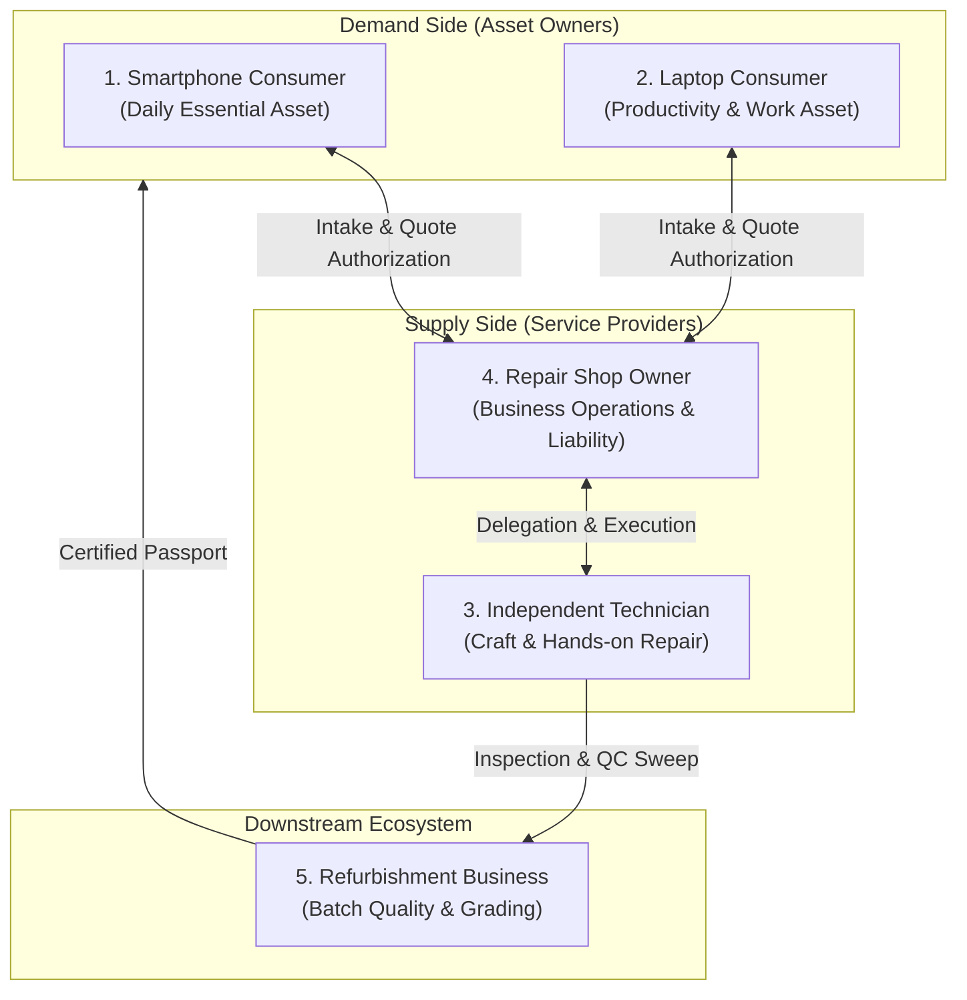

# REPAIRPROOF — USER RESEARCH PROGRAM & VALIDATION FRAMEWORK
## Human-Centered Discovery Protocol for Electronics Repair Verification

---

### Executive Framework & Research Ethics Protocol

This user research program is designed to empirically validate the pain points, operational workflows, and trust deficits across the electronics repair ecosystem before committing product capital.

#### Core Research Principles
1. **The Behavioral Truth Principle**: Research must focus on **past actual behavior and financial expenditures**, not hypothetical future preferences. (Reference: Rob Fitzpatrick’s *The Mom Test*).
2. **Zero-Leading Question Standard**: Never ask questions that reveal the product hypothesis (e.g., *“Would you like a digital certificate?”*). Instead, inquire about historical breakdowns, conflict resolutions, and documentation methods.
3. **Evidence Hygiene**: Differentiate verified empirical observations from preliminary assumptions. No interview results or quotes are fabricated in this document.

---

### 1. Persona Profiles & Ecosystem Vectors



---

#### Persona 1: Smartphone Consumer (Mobile Daily Essential)
* **Demographic Context**: Everyday smartphone owner (iOS / Android), device age 1–4 years, non-technical, relies on the phone for payments, authentication, and communication.

1. **Goals**:
   * Restore full device functionality as rapidly as possible (same-day turnaround).
   * Preserve personal data (photos, banking apps, 2FA tokens) without wiping or unauthorized snooping.
   * Avoid paying for a brand-new replacement when a simple repair suffices.
2. **Frustrations**:
   * Opaque pricing; huge variance between authorized stores and independent strip-mall kiosks.
   * Loss of proprietary features after repair (e.g., TrueTone disappearing, battery health warnings, Face ID breaking).
   * Discomfort leaving an unlocked phone with an unfamiliar technician.
3. **Current Workflows**:
   * Asks friends/family or checks Google Maps reviews $\rightarrow$ Walks in for verbal estimate $\rightarrow$ Leaves phone unlocked or gives passcode on a sticky note $\rightarrow$ Receives paper receipt or text message $\rightarrow$ Inspects screen visually upon pickup.
4. **Trust Concerns**:
   * Did the shop swap out good internal components for cheap fakes?
   * Did someone browse private photo albums or message histories while testing the screen?
   * Will the repair hold up past the standard 30-day warranty window?
5. **Financial Concerns**:
   * Sunk-cost dilemma: Is spending $180 to repair a phone worth $350 on the used market rational?
   * Unexpected cost escalations after intake (e.g., *"We opened it and found water damage; it will be another $90"*).
6. **Digital Literacy**:
   * Consumer-grade proficiency (familiar with mobile browsers, SMS links, QR codes, Apple Pay/Google Pay). Expects frictionless, zero-install interactions.
7. **Adoption Barriers**:
   * Resistance to downloading a dedicated mobile application for a one-off repair transaction.
   * Skepticism toward unfamiliar digital badges or unverified certificates.
8. **Expectations from RepairProof**:
   * Plain-language explanation of what was broken and what was replaced.
   * Instant, app-less link to approve or reject itemized quotes.
   * Verifiable proof that fitted components are genuine or certified aftermarket.

---

#### Persona 2: Laptop Consumer (Work & Productivity Asset)
* **Demographic Context**: Knowledge worker, remote employee, student, or creative professional. The laptop is a primary income-generating asset.

1. **Goals**:
   * Minimize downtime; preserve internal storage and project files without OS formatting.
   * Ensure structural integrity (hinges, cooling fans, battery thermals, keyboard backlight).
   * Receive a clear explanation of component wear vs. accidental damage.
2. **Frustrations**:
   * Official manufacturer service centers (e.g., Apple Store, Dell Support) frequently refuse component-level repair, proposing logic board replacements costing 70% of a new machine.
   * Repair shops holding laptops for 7–14 days awaiting parts without status updates.
   * Diagnostic fees charged without a conclusive diagnosis or clear path to resolution.
3. **Current Workflows**:
   * Tries software troubleshooting/reboots $\rightarrow$ Checks manufacturer warranty $\rightarrow$ Searches Reddit/local repair shops $\rightarrow$ Drops off laptop with charger $\rightarrow$ Waits for phone call or email quote $\rightarrow$ Tests boot and basic keys upon collection.
4. **Trust Concerns**:
   * Unauthorized access to corporate documents, intellectual property, or stored passwords.
   * Incomplete thermal maintenance (poor thermal paste application leading to throttling).
5. **Financial Concerns**:
   * High repair costs exceeding the machine’s depreciated book value.
   * Inability to verify if a motherboard replacement was genuinely new or harvested from an old unit.
6. **Digital Literacy**:
   * Moderate to high (comfortable with desktop operating systems, cloud portals, PDF invoices, and detailed spec sheets).
7. **Adoption Barriers**:
   * Reluctance to register an account while under work deadlines.
8. **Expectations from RepairProof**:
   * Detailed breakdown of parts installed (OEM vs. third-party specification).
   * Verified diagnostic reports showing thermal curves and storage health (S.M.A.R.T. readouts).
   * Portable maintenance passport useful when reselling the laptop later.

---

#### Persona 3: Independent Repair Technician (Hands-On Craftsperson)
* **Demographic Context**: Bench technician, micro-soldering specialist, or mobile device technician with 2–15 years of bench experience. Pride in technical craft.

1. **Goals**:
   * Focus on diagnosis, microsoldering, and reassembly without drowning in paperwork.
   * Protect personal and shop reputation against fraudulent customer claims.
   * Prove technical competency to command fair hourly rates for board-level work.
2. **Frustrations**:
   * Customers blaming the technician for pre-existing flaws (e.g., non-working speaker, bent frame) not noticed during quick intake.
   * Spending unpaid hours diagnosing complex board shorts only to have the customer reject the quotation.
   * Unstandardized photo documentation: taking bench photos on personal phones, cluttering camera rolls, and manually texting photos to customers.
3. **Current Workflows**:
   * Receives device with paper ticket $\rightarrow$ Tests basic functions $\rightarrow$ Disassembles under microscope $\rightarrow$ Takes diagnostic photos with bench camera or phone $\rightarrow$ Tells front counter staff the parts needed $\rightarrow$ Performs repair $\rightarrow$ Completes quick physical test $\rightarrow$ Hands back to counter.
4. **Trust Concerns**:
   * Skeptical of platforms that add clicks or administrative overhead to the repair process.
   * Wary of systems that try to automate or undermine technician diagnosis with simplistic heuristics.
5. **Financial Concerns**:
   * Unbillable diagnostic time.
   * Part supplier RMA friction when received replacement parts arrive dead-on-arrival (DOA).
6. **Digital Literacy**:
   * High technical hardware literacy, variable software preference (prefers keyboard shortcuts, rapid input, hates sluggish enterprise web forms).
7. **Adoption Barriers**:
   * "Speed tax": If documenting a repair takes more than 2 minutes, technicians will bypass the system.
   * Clunky photo upload workflows.
8. **Expectations from RepairProof**:
   * Rapid, frictionless photo capture and coordinate pinning of defects.
   * Clear intake baseline to prevent liability for pre-existing cosmetic flaws.
   * Standardized subsystem checklist to speed up final verification.

---

#### Persona 4: Repair Shop Owner (Business Operations & Liability)
* **Demographic Context**: Small business owner or franchise operator running 1–5 repair storefronts with 2–8 technicians.

1. **Goals**:
   * Maximize gross margin per bench hour; increase quote conversion rates.
   * Minimize chargebacks, Google review disputes, and warranty return claims (RMAs).
   * Track technician productivity, parts consumption, and turnaround speed.
2. **Frustrations**:
   * Customers abandoning quotes after intake, leaving uncollected diagnostic labor.
   * Inconsistent diagnostic quality between experienced lead techs and apprentice hires.
   * Warranty blame-shifting between part suppliers and technicians when a screen fails 3 weeks later.
   * Juggling separate tools: POS, inventory spreadsheets, WhatsApp, email, paper intake sheets.
3. **Current Workflows**:
   * Uses legacy repair shop POS (e.g., RepairDesk, RepairShopr, or Square) for invoicing and parts tracking $\rightarrow$ Paper intake forms for physical signatures $\rightarrow$ Phone calls to customers for quote authorization $\rightarrow$ 30-day paper warranty stamped on paper invoice.
4. **Trust Concerns**:
   * Platform lock-in; fear of losing proprietary customer and sales records.
   * Customer privacy liabilities (GDPR, state privacy laws) regarding stored device photos.
5. **Financial Concerns**:
   * Software subscription creep ($100–$300/month across different SaaS tools).
   * Merchant chargebacks from unhappy customers claiming inferior repair quality.
6. **Digital Literacy**:
   * Pragmatic business literacy; comfortable with dashboards, Excel exports, and web POS.
7. **Adoption Barriers**:
   * High switching costs if forced to replace their primary retail POS and barcode inventory system.
   * Staff training resistance.
8. **Expectations from RepairProof**:
   * Modular utility that complements existing POS systems without requiring full replacement.
   * Quantifiable reduction in customer authorization turnaround time and dispute rates.
   * Professional branded repair certificates that elevate the shop above local competitors.

---

#### Persona 5: Refurbishment & Recommerce Business (Asset Lifecycle)
* **Demographic Context**: Warehouse refurbisher, trade-in processor, or online recommerce seller (eBay, Back Market, Swappa) processing 200–5,000 devices/month.

1. **Goals**:
   * Maximize resale price realizations by certifying device health.
   * Reduce marketplace return rates (returns on Back Market/eBay eat 15–25% of gross margins).
   * Prepare for upcoming European Digital Product Passport (DPP) compliance requirements.
2. **Frustrations**:
   * Marketplace buyers questioning battery authenticity or cosmetic grading.
   * High labour cost of manual testing; lack of auditable logs for bulk testing.
   * Counterfeit component infiltration in bulk parts supply chains.
3. **Current Workflows**:
   * Pallet intake $\rightarrow$ Automated USB diagnostic test (Phonecheck / NSYS) $\rightarrow$ Manual cosmetic grading $\rightarrow$ Selective component replacement (screens, batteries) $\rightarrow$ Secondary USB sweep $\rightarrow$ PDF report generated $\rightarrow$ Listing on marketplace.
4. **Trust Concerns**:
   * Marketplace algorithmic penalties if returned devices exceed 3%.
   * Inconsistent grading between human QA inspectors.
5. **Financial Concerns**:
   * Per-device testing fee inflation from diagnostic vendors.
   * Margin compression in competitive recommerce channels.
6. **Digital Literacy**:
   * High operational and IT literacy (operates ERPs, automated scanners, API webhooks).
7. **Adoption Barriers**:
   * Reluctance to introduce any manual documentation steps into automated high-speed conveyor lines.
8. **Expectations from RepairProof**:
   * Bulk/API-friendly cryptographic certificate generation.
   * Consumer-facing QR verification link that can be physically stickered onto refurbished devices.

---

### 2. Rigorous Non-Leading Interview Protocols

```
┌────────────────────────────────────────────────────────────────────────┐
│                      THE NON-LEADING QUESTION RULE                     │
├────────────────────────────────────────────────────────────────────────┤
│  ❌ LEADING (Biased):                                                  │
│     "Would you feel safer if your repair shop gave you a digital       │
│      certificate showing before-and-after photos?"                     │
│                                                                        │
│  ✅ EMPIRICAL (Objective):                                             │
│     "Think about the last time you took an electronic device for       │
│      repair. Walk me through what happened from the moment you noticed  │
│      the issue to when you picked it up."                              │
└────────────────────────────────────────────────────────────────────────┘
```

#### Protocol A: Consumer (Smartphone & Laptop) Interview Guide
* **Goal**: Understand past repair experiences, trust evaluation, decision triggers, and breakdown resolution.
* **Format**: 30-minute semi-structured interview.

```markdown
### 1. Context & Device History
- What electronics have you had repaired in the last 24 months?
- When the problem first appeared, what was your initial reaction and what alternatives did you consider before seeking repair?

### 2. Shop Selection & Intake
- How did you choose the person or shop that worked on your device?
- When you handed your device over, what information did you receive in writing or verbally?
- Did the shop document any pre-existing scratches, cracks, or quirks on your device? If so, how?

### 3. Diagnosis & Quotation
- How did they communicate what was wrong and how much it would cost?
- How did you decide whether to approve that repair?
- Were there any surprises between what was quoted and what was billed on your final invoice?

### 4. Verification & Handover
- When you picked up the device, how did you verify that the problem was actually fixed?
- What explanation were you given regarding what brand or grade of replacement parts were installed?
- What warranty coverage were you provided, and what documentation proves that warranty today?

### 5. Disputes & Historical Failures (Critical Stress-Test)
- Have you ever had a device fail again shortly after being repaired? What happened next?
- Have you ever had an experience where a shop claimed something was broken that you were unsure about? How did you resolve that?
```

---

#### Protocol B: Independent Technician & Shop Owner Interview Guide
* **Goal**: Map bench intake routines, customer authorization workflows, dispute handling, and operational bottlenecks.
* **Format**: 45-minute contextual inquiry (ideally conducted at the workbench).

```markdown
### 1. Current Intake & Baseline Routines
- Walk me through the exact steps you take when a customer hands you a broken smartphone or laptop.
- How do you document pre-existing cosmetic damage, missing screws, or prior third-party repair work?
- Where do those photos or notes live, and how are they retrieved if a customer returns with a complaint?

### 2. Diagnosis & Photographic Proof
- When you discover internal damage (e.g., corroded traces, micro-fractured ribbon cables), how do you record that?
- How do you currently show that evidence to the customer before ordering parts?
- What percentage of customers reject a repair quote after you have opened the device? What happens to the diagnostic time spent?

### 3. Quotation & Authorization
- How does a customer approve a repair estimate (in person, phone call, text, email)?
- When you offer customers choices between OEM, refurbished, and aftermarket parts, how do you explain the tradeoffs?
- How do you document that the customer accepted those specific part tradeoffs?

### 4. Post-Repair Functional Verification
- What specific steps do you or your technicians follow before closing a device and marking it ready for pickup?
- What written or digital checklist is completed, and who signs off on it?
- Have you ever had a customer claim a function (e.g., front camera, proximity sensor, wireless charging) worked before you touched it, but stopped working after? Walk me through the most recent example and how you handled it.

### 5. Financial & Administrative Burden
- Approximately how much time per repair is spent on non-repair tasks (taking photos, messaging customers, writing invoices)?
- What software tools do you currently pay for, and what is the biggest friction point in your daily software workflow?
```

---

#### Protocol C: Refurbishment & Recommerce Operator Interview Guide
* **Goal**: Map batch intake testing, grading calibration, marketplace dispute patterns, and audit readiness.
* **Format**: 45-minute operational walkthrough.

```markdown
### 1. Operational Ingestion
- Walk me through how a batch of incoming traded-in or harvested devices is processed through your facility.
- What testing tools are plugged in, and what data is extracted automatically vs. entered manually?

### 2. Component Provenance & Grading
- When devices require replacement screens, batteries, or housings, how do you document which grade of component was installed in which serial number?
- How do you communicate device health and history to buyers on online marketplaces?

### 3. Returns & RMA Friction
- What are the most frequent reasons buyers return devices, and how do you investigate whether a returned device was tampered with after sale?
- How are warranty claims managed once a device is in the end-user’s hands?

### 4. Regulatory Preparation
- What steps, if any, is your company taking to prepare for the EU Digital Product Passport (DPP) or Right to Repair traceability requirements?
- What data are you currently unable to capture that you anticipate needing in the next 24 months?
```

---

### 3. Problem Validation Scorecard

To determine whether RepairProof solves an acute, commercially viable problem (rather than a trivial annoyance), every customer interaction must be scored against standard problem validation criteria.

#### Problem Scoring Rubric (1 to 5 Points Each)

| Criteria | 1 Point (Trivial) | 3 Points (Moderate) | 5 Points (Critical / Urgent) |
|---|---|---|---|
| **Frequency** | Happens once a year or rarely | Happens weekly or monthly | Happens on every single repair transaction |
| **Financial Impact** | Negligible (<$5 impact) | Causes occasional loss ($20–$50 dispute) | Causes major loss (chargeback, lost customer, >$150 dispute) |
| **Emotional Intensity** | Indifference / mild annoyance | Moderate frustration, requires follow-up | Intense anger, accusations of fraud, bad reviews |
| **Existing Workaround Spend** | Free or manual (paper, memory) | Pays small fee for unintegrated tool | Actively pays $100+/mo for fragmented software to mitigate |
| **Urgency to Solve** | "Nice to have someday" | "Would consider in next upgrade cycle" | "Need a solution immediately" |

#### Validation Threshold Matrix
* **Total Score per Respondent**:
  * **21–25 Points**: **Tier-1 Critical Pain Point** (Immediate candidate for core platform automation).
  * **15–20 Points**: **Tier-2 Secondary Pain Point** (High value; bundle into workflow).
  * **$\le$ 14 Points**: **De-prioritize / Invalidated** (Do not build capital-intensive features).

---

### 4. Empirical Evidence Recording Schema

To ensure that research data remains auditable, structured, and free of bias, researchers must record each participant session using the following standardized schema:

```json
{
  "$schema": "https://json-schema.org/draft/2020-12/schema",
  "title": "RepairProof_User_Research_Record",
  "type": "object",
  "properties": {
    "session_id": { "type": "string" },
    "date": { "type": "string", "format": "date" },
    "persona_category": {
      "type": "string",
      "enum": [
        "SMARTPHONE_CONSUMER",
        "LAPTOP_CONSUMER",
        "INDEPENDENT_TECHNICIAN",
        "REPAIR_SHOP_OWNER",
        "REFURBISHMENT_BUSINESS"
      ]
    },
    "participant": {
      "type": "object",
      "properties": {
        "identifier": { "type": "string", "description": "Anonymized identifier, e.g. RSO-014" },
        "location": { "type": "string" },
        "device_volume_per_month": { "type": "number" },
        "years_in_business": { "type": "number" }
      }
    },
    "problem_validation_scores": {
      "type": "object",
      "properties": {
        "pre_existing_damage_disputes": { "type": "integer", "minimum": 1, "maximum": 5 },
        "quote_abandonment_due_to_distrust": { "type": "integer", "minimum": 1, "maximum": 5 },
        "part_provenance_confusion": { "type": "integer", "minimum": 1, "maximum": 5 },
        "unpaid_diagnostic_time": { "type": "integer", "minimum": 1, "maximum": 5 },
        "post_repair_subsystem_blame_shifting": { "type": "integer", "minimum": 1, "maximum": 5 }
      }
    },
    "concrete_historical_behaviors": {
      "type": "array",
      "items": {
        "type": "object",
        "properties": {
          "incident_type": { "type": "string" },
          "description": { "type": "string" },
          "financial_loss_amount": { "type": "number" },
          "how_resolved": { "type": "string" }
        }
      }
    },
    "current_software_stack": {
      "type": "array",
      "items": { "type": "string" }
    },
    "unsolicited_quotes": {
      "type": "array",
      "items": { "type": "string" }
    },
    "lead_researcher_notes": { "type": "string" }
  }
}
```

---

### 5. Tagging Taxonomy for Research Synthesis

When transcribing interviews, tag quotes and observations using the following standardized taxonomy:

| Tag Code | Category | Definition | Example Finding |
|---|---|---|---|
| `[PAIN-LIABILITY]` | Liability & Blame | Disputes regarding pre-existing flaws vs. repair damage | *"Customer claimed their vibration motor worked before I replaced their battery."* |
| `[PAIN-OPAQUE]` | Price / Part Opaqueness | Inability to prove or verify component grade or cost | *"I have no way of knowing if the technician installed an OEM OLED or cheap LCD."* |
| `[PAIN-SPEED]` | Bench Inefficiency | Time wasted on documentation and messaging | *"I spend 15 minutes per device taking photos and sending WhatsApp updates."* |
| `[WORKAROUND]` | Current Workaround | Hacks or unintegrated tools currently used | *"We use a red Sharpie on a paper intake form to circle cracks on a phone diagram."* |
| `[SPEND-EXISTING]`| Active Financial Spend | Money spent today to mitigate repair risk | *"We pay $180/mo for a camera station software that only works on Windows."* |
| `[BARRIER-UX]` | Adoption Barrier | Friction points that prevent tool adoption | *"If this requires me to install an app on my customer's phone, I won't use it."* |

---

### 6. Research Execution Plan & Milestones

```mermaid
gantt
    title RepairProof Empirical User Research Program
    dateFormat  YYYY-MM-DD
    section Phase 1: Preparation
    Screener Design & Recruitment Pipeline      :2026-11-20, 10d
    Calibration & Pilot Interviews (5 Subjects) :2026-11-30, 7d
    section Phase 2: Discovery Fieldwork
    Interviews: 20 Independent Techs & Owners   :2026-12-07, 21d
    Interviews: 25 Consumers (Mobile & Laptop)   :2026-12-14, 21d
    Interviews: 10 Refurbishers & Recommerce    :2026-12-21, 14d
    section Phase 3: Synthesis & Scored Validation
    Taxonomy Tagging & Evidence Scoring         :2027-01-08, 10d
    Problem Scorecard Synthesis & Feature Gate  :2027-01-18, 7d
```

#### Sampling Quotas for Statistical Validity
* **Independent Technicians**: $n = 20$ (Split: 10 general gadget repair, 10 board-level micro-soldering specialists).
* **Repair Shop Owners**: $n = 15$ (Split: 8 single-store owners, 7 multi-store/franchise operators).
* **Smartphone & Laptop Consumers**: $n = 25$ (Experienced an out-of-warranty repair within the last 12 months).
* **Refurbishers / Recommerce Operators**: $n = 10$ (Processing $>250$ devices/month).

#### Synthesis Gate (Go / No-Go Criteria for Engineering Capital)
* **Gate 1: The Liability Proof Gate**: At least **80% of surveyed technicians and shop owners** must score *Pre-existing cosmetic/subsystem liability disputes* at $\ge 4$ points on the validation rubric.
* **Gate 2: The Consumer Conversion Gate**: At least **70% of surveyed consumers** must confirm they would prefer a repair quote featuring photographic defect proof over a verbal/text quote.
* **Gate 3: The Friction Gate**: Bench technicians must be able to complete intake photos and defect pinning in **under 90 seconds** without disrupting their bench throughput.
