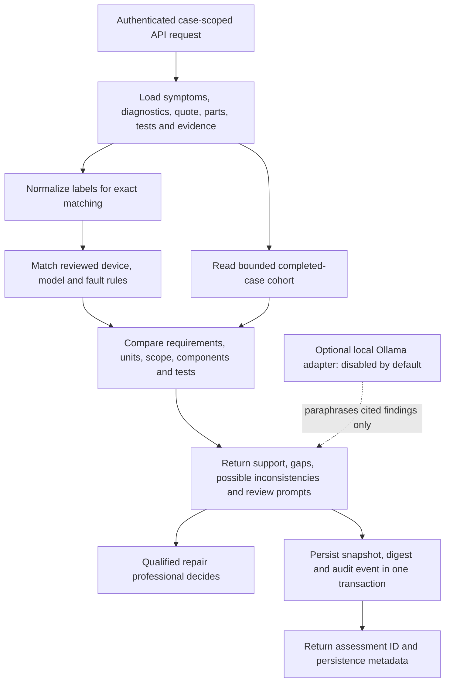

# Diagnostic consistency decision support

## Scope

`GET /cases/:caseId/diagnostic-consistency` compares the record already held by RepairProof:

1. `RepairCase.problemDescription` (customer-reported symptom).
2. Submitted `Diagnostic.findings`, including structured measurement values where present.
3. The current customer-facing quotation's issue and proposed repair.
4. Recorded `ComponentReplacement` entries and component sources.
5. `TestResult` entries and measurement details.
6. Eligible original evidence-file metadata.

The route is available to the case's shop technician and shop owner. It reads case data through the tenant-scoped `shopId` and does not update lifecycle state, approve a quotation, or mark a repair verified. Every assessment is saved as a versioned JSON snapshot with a SHA-256 digest of its source-record snapshot. Snapshot creation and the `DIAGNOSTIC_CONSISTENCY_ASSESSED` audit event commit in one transaction. The assessment has a composite `(caseId, shopId)` foreign key; deleting a case cascades its snapshots, and shop deletion is restricted while records remain. Actor deletion preserves the snapshot and sets its actor reference to null. `GET` creates a new assessment each time; it does not silently return a prior result.

- `POST /cases/:caseId/diagnostic-consistency` creates and returns one new snapshot.
- `GET /cases/:caseId/diagnostic-consistency/history?limit=20` lists the latest tenant-scoped snapshots, capped at 50.

## Processing flow



## Result contract

Every response includes:

- `supportingEvidence`: record type, RepairProof record reference, and a short detail.
- `missingEvidence`: absent measurements, unsubmitted records, unmatched reviewed rule, and insufficient history. A missing record means “not recorded here,” not “did not happen.”
- `potentialInconsistencies`: narrowly defined review signals, e.g. a failed post-repair test, a unit mismatch, a cited-range mismatch, or a component that does not clearly match quoted parts. Each has evidence references and a `REVIEW` severity. None says fraud, dishonesty, or definitive misdiagnosis.
- `confidenceLimitations`: always states that the assessment reflects recorded information and that causal/intent claims are unsupported. No uncalibrated numeric confidence is presented.
- `recommendedHumanReview`: concrete follow-up actions. Every assessment remains decision support and requires qualified human judgment.
- `applicableRule`: citation and version when a reviewed rule matched.
- `statisticalComparison`: descriptive completed-case outcome association only, when the minimum cohort is met.
- `languageModelExplanation`: `null` by default, or a schema-checked local explanation with citations to existing assessment references.
- `persistence`: indicates a committed assessment snapshot and its source-record SHA-256. The digest detects changes to the loaded record snapshot; it does not attest to the truth of source records.

`NO_POTENTIAL_INCONSISTENCY_FOUND_IN_AVAILABLE_RECORD` does not mean a repair is correct. It means these checks did not raise a review signal in the material available to this request.

## Device-specific rule registry

The `REVIEWED_DEVICE_DIAGNOSTIC_RULES` registry includes narrowly scoped Google Pixel 8 and Pixel 8 Pro battery-runtime guidance. Google recommends battery replacement when battery runtime decreases or the rated cycle count is reached. These entries require a matching structured fault label and battery-runtime finding, and can signal that a proposed battery replacement aligns with the cited recommendation. They do not establish battery failure, require a measurement threshold, imply a post-repair test, or establish that replacement is the only suitable repair. The cited guidance says Pixel 8 and Pixel 8 Pro do not expose the battery-health status feature described for newer models, so the rules make no capacity-health assertion. Source: [Google Pixel battery guidance](https://support.google.com/pixelphone/answer/15738128?hl=en), reviewed 2026-11-22.

No other manufacturer/model rules are asserted. Add a rule only as a reviewed code change with:

- exact normalized manufacturer, model, and structured fault label;
- customer symptom terms and required technician finding terms;
- measurements with exact expected units and any sourced range;
- supported repair terms, expected replacement records, and post-repair test names;
- source title, HTTPS URL, section, rule version, and review date.

Rule matching uses normalized exact text (Unicode decomposition, accent removal, punctuation and case normalization). It does not infer semantic equivalence. A range or relationship from a rule can produce only a human review prompt. Test conditions, instrument accuracy, model variants, software state, and service bulletin updates can make a naive comparison misleading; the source must state its limits and should be versioned.

## Statistical analysis

The historical comparison searches up to 500 completed cases in the previous 24 months for the same exact make/model, normalized fault label, and normalized approved repair text. The current shop is excluded. A case is outcome-eligible only when it has at least one recorded post-repair test. A passing case has only passing tests; any failed test is counted as not passing. Because tests have no lifecycle phase field, an interim failure later resolved may still count as not passing; the API reports this limitation.

The API reports the descriptive passing-test share only with at least 20 cases from at least 5 other shops. It does not compute a causal effect, individual success probability, or benchmark “correct diagnosis.” The share can be biased by selection, missing follow-up, different test quality, and inconsistent records. Exact text matching will miss valid equivalent repairs. Below the threshold, it returns `INSUFFICIENT_SAMPLE` without partial counts.

## Structured measurements

New diagnostics should store measurements under a stable object/array format in `Diagnostic.findings`, for example:

```json
{
  "faultType": "structured fault label",
  "summary": "Technician observation",
  "measurements": [
    { "key": "measurement_key", "label": "Readable name", "value": 12.4, "unit": "V" }
  ]
}
```

`TestResult.details.measurements` uses the same shape. Keep instrument, procedure, operating conditions, and calibration context alongside measurement records when collected. The current flexible JSON DTO does not enforce this shape, so unrecognized values are not interpreted as measurements.

## Optional language-model explanations

An optional Ollama adapter can paraphrase the already computed assessment. It is disabled unless both `DIAGNOSTIC_LLM_ENABLED=true` and `DIAGNOSTIC_LLM_MODEL` are set. The API accepts only local endpoints (`localhost`, loopback, or the Docker `ollama` host), uses a 15-second timeout, does not send customer symptom text or files, and returns `null` if local inference fails or returns an unknown citation. To use Docker, set the `local-llm` Compose profile, pull a model into the local Ollama volume, set the model name, and explicitly enable the feature. No hosted inference API or API key is used. The model runs on the operator's hardware; disk, memory, electricity, and any applicable model-license terms still apply. Ollama lists Qwen2.5 1.5B at about 986 MB and under Apache 2.0; check the [current model listing and license](https://ollama.com/library/qwen2.5) before distribution or commercial use.

Example local setup:

```sh
docker compose -f docker/docker-compose.yml --profile local-llm up -d ollama
docker compose -f docker/docker-compose.yml exec ollama ollama pull qwen2.5:1.5b
```

Then set `DIAGNOSTIC_LLM_ENABLED=true` and `DIAGNOSTIC_LLM_MODEL=qwen2.5:1.5b` in the Compose environment and recreate the API container. This optional model download is roughly 1 GB; no remote inference subscription is involved. Inference remains on the same Docker network. Keep the flag off where the API is hosted on infrastructure that should not process case summaries with an LLM.

The adapter must:

- receive only the minimum necessary structured fields and evidence references; never receive direct object-storage URLs or customer contact data;
- use only assessment evidence references and the cited rule metadata for a device-specific statement;
- cite only reference IDs already included in `supportingEvidence` or `applicableRule`;
- be schema-validated and discarded if it adds an unsupported fact or citation;
- never generate signal codes, confidence, a diagnosis, a dishonesty claim, an approval, or lifecycle transition;
- remain disabled by default and never send case data outside RepairProof. Inference errors fail closed to `null` and do not affect the deterministic result.

The deterministic assessment remains authoritative for its own structured checks; the explanation is optional presentation text only.

## Evidence and limits

Original evidence is eligible for support references only when clean and not marked legacy-unverified. A SHA-256 hash identifies file bytes; it does not establish the truth, origin, date, or depicted repair. A photograph alone cannot establish a diagnosis. This service does not inspect image truth, customer intent, technician intent, or the physical device.

Assessments and the optional explanation are persisted with the returned snapshot so a reviewer sees the same output as the originating request. The snapshot includes private case information and is governed by the repair case's access controls and retention/deletion behavior. The local model receives no raw customer symptom text, contact information, file bytes, or storage URLs. Keep access tenant-scoped and apply the platform's case retention policy when exporting or deleting records.
