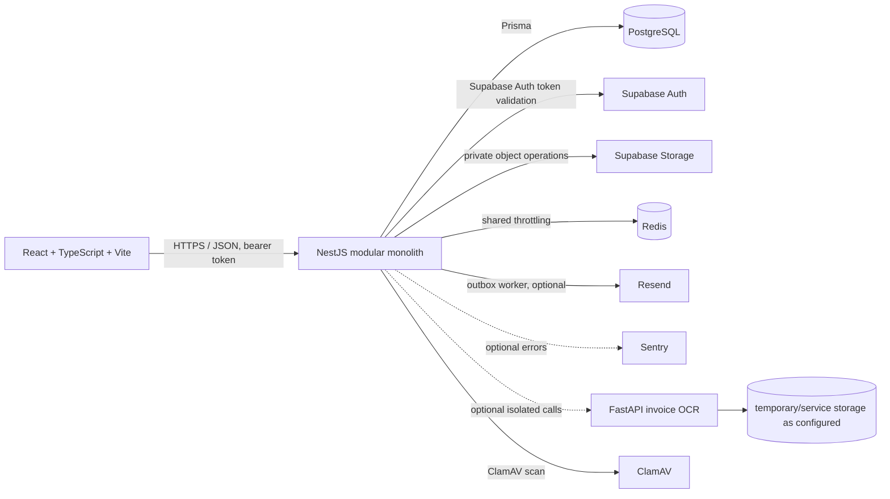

# Architecture overview

## System shape

RepairProof currently uses a modular monolith: one NestJS API process and one PostgreSQL database, with domain modules and a shared Prisma client. The React/Vite browser client calls the API. Supporting systems are external or optional adapters, not a fleet of independently deployed RepairProof microservices.

The OCR box is not a production dependency of current API workflows. AI/ML code may be unavailable without blocking core documentation flows.

## Runtime containers and ownership

| Container/process | Responsibility | Data it owns |
|---|---|---|
| Web | Routes, role-specific UI, input feedback, API client | No authoritative business state |
| API | Authentication integration, authorization, validation, workflows, audit, outbox | Business rules; durable writes in Postgres |
| PostgreSQL | Relational records, audit events, outbox, feature flag config | System of record |
| Redis | Shared API throttling state | Ephemeral throttle keys only |
| ClamAV | Scan uploaded object content | No business record ownership |
| FastAPI OCR (optional) | Isolated document extraction | Extraction response, not approved truth |
| Supabase Auth/Storage | Identity provider and private evidence bytes | Provider-managed identity/object data |

## Module boundaries

Nest modules under `apps/api/src/modules` own domain controllers, application services, DTOs and workflow rules. Controllers parse transport inputs; services enforce business invariants and authorization-aware queries; Prisma is the persistence boundary. Cross-domain workflows call application services and use a Prisma transaction when atomicity matters. Avoid importing another module's controller or reaching around its service boundary.

Principal domains include auth/users/organizations, devices/cases, diagnostics/quotations/approvals, evidence/components/test-results/verification/certificates/warranties, notifications, analytics, administration, price intelligence, diagnostic consistency, and feature flags. `packages/shared` contains cross-runtime enums/types only; it must not contain secrets, persistence logic, or browser/server-specific behavior.

## Trust boundaries and data flow

1. Browser obtains identity tokens from Supabase Auth and sends a bearer token to the API.
2. API validates identity, resolves local user and organization membership, checks role/resource scope, validates DTOs, and executes a transaction.
3. Evidence upload starts with API-issued intent, uses private object storage, then calls completion to verify and persist metadata. Downloads go through authorized API logic and short-lived access mechanisms.
4. Notifications are created after domain changes through durable database records/outbox. Delivery failure updates delivery state; it must not roll back a committed repair workflow.
5. AI outputs are advisory and confidence-bearing. They cannot approve a quote, establish evidence truth, or independently certify a repair.

## Resilience characteristics and limits

PostgreSQL is required for API readiness. Redis is required for production/shared rate limiting. Storage, email and AI failures should degrade those capabilities while preserving already committed repair records. The current local Compose stack is single-host and not a high-availability topology. Backups, restore drills, production monitoring ownership and live deployment must be established separately; see [release assessment](release-readiness-2026-11-23.md).

## Architectural references

See [architecture design](../REPAIRPROOF-ARCHITECTURE.md), [database design](../REPAIRPROOF-DATABASE-DESIGN.md), [evidence management](../apps/api/EVIDENCE-MANAGEMENT.md), [notification integration decisions](../apps/api/EXTERNAL-INTEGRATIONS.md), and [AI limitations](../REPAIRPROOF-AI-INTELLIGENCE-ARCHITECTURE.md). Those documents contain design rationale; this overview distinguishes current wiring from optional or disabled integrations.
