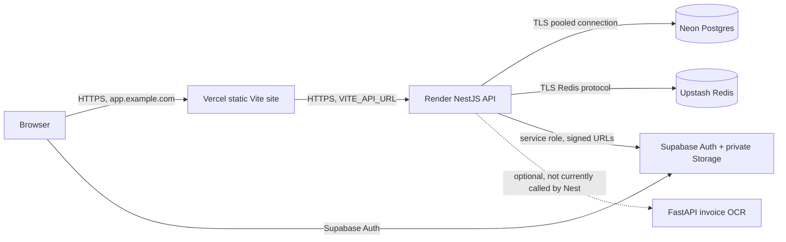

# RepairProof hosted deployment plan

## Recommendation and service boundary

The current frontend is a **React + Vite single-page application**, not Next.js. It can be served as static files; converting it to Next.js is not required for this topology. The repository already has a local Docker/Compose release path. This document describes a separate hosted path and does not claim that provider accounts, DNS, secrets, or a live deployment have been configured.



| Service | Proposed host | $0 use | Production assessment |
| --- | --- | --- | --- |
| React/Vite frontend | Vercel Hobby | Static deployment and SPA rewrites | Hobby is restricted to personal, non-commercial use. RepairProof as a business/customer service needs a plan whose terms permit commercial use; otherwise use a commercially permitted host or paid Vercel. [Vercel fair-use terms](https://vercel.com/docs/limits/fair-use-guidelines), [Terms of Service](https://vercel.com/legal/terms) |
| NestJS API | Render Free web service | Docker web service; free TLS/custom domain | Cold starts after 15 idle minutes, roughly one minute to wake, 512 MB/low CPU, ephemeral filesystem, no workers/cron/persistent disks, and free services may restart. Render says free instances are for testing and not production. [Render Free](https://render.com/docs/free) |
| PostgreSQL | Neon Free | 1 GB storage, 100 CU-hours/project/month, 5 GB egress, compute sleeps after 5 minutes | Suitable for a prototype. Quota/scale-to-zero can pause or delay requests. Instant restore is not an independent retained backup. Do not use it as the only durable production record. [Neon plan limits](https://neon.com/docs/introduction/plans) |
| Redis | Upstash Redis Free | One database, 250 MB, 500K commands/month, 10 GB bandwidth | Fits low-volume distributed throttling tests; monitor limits and failures. It is not a production SLA/HA commitment. [Upstash pricing](https://upstash.com/pricing/redis) |
| Auth and object storage | Existing Supabase adapters | Free project includes 1 GB storage; inactivity pausing applies | Current API uses Supabase Auth and a private Supabase Storage bucket. A database dump does not back up evidence objects. Free plan has no automatic database backups; export and separately back up the objects. [Supabase quotas](https://supabase.com/docs/guides/platform/billing-on-supabase), [backups](https://supabase.com/docs/guides/platform/backups) |
| Python invoice OCR | Keep off for $0 demo | No extra Render service/usage | The image bundles Tesseract and may exceed small free-service memory/CPU under real OCR. More importantly, Nest currently has no invoice-AI adapter calling this service. Do not expose it publicly or claim OCR integration until wired, authenticated, measured, and deployed as an internal service. |

**Decision:** This stack can host a $0 **working demonstration** with synthetic/test records and cold starts. It cannot meet a production reliability, recovery, malware-scanning, privacy, or vendor-support commitment at $0. Vercel Hobby's non-commercial restriction and Render's own warning are independent blockers for a commercial production service. Do not onboard real repair customers or upload real identity, invoice, device, or repair evidence on this free topology.

The free Render API also has no ClamAV service. This application requires malware scanning for production evidence uploads; without a reachable scanner, upload finalization fails closed. Do not represent evidence upload as available until a suitably provisioned scanner is deployed and exercised. Render Free also has no dependable scheduled worker for warranty-expiration or email jobs. In-app repair records can be demonstrated, but notifications and scheduled work are not a production delivery guarantee.

## Provider configuration

### Vercel

Create a project using the repository root (not `apps/web`) so the pnpm workspace can build `packages/shared` and the web app. `vercel.json` contains the frozen-lockfile install, workspace build, `apps/web/dist` output, and SPA fallback required for React Router deep links. Set `VITE_API_URL` to the absolute HTTPS API origin; do not use `/api` unless a same-origin proxy is deliberately configured. Set `VITE_SUPABASE_URL`, `VITE_SUPABASE_ANON_KEY`, and preferably `VITE_APP_URL` in the Vercel production environment and rebuild after changes. When `VITE_APP_URL` is omitted, production SEO metadata may use Vercel's configured production domain; preview builds remain noindex.

Every `VITE_*` value is public and embedded in downloadable browser JavaScript. Only the Supabase URL and anon/public key belong there. Never set `SUPABASE_SERVICE_ROLE_KEY`, database URLs, Redis credentials, signing secrets, or provider API keys in Vercel frontend variables.

### Render

Create one Docker Web Service from the repository root with `dockerfilePath: docker/Dockerfile.api`, context `.`, and health check `/health/ready`. The API now binds to Render's injected `PORT`; `API_PORT` remains the Docker/local fallback. Bind only the API's public HTTP listener; Neon and Redis should be reached via TLS, not public app routes. Configure exact `API_CORS_ORIGIN` and `PUBLIC_APP_URL` values; do not use wildcard CORS with credentials.

For a demo, keep Render auto-deploy disabled and deploy the reviewed commit manually after checks. The existing GitHub workflow still implements the prior GHCR + Compose/SSH topology; it does **not** deploy to Vercel or Render. Before using these hosted providers, wire Vercel and Render release credentials into a reviewed, CI-gated workflow or follow the manual release steps below. Do not enable a second auto-deployment path that bypasses database migrations or required checks.

### Neon, Redis, and Supabase

- Neon: create separate projects for demo and production. Set `DATABASE_URL` to Neon's pooled TLS connection string for API runtime and `DIRECT_URL` to its direct TLS connection string for Prisma migrations. Keep a small runtime connection pool (`connection_limit=5` to start); verify Neon-generated URL parameters instead of hand-editing provider credentials. Use the same region as Render where available.
- Upstash: use the TLS `rediss://` connection string in `REDIS_URL`. Production requires Redis (`REQUIRE_REDIS_RATE_LIMIT=true`); the API must fail readiness if required Redis is down. A Redis outage should block protected write traffic rather than silently fall back to per-process limits.
- Supabase: keep Auth redirect URLs and Site URL restricted to the production frontend origin. Create a private evidence bucket with the exact MIME allowlist and size cap expected by the API. The service-role key belongs only in Render runtime secrets. Confirm signed upload/download access with a non-public test object.

## DNS and HTTPS

Use distinct hostnames, for example `app.repairproof.example` and `api.repairproof.example`.

1. Add the frontend custom domain to Vercel and publish the exact DNS record Vercel displays (CNAME for a subdomain; use the dashboard's current apex instructions for the root domain). Do not copy an old provider IP from a guide.
2. Add the API custom domain to Render and publish the DNS target Render displays. Wait for both providers to validate DNS and issue TLS certificates.
3. Confirm HTTP redirects to HTTPS for both hostnames and check the certificate chain/expiry.
4. Set `VITE_API_URL`, `API_CORS_ORIGIN`, `PUBLIC_APP_URL`, `CERTIFICATE_BASE_URL`, Vercel `VITE_APP_URL`, and Supabase redirect allowlists to the final origins. Avoid preview domains in production allowlists except explicitly approved preview environments.

## Production environment variables

Use [.env.hosted.example](../.env.hosted.example) as a **name/value checklist only**. It contains placeholders, not deployable credentials. Configure browser variables in Vercel and server variables in Render's encrypted environment settings; keep a separate value set per environment.

| Variable | Provider / visibility | Notes |
| --- | --- | --- |
| `VITE_API_URL` | Vercel, public | Absolute `https://api...` URL. |
| `VITE_SUPABASE_URL`, `VITE_SUPABASE_ANON_KEY`, `VITE_APP_URL` | Vercel, public | Browser-safe values only. |
| `PORT` | Render runtime | Injected by Render. API now honors it. Do not bake it into the image. |
| `NODE_ENV`, `API_CORS_ORIGIN`, `PUBLIC_APP_URL`, `CERTIFICATE_BASE_URL`, `API_TRUST_PROXY_HOPS` | Render runtime | Set `production`, exact origin(s), and trusted proxy count `1` for Render's ingress. |
| `DATABASE_URL`, `DIRECT_URL` | Render secret | Neon pooled runtime URL and direct migration URL; TLS required. |
| `REDIS_URL`, `REDIS_POOL_SIZE`, `REQUIRE_REDIS_RATE_LIMIT` | Render secret/config | TLS URL, start with pool size 2, and require shared Redis in production. |
| `SUPABASE_URL`, `SUPABASE_ANON_KEY` | Render runtime | Auth provider configuration; anon key is public but server needs it too. |
| `SUPABASE_SERVICE_ROLE_KEY` | Render secret | Server-only evidence storage access. Rotate if exposed. |
| `EVIDENCE_STORAGE_BUCKET`, `EVIDENCE_MAX_FILE_BYTES`, `EVIDENCE_RETENTION_DAYS`, `EVIDENCE_RETENTION_WORKER_ENABLED`, `CLAMAV_HOST`, `CLAMAV_PORT`, `CLAMAV_TIMEOUT_MS` | Render runtime | Private bucket and scanner configuration. Do not activate real evidence intake without scanner and restore-tested storage backup. |
| `RESEND_API_KEY`, `EMAIL_FROM` | Render secret/config | Optional email provider. An unset provider must not be treated as delivery success. |
| `SENTRY_DSN`, `METRICS_ENABLED`, `METRICS_BEARER_TOKEN` | Render secret/config | Optional error monitoring and private metrics; keep metrics disabled until access is restricted. |
| `INVOICE_AI_INTERNAL_TOKEN`, `INVOICE_AI_SIGNING_SECRET` | Render AI service only | Only after a private API-to-AI adapter is implemented. Use independent random 32+ character values. Do not expose AI service publicly. |
| `CUSTOMER_AUTHORIZATION_ENABLED` | Render runtime | Keep `false` until public projection, token/log handling, privacy/legal review, and release-candidate HTTP tests are complete. The API fails closed unless explicitly set to `true`. |

Generate secrets with a password manager or `openssl rand -hex 32`. Keep `.env.hosted.example` tracked and all filled `.env*` files out of git, chat, browser builds, images, logs, and CI output. Rotate provider credentials after any suspected disclosure.

## Migration and release procedure

1. Merge only through a reviewed PR after required CI and container checks pass. Confirm the release SHA is the reviewed `main` commit.
2. Check the migration diff for destructive DDL, enum changes, long locks, data rewrites, and old/new code compatibility. Use expand/backfill/contract releases; do not rely on rollback SQL.
3. Take a database backup and verify that it can be read before applying production migrations. A Neon restore window is not an independent backup.
4. From a trusted CI runner or controlled operator machine, use the release SHA and environment-only production credentials:

   ```sh
   pnpm install --frozen-lockfile
   pnpm --filter @repairproof/shared build
   pnpm --filter @repairproof/api run db:generate
   pnpm --filter @repairproof/api run db:migrate:deploy
   ```

   The Prisma schema reads `DATABASE_URL` and `DIRECT_URL`; never run `db:push` against a hosted production database. Do not seed demo data in production.
5. Deploy the same SHA to Render manually. After the API is healthy, deploy the Vercel production build with the production `VITE_*` values. Disable any provider auto-deploy mode that could ship before the required CI/migration gate.
6. Run the smoke checks below, inspect logs and provider usage/quota dashboards, then announce the release only after verifying the live commit/deployment IDs in provider consoles.

The current GitHub workflow is still the GHCR/Compose release path. It must be deliberately adapted and reviewed before enabling Vercel/Render secrets; this document and `vercel.json` do not themselves wire the providers into CI or perform a deployment.

## Deployment checklist

- [ ] Demo versus production is declared; no real customer data on free-tier demo services.
- [ ] Vercel plan/use is allowed for the intended purpose; Render compute is appropriate for production load.
- [ ] Production and staging have separate provider projects, credentials, database, storage, Redis, auth URLs, and domains.
- [ ] GitHub `main` protection requires independent approval and every listed CI/build check. Provider auto-deploy is off or gated by the same checks and migration process.
- [ ] DNS, HTTPS, API CORS, frontend API origin, and Supabase callback allowlists use final exact domains.
- [ ] Runtime secrets are set in provider secret stores; none appear in build args, Vercel browser variables, source control, artifacts, or logs.
- [ ] Neon pooled/direct URLs work from Render; Redis TLS works and readiness is green.
- [ ] Private Supabase bucket policies, malware scanner, upload limits, and object backup/restore have been tested before enabling evidence uploads.
- [ ] A database dump and a separate evidence-object backup have been copied off-provider and a restore drill has succeeded.
- [ ] `/health/live`, `/health/ready`, authenticated repair path, and release identity have been verified from outside the provider network.
- [ ] Quota/billing alerts and on-call contact exist; free quotas do not imply a spend limit unless provider account settings enforce one.

## Smoke tests after deploy

Use the actual domains and a disposable account. Do not use customer documents as test uploads.

```sh
curl --fail --show-error https://app.repairproof.example/
curl --fail --show-error https://api.repairproof.example/health/live
curl --fail --show-error https://api.repairproof.example/health/ready
```

Then verify (1) the SPA opens directly on a nested route; (2) API CORS permits the exact frontend origin and rejects an unrelated origin; (3) a disposable user can sign in and create a repair case; (4) the case persists after API restart/redeploy; (5) quote approval and lifecycle transitions are rejected for unauthorized actors; (6) email failure leaves repair state intact; (7) with scanner/storage enabled, a harmless allowed test file uploads to a private bucket, is scanned, and only a signed download works; (8) the displayed certificate does not reveal private identifiers; and (9) Sentry/logs contain no auth tokens, invoice contents, serial numbers, or personal documents. Mark unavailable capabilities as unavailable; do not declare success from HTTP 200 alone.

## Rollback and recovery

**Application rollback:** stop further deploys. In Render, redeploy the previously successful API commit; in Vercel, promote/restore the prior successful frontend deployment. Use the same release pair when possible. Keep database migrations applied only if the old code remains schema-compatible. Never run `prisma db push`, reset, or guessed down-migrations during rollback.

**Schema rollback/data recovery:** if a migration is incompatible or corrupts data, pause writes where practical. Restore a verified backup into a new isolated Neon project/branch, validate row counts and key repair/evidence references, run privacy/access checks, point staging at it, and only switch production connection strings after sign-off. Preserve the failed database for investigation. Restore evidence objects independently and validate their recorded hashes; a hash shows stored-byte integrity, not that an image/document is truthful.

**Disaster recovery targets:** for a paid production service, start with a measured target of **RPO ≤24 hours** and **RTO ≤8 hours**, then tighten from business requirements and restore drills. Back up Postgres at least daily to a separate encrypted account/provider with 30-day retention; copy private evidence objects separately with lifecycle/versioning controls; store encryption keys outside the backup destination; verify automated backup success and perform a quarterly restore drill. Neon Free's six-hour instant-restore window is not a substitute for retained off-site dumps. On free demo tiers, no reliable RPO/RTO or data durability is promised; keep only disposable data and export anything the owner cannot afford to lose.

## Monitoring and actual deployment status

For a demo, check provider deploy state, `/health/ready`, Render logs/restarts, Neon compute/storage/egress quota, Upstash command/bandwidth quota, and Supabase storage/inactivity warnings. Render Free sleeps and may restart; missed warranty/email jobs and delayed first requests are expected failure modes. Use synthetic checks from outside the providers. Do not treat an in-process health route as an uptime SLA.

**No hosted deployment has been performed or confirmed.** DNS, provider environments, secret stores, migrations, TLS certificates, database backups, and live health checks must be verified in the actual Vercel/Render/Neon/Supabase/Upstash accounts before calling RepairProof deployed.
