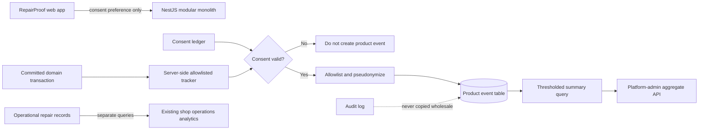

# RepairProof product analytics architecture

## Status and principles

Product analytics is implemented as a first-party, consent-gated server-side tracker. The current `/analytics/summary` remains a tenant-scoped operational summary; the separate `/analytics/product-summary` endpoint is limited to platform administrators and returns thresholded aggregate activity. There is deliberately no browser tracking SDK, cookie, session replay, or third-party analytics destination.

The first release should use first-party, server-confirmed events and PostgreSQL aggregation inside the existing modular monolith. Do not add a microservice, Redis analytics queue, or external analytics vendor until traffic or a reviewed privacy need justifies one. Keep audit records, operational dashboards, error monitoring, and product analytics as separate data purposes and access paths.

Goals:

- Understand where the repair documentation workflow is adopted or abandoned.
- Measure repeated shop usage and retention without tracking customers across sites.
- Evaluate whether usage accompanies better documentation and fewer avoidable workflow failures; do not treat clicks or feature adoption as proof of customer value.
- Make analytics optional, transparent, revocable, and data-minimal.

Non-goals: advertising, cross-site tracking, session replay, keystroke capture, heatmaps, customer-level marketing profiles, pricing surveillance, technician ranking, or automated shop quality scores.

## Collection flow

1. Domain services call the tracker only after the authoritative transaction commits. The tracker is best-effort: a tracking/database outage drops measurement and never rolls back a repair workflow. This trades guaranteed event delivery for isolation from the critical repair path.
2. The tracker checks the actor's latest consent and policy version immediately before writing. If consent is absent or withdrawn, it stores no event. Withdrawal transactionally removes prior actor-keyed raw events.
3. The event is constructed from a strict server-side allowlist. Arbitrary request bodies, database rows, exception messages, audit payloads, and user-entered strings are never copied into event properties.
4. Event rows use pseudonymous actor, organization, and (for repair milestones) journey keys. `/analytics/product-summary` aggregates them and suppresses cells below 20. The service purges raw events older than 90 days daily. It never reads evidence contents or repair notes.

For `customer_approval.recorded`, which may be initiated by a tokenized public page without a customer account, keep the decision in the repair record and use it only for the shop's own operational reporting. Do not create a product event tied to a customer, case, quote, token, or exact action time. Platform-wide reporting requires a separately reviewed aggregate with `k >= 20`; it must not be back-solved into customer-level actions. The repair authorization and required audit record persist normally.

## Event envelope

Each event has a UUIDv7 `eventId`, catalog `name`, `schemaVersion`, server-assigned `occurredAt`, `actorKind`, coarse `role`, and an allowlisted `properties` object. Use HMAC-SHA-256 with a secret held outside the database for stable `actorKey` and `organizationKey` pseudonyms. Domain IDs are used only as HMAC input and are never stored in product events. A secret rotation intentionally starts new identity cohorts unless a controlled, reviewed re-key is approved.

Common allowed properties:

| Property | Type | Notes |
|---|---|---|
| `role` | enum | `shop_owner`, `technician`, `consumer_link`, `platform_admin`; never a name or email. Do not use platform-admin activity for adoption cohorts. |
| `channel` | enum | `web_app`, `public_authorization`, `public_certificate`. |
| `result` | enum | Only where relevant: `success`, `rejected`, `change_requested`, `failed_validation`; no exception text. |
| `workflowStage` | enum | Catalog-defined stage, not a case ID or free text. |
| `locale` | enum, optional | Supported UI locale only; include only after consent and aggregate small groups. |
| `schemaVersion` | integer | Version the event contract independently of API version. |

Never store: names, email, phone, postal address, device serial/IMEI, manufacturer/model, case/quotation/certificate IDs, fault descriptions, symptoms, evidence names/URLs/hashes, quotation values, invoice values, free-text, authorization tokens, IP addresses, full user-agent strings, precise location, or raw referrers/query strings. Do not infer location from IP. Avoid event-level timestamps beyond what is needed for day/week analysis; aggregate and discard raw rows on schedule.

### Catalog

Names are stable `domain.past_tense_action` identifiers. Emit once for a committed milestone, with idempotency key `(source type, source record ID, event name, source revision)` stored in the outbox, not in a public payload.

| Event | Authoritative trigger | Minimal event properties | Storage mode / metric class |
|---|---|---|---|
| `account.registration_completed` | Auth/profile provisioning transaction commits. Never emit on form submit. | `role`, `channel` | Raw pseudonymous event only after that profile opts in; adoption |
| `device.registration_completed` | Device row commits and ownership/shop relation is valid. | `role`, `deviceCategory` (`smartphone`, `laptop`) | Raw pseudonymous event only after that profile opts in; adoption |
| `repair_case.created` | Case creation transaction commits, including a draft. | `role`, `entryMode` (`case_form`, `shop_intake`) | Raw pseudonymous event only after that profile opts in; adoption |
| `diagnostic.submitted` | Diagnostic record and required case transition commit. | `role`, `findingCountBand` (`0`, `1-2`, `3-5`, `6+`); never finding text | Raw pseudonymous event only after that profile opts in; workflow completion |
| `quotation.delivered` | Quote changes to `SENT` and the secure quote becomes available to the customer; count once per quote version. This is availability, not proof that an email reached an inbox or was read. Provider acceptance/bounce is a separate delivery operational metric. | `channel`, `revisionBand` (`first`, `revision`) | Raw pseudonymous staff event only after that profile opts in; workflow completion |
| `customer_approval.recorded` | Server accepts an explicit decision for the exact quotation version. | `result` enum | Shop-scoped operational reporting; platform-wide results require a privacy-reviewed aggregate with `k >= 20`; no customer-level event |
| `repair.completion_documented` | Technician moves the case to `AWAITING_VERIFICATION`. This is **not independent verification**. | `role` only | Raw pseudonymous staff event only after that profile opts in; documentation completion |
| `certificate.accessed` | Public certificate endpoint returns a valid public certificate. Repeated views of the same certificate count once per UTC day using a daily HMAC key. | `channel` only; no raw certificate ID or visitor identity | Anonymous aggregate count only; reach, not value |
| `warranty.claim_submitted` | Valid claim record commits. | No claim details or customer properties. | Shop-scoped operational outcome; platform-wide results require a privacy-reviewed aggregate with `k >= 20` |
| `shop.repeat_usage` | Derived only: consented staff members have accepted meaningful actions on at least two distinct days in the trailing 28 days. Never emit from a frontend timer. | `activeDayBand` (`2`, `3_7`, `8_plus`) | Derived from consenting staff events only; label **consented member activity** and disclose incomplete coverage |
| `user.retained_d7` / `user.retained_d30` | Derived from a registration cohort and a meaningful accepted action on day 7 or within days 7–30, respectively. Use a declared cohort window and one event per pseudonym/cohort. | `cohortWeek`, `role` | Derived only from profiles that opted in; retention |

`shop.repeat_usage`, D7, and D30 are derived metrics, not source events. Persist their aggregates only; do not create synthetic user actions. Shop activity is computed from the events of analytics-consenting members only; label it as **consented member activity**, disclose incomplete coverage, and suppress it when the cohort is too small. A shop owner cannot opt another member into person-level tracking. A failed transition, validation error, retry, or duplicate request does not count as a completed event. Validation failures may be counted separately in aggregate operational telemetry without actor identifiers.

## Consent and identity

- Provide an optional, off-by-default **Product analytics and controlled experiments** setting with plain-language purpose, examples of fields collected, retention, and withdrawal control. It is not bundled with terms acceptance, repair authorization, warranty consent, or necessary service processing.
- Persist an append-only consent ledger: profile reference, purpose `PRODUCT_ANALYTICS`, granted/withdrawn decision, notice version, and timestamps. The ledger belongs in the identity/privacy domain, not in event properties. Consent is per person and does not grant consent for their customers.
- Do not send analytics events or persist experiment assignments until the account has accepted the current notice version. Withdrawal stops future collection immediately and removes product events plus profile-scoped experiment assignments and metrics. Preserve data only where a documented legal obligation independently requires it.
- `Profile.id` is the authenticated identity source; never accept an actor ID in a client event request. Derive role and organization membership server-side at event time. A customer accessing a public certificate is anonymous; do not fingerprint or persist their browser identity.
- If there is no valid consent, do not fall back to cookies, localStorage, a third-party SDK, or server-side IP/user-agent tracking. Essential authentication, fraud prevention, and statutory audit logging remain separate and must not be repurposed as product analytics.
- HMAC pseudonyms remain linkable and must be handled as sensitive pseudonymous data. Keep the HMAC secret in the deployment secret store, restrict access, separate dev/staging/prod keys, and never log it.

## Storage, security, retention

Use PostgreSQL models in the RepairProof application database (a separate schema can be introduced if operational separation becomes necessary):

- `AnalyticsConsent`: append-only profile-linked consent decisions and notice versions.
- `ProductAnalyticsEvent`: HMAC event idempotency key, optional pseudonymous actor/organization/journey keys, event name, coarse role, allowlisted JSON properties, UTC date bucket, and no domain foreign keys.
- No event outbox or materialized aggregate table is used in the initial release. Capture is best-effort after commit and summary aggregation is computed by the API; event volume should be reviewed before scaling this query path.

Access: ingestion/worker uses least-privilege DB role. Raw events are not available to ordinary shop staff, technicians, or platform support. Shop dashboards show only that shop's operational records and product aggregates, with a minimum cohort threshold where an aggregate could reveal an individual's action. Platform dashboards show only aggregated, thresholded values. Enforce authorization in the API, not in frontend filters.

Retention defaults (set by scheduled deletion, monitored, and documented in the privacy notice):

| Data | Retention |
|---|---|
| Pending outbox rows | Delete after delivery/drop; failed rows retry with bounded attempts and are dropped after 7 days. |
| Raw product events | 90 days maximum. |
| Pseudonymous user/shop daily cohorts | 13 months maximum, only with valid analytics consent. |
| Aggregates with cells below `k = 20` | Suppress or combine; never expose small-cell counts in platform-wide dashboards. |
| Thresholded, non-identifying totals | Up to 24 months for seasonality, then delete unless separately reviewed. |
| Consent ledger | Retain according to the approved privacy/legal schedule, separately from analytics events. |

Withdrawal/delete workflow: mark consent withdrawn; stop new events; delete raw events matching the actor pseudonym and profile-scoped feature experiment assignments (which cascade to metrics). For shared shop aggregates, rebuild without the actor where feasible. Keep only genuinely anonymous aggregates that cannot reasonably be linked back to a person or shop. Document exceptions and legal holds.

## Funnels, cohorts, dashboards

**Funnels** (each step uses server-confirmed events and deduplicated source records):

1. Registration → first device → first repair case → diagnostic submitted → quotation delivered → customer decision → completion documented → certificate accessed.
2. Case start → diagnostic complete → quote decision → repair documentation complete. Report abandonment at each step, using elapsed-time buckets rather than publishing exact per-person timelines.
3. First shop activity → second active day → repeat usage by day 28.

Denominators must be explicit: e.g. quote approval rate = approved decisions / (approved + rejected + change-requested decisions) for delivered valid quote versions. Do not count pending quotes as rejections. Report revision rate separately; do not infer customer satisfaction from approval.

**Cohorts:** registration week, role, consented shop cohort, and UI locale only where group size is sufficient. D7 is a meaningful action on calendar day 7; D30 is at least one action during days 7–30. Also report rolling 28-day shop active usage. State time zone and whether days are UTC or shop-local consistently; prefer UTC storage and shop-local dashboard bucketing only when the shop timezone is configured.

**Dashboards:**

| Dashboard | Audience | Useful measures | Explicitly not a claim of |
|---|---|---|---|
| Workflow adoption | Product team, thresholded aggregate | Step conversion, time-to-next-step bands, revision and abandonment rates | Repair quality or customer value |
| Shop repeat usage | Consented organization owner; aggregate platform view | Active days, repeat usage, cohort retention | Business growth, revenue uplift, or staff productivity |
| Documentation completeness | Shop owner; shop-scoped | Required diagnostics/evidence/tests present by workflow stage; missing-field rates | Independent truth or correctness of evidence |
| Customer interaction | Shop-scoped aggregate | Quote delivery/decision latency bands, approval/rejection/change-request proportions, certificate access counts | Satisfaction, fairness, or trust |
| Post-repair signals | Restricted aggregate with mature cohorts | Warranty claim and dispute rates by completed-case cohort; observation-window coverage | Causation, technician fault, or definitive repair failure |

For warranty/dispute outcomes, publish the cohort denominator and follow-up maturity (for example, 30/90-day observable cases). A rising claim rate is a review signal, not a verdict. Do not score/rank technicians or businesses from sparse, unadjusted event counts.

## Separating activity from customer value

Event counts show that a recorded feature or workflow step was used. They do not show that repairs became more reliable, cheaper, faster, fairer, or more trusted. Value hypotheses require separately defined outcomes, suitable comparison/cohort design, and review for confounding (device mix, fault severity, region, shop size, and observation time). Do not call quotation approval, certificate views, or repeat usage “customer success” on their own. Do not claim fewer repeat failures without an adequately mature, comparable cohort and outcome validation.

## Implementation and release gates

1. Approve the privacy notice, analytics consent wording, event catalog, retention schedule, and access roles before enabling collection.
2. Implement consent read/write APIs and account UI; test grant, withdrawal, stale notice version, and deletion behavior.
3. Add domain outbox calls only at transaction commit boundaries. Keep events server-authored, allowlisted, schema-versioned, and idempotent.
4. Add a worker and daily aggregate job in the existing backend. Failure must never block or roll back repair workflows; dead-letter/drop after bounded retry and alert on backlog.
5. Add tenant authorization and minimum-cell suppression to aggregate APIs. No raw event export in ordinary product UI.
6. Verify cross-tenant isolation, no event when consent is absent, no sensitive properties, duplicate-event idempotency, deletion propagation, outbox retry, and aggregate formulas before enabling the setting.
7. Start with a small internal opt-in pilot. Do not activate an external provider until vendor processing, region, contract, deletion, subprocessor, and cost reviews are complete.

## Implemented scope and remaining limits

- Consent ledger and authenticated preference endpoints are implemented. Workshop signup offers a separate, unchecked optional consent control; staff can later review or withdraw from the account menu. Consent is not bundled with terms or repair approvals.
- The first-party service captures registration (only when signup consent is checked), device/case registration, diagnostic submission, quotation availability to the secure review page, technician-documented completion, and valid public certificate accesses. Warranty claim milestones are captured only for consenting authenticated shop staff. Customer approval details are intentionally not product events.
- Source identifiers are HMAC inputs only. Actor and organization identifiers are HMAC pseudonyms; repair workflow stages use a HMAC journey key. The signing secret must be unique per environment, at least 32 characters, and held in the deployment secret store. Changing it resets cohorts; withdrawing consent after rotation cannot find historical events under the old key, so rotate only with a coordinated event purge or after the 90-day retention window.
- Collection is off unless `PRODUCT_ANALYTICS_ENABLED=true` and `ANALYTICS_PSEUDONYM_SECRET` is set. Preference may be recorded while collection is disabled; no events are then written. No external provider or browser SDK is present.
- The platform-admin aggregate API is implemented with a minimum cell size of 20. A product-facing dashboard, scheduled materialized aggregates, provider-side delivery metrics, customer-approval conversion, and statistical D7/D30 cohort reporting are not implemented. These should remain unclaimed until separately built and reviewed.
- Current summaries describe consented staff feature activity, not customer value, repair quality, or independent verification. `/analytics/summary` is still operational shop reporting and is kept separate.
